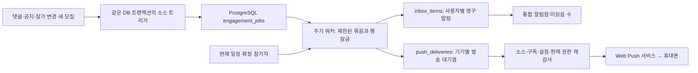

# 관심사·호스트 구독과 통합 알림함

현재 구현은 PostgreSQL에 구독, 알림, 처리 대기열을 영구 저장한다. 알림함 자체에는 Redis를 사용하지 않으며, 공지방의 실시간 갱신은 별도의 Redis Pub/Sub 경로를 사용한다. 웹푸시는 이 기록의 전달 수단이며 기기 권한이 없어도 사이트의 알림함을 사용할 수 있다.

## 이용 흐름

- 헤더의 종 아이콘·내 행사 등의 알림함 버튼 → 읽지 않은 알림 최대 6개의 드롭다운 → 하단 더보기 → `/notifications`. 전체 페이지에서 댓글·답글, 공지방, 참가 상태와 행사 변경, 새 모집, 행사 리마인더를 종류별로 확인한다.
- 드롭다운을 열기만 해서는 읽음 처리하지 않는다. 서버에서 미읽음만 조회하므로 최근 읽은 알림이 많아도 이전의 미읽은 알림이 표시된다. 선택한 알림만 읽음 처리하고 대상 화면으로 이동한다. 로그인 만료 시 내용을 지우고 로그인 안내를 표시한다.
- 열린 드롭다운은 페이지가 보이는 동안 30초마다 갱신한다. 바깥 영역 선택·Escape·페이지 이동으로 닫히고, 모바일에서는 화면 너비와 하단 메뉴·안전 영역에 맞춰 배치한다. 날짜는 한국 시간으로 표시한다.
- 알림을 선택하면 해당 글·공지방·참가 화면으로 이동하고 내 알림만 읽음 처리한다. 현재 저장된 알림을 한 번에 읽음 처리하고 20개씩 이어 보기를 제공한다. 처리 대기 중인 소스 작업이 이후 알림으로 저장되면 새 미읽음으로 나타날 수 있다.
- 알림함의 구독 설정에서 관심 카테고리를 선택한다. 플레이어의 공개 프로필에서는 호스트를 구독할 수 있다.
- 새 모집 알림은 구독 이후 공개되고 신청 가능한 실제 모집만 대상으로 한다. 체험용 샘플과 과거 모집을 새 구독자에게 소급 발송하지 않는다.
- 카테고리와 호스트를 모두 구독해도 같은 모집 알림은 한 번 저장한다. 호스트 구독으로 익명 작성자의 정체를 알아낼 수 없게 익명 모집은 카테고리 구독으로만 전달한다.
- 마이페이지의 알림 설정에서 댓글·공지방·참가 현황·새 모집·행사 리마인더의 푸시를 개별적으로 켜거나 끈다. 푸시를 꺼도 사이트 알림함의 기록은 남는다.

호스트 구독은 최대 200명이다. 양쪽 사용자 사이의 차단, 탈퇴·활동 제한, 삭제·운영 숨김, 방 접근 권한을 조회와 발송 시 다시 확인한다. 로그인 주체 ID, 신청자의 연락처, 기기 endpoint와 암호화 키는 알림 응답에 포함하지 않는다.

## 행사 리마인더

리마인더는 현재 행사 시작 시각을 기준으로 **24시간 전과 2시간 전**에 처리한다. 날짜 기준인 환불 계산과 달리 정확한 시각의 차이를 사용한다.

확정 참가자이며 유효한 공지방 멤버인 사람이 대상이다. 해당 리마인더 시점 전에 참가한 사람에게만 보내므로 늦게 참가한 사람에게 지난 알림을 몰아 보내지 않는다. 취소·환불·환불 검토 중인 신청, 취소된 행사와 변경 전 일정은 발송하지 않는다.

워커가 잠깐 중단된 경우 현재 구간의 알림을 복구한다. 24시간 알림은 시작 24시간 전부터 2시간 전까지, 2시간 알림은 시작 2시간 전부터 시작 전까지 대상이 된다. 복구 시 이미 지난 구간의 알림을 함께 보내지 않는다. 행사 시작 이후에는 리마인더를 보내지 않는다.

중복 키에는 신청 ID, 현재 시작 시각, 행사 변경 차수, 24시간/2시간 구간을 포함한다. 일정이 바뀌면 새 일정의 리마인더를 만들고, 이전 일정의 대기 푸시는 전송 직전에 무효화한다. 이미 외부 Push 서비스에 전달된 알림을 회수할 수는 없다.

## 데이터 흐름



새 비공개 테이블 4개:

| 테이블                   | 저장 내용                                                |
| ------------------------ | -------------------------------------------------------- |
| `category_subscriptions` | 회원과 관심 카테고리, 구독 시각                          |
| `host_subscriptions`     | 회원과 호스트의 비공개 관계, 구독 시각                   |
| `inbox_items`            | 수신자별 종류·소스·내부 이동 경로·읽음 시각·중복 키      |
| `engagement_jobs`        | 소스 이벤트와 처리 상태, 재시도, 대량 수신자의 처리 위치 |

기존 댓글 `notifications`와 행사 변경 `event_change_recipients`의 읽음 표시를 통합 알림함과 동기화한다. 공지방 전체의 마지막 열람 위치나 각 참가자의 실제 메시지 열람 증명과는 별도다.

소스 변경과 대기열 삽입을 같은 트랜잭션에 넣어 서버가 중단되어도 처리할 근거를 잃지 않는다. 여러 워커는 잠긴 작업을 건너뛰고 수신자를 제한된 묶음으로 나누어 처리한다. 유일 제약이 재시도·겹친 구독·여러 기기의 중복을 막는다. 외부 통신은 원본 저장 트랜잭션 밖에서 처리한다.

## 실행

기존 실행 명령을 확장했다.

```powershell
npm run db:migrate
npm run push:worker
# 알림함 생성·리마인더와 최대 20개 푸시 발송을 한 번 처리
npm run push:drain
```

로컬 개발 서버의 내장 워커가 알림함과 리마인더를 처리한다. 운영에서는 `PUSH_WORKER_MODE=external`로 지정하고 `push:worker`를 별도 상시 프로세스로 실행한다. 상시 Next.js 서버를 사용하는 환경은 `embedded`도 선택할 수 있다. 요청 때만 깨어나는 서버리스 환경에서는 별도 워커가 필요하다.

VAPID 설정이 없어도 사이트 알림 생성과 리마인더 처리는 실행한다. VAPID가 없으면 휴대폰 외부 푸시 발송만 비활성화된다. iPhone·Android의 HTTPS·홈 화면 실행·알림 허용 조건은 [웹푸시 문서](WEB_PUSH.md)를 참고한다.

## API

모든 경로는 현재 로그인 회원의 활성 상태를 확인한다. 변경 요청에는 같은 출처 검증과 입력 제한을 적용한다.

| 경로                                            | 메서드 | 용도                                        |
| ----------------------------------------------- | ------ | ------------------------------------------- |
| `/api/engagement/inbox?kind=all&cursor=...`     | GET    | 종류별 알림, 다음 커서, 전체 미읽음 수      |
| `/api/engagement/inbox?unreadOnly=true&limit=6` | GET    | 드롭다운용 미읽음 알림만 조회               |
| `/api/engagement/inbox/read`                    | POST   | `{id}`로 한 알림, `{}`로 현재까지 모두 읽음 |
| `/api/engagement/subscriptions`                 | GET    | 관심 카테고리와 호스트                      |
| `/api/engagement/subscriptions/categories`      | PUT    | `{categories:[카테고리 slug]}`              |
| `/api/engagement/hosts/{publicId}`              | GET    | 해당 공개 프로필 구독 상태                  |
| 같은 경로                                       | PUT    | `{subscribed:true/false}`                   |

알림 목록은 기본 20개이며 커서는 로그인 회원·종류·미읽음 필터에 묶여 있다. 다른 사용자의 알림 ID로 읽음 표시하거나 다른 종류·미읽음 필터의 커서를 재사용할 수 없다. `unreadOnly`는 쿼리 문자열 `true`/`false`만 허용하며 생략 시 전체 알림을 조회한다. API는 인증 주체 UUID 대신 공개 프로필 ID만 내보낸다.

## 검증 범위

2026-10-04에 전체 회귀 **368개**, 실제 로컬 DB·HTTP 구독/알림 검사 **2개**, 기존 행사 변경 HTTP 회귀 **1개**가 통과했다. 서식·타입·Drizzle 검사와 Next.js 운영 빌드도 통과했다. 로컬 DB의 53개 테이블에 RLS가 적용되어 있고 리마인더 일정 인덱스를 확인했다.

`npm run check`, `npm run build`, 로컬 서버 실행 후 `npm run test:engagement-api`로 확인한다. HTTP 인증·출처·읽음 소유권, PostgreSQL 트리거와 구독 중복, 익명 호스트 보호, 기존 읽음 동기화, 시간 주입을 통한 리마인더 재시도와 일정 변경·취소를 검사한다. 테스트용 회원·행사만 만들고 정리하며 외부 결제를 실행하지 않는다.

실제 휴대폰 수신과 실제 다중 사용자 부하 측정은 아직 수행하지 않았다. 워커 저장 보장과 멱등성을 검증해도 OS 알림 표시나 전체 서비스의 최대 수용량을 보장하지는 않는다.

2026-10-08 드롭다운 확장 검증: 실제 PostgreSQL·HTTP 검사 2개 통과. 미읽음 전용 조회, 읽은 최신 알림 제외, 전체/미읽음 커서 분리, 잘못된 필터 입력 거부와 기존 구독·알림·일정 변경 흐름을 함께 확인했다. 통합 검사는 실행 중인 내장 워커와 경합할 때도 자체 임시 데이터의 작업 완료를 확인한다.
