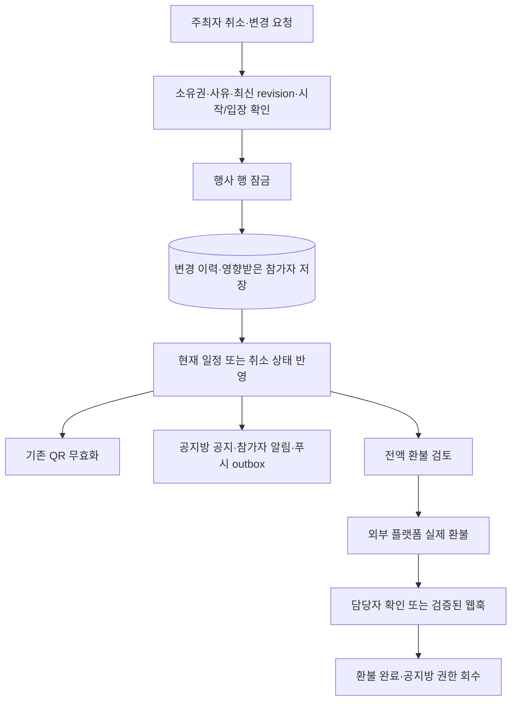

# 주최자 행사 취소·일정 변경

구현 기준: 2026-10-04. QR 입장 다음 단계로 주최자의 행사 변경, 참가자 안내, 환불 검토를 연결했습니다.

## 이용 방법

**주최자:** 내 행사 → 행사 관리 → 행사 일정·변경 안내 → 주최자 일정 변경·행사 취소.

정확한 한국 시간의 새 시작/종료, 참가자에게 공개할 사유, 처리 내용 확인을 입력합니다. 지정 담당자는 참가·환불 관리를 계속할 수 있지만 행사 취소/일정 변경은 모집글 작성자만 가능합니다. 신규 행사에는 먼저 기존 행사 설정을 저장합니다.

**참가자:** 모집글 참가 화면에서 최신 일정과 변경 이력을 확인합니다. 내 참가 내역(`/participation`)의 변경 안내에서 읽음 처리할 수 있습니다. 기존 공지방에도 담당자 공지가 남습니다. Web Push의 참가 안내 수신을 켠 기기에 변경 알림 발송을 예약합니다.

기존 참가를 유지하는 방식을 적용했습니다. 일정 변경에 참여하기 어렵다면 **변경된 시작 시각 전이며 QR 입장이 확인되지 않았을 때** 날짜별 차감 없이 전액 취소·환불을 요청합니다. 변경 이후 새로 신청한 회원에게는 기존 한국 날짜 환불 규칙을 적용합니다.

## 행사 취소와 결제 상태

행사 취소와 외부 돈의 환불은 별개입니다. 주최자가 취소 버튼을 눌러도 주문·영수증을 `refunded`로 바꾸거나 외부 플랫폼에 돈을 돌려주는 요청을 보내지 않습니다.

- 행사 취소 사유·시각을 별도 저장하고 접수를 닫습니다. 재개할 수 없으며 새 행사를 만들어야 합니다.
- 확정 참가자의 신청 상태와 공지방 접근을 유지해 취소·정산 안내를 확인할 수 있습니다. 따라서 확정 인원은 결제/승인 기록이며 실제 행사 진행 가능 표시와 구분합니다.
- 검증된 결제가 있고 아직 환불되지 않은 유료 확정/확인 필요 신청에 100% 환불 검토 요청을 생성합니다. 무료 확정 신청은 결제 환불 요청을 만들지 않습니다.
- 미결제 신청/승인 대기는 취소하고, 이미 결제된 대기 내역은 담당자 확인 상태로 보존합니다.
- 기존 차감 환불 요청은 원래 금액을 수정하지 않습니다. 처리 전 요청을 종료한 이력을 남기고 전액 요청을 새로 생성합니다. 일정 변경에서도 기존 일반 취소 요청을 새 전액 요청으로 연결합니다.
- 담당자가 외부 플랫폼의 실제 환불 금액을 확인하거나 검증된 환불 웹훅이 도착해야 결제·참가 상태를 환불 완료로 기록하고 공지방 권한을 회수합니다.
- 이미 완료된 과거 환불과 영수증은 수정하거나 중복 생성하지 않습니다. 실제 결제·환불·정산은 외부 플랫폼이 담당하며 어댑터 실연동은 아직 별도 설정이 필요합니다.

## 일정·QR·입장 기록

기존 신청의 금액, 당시 시작 시각, 환불 정책, 동의 시각, 질문 답변은 불변 스냅샷으로 유지합니다. 현재 행사 설정의 일정만 변경하고 이전/새 일정과 사유를 별도 이력에 저장합니다.

변경/취소 시 기존 QR 해시는 삭제합니다. 일정을 변경한 뒤에는 참가자가 새 QR을 발급받아야 합니다. 취소 행사는 QR 발급·스캔·입장 완료·신규 신청·새 결제·외부 참가 승인·새 참가 전적·후기·매너 평가를 차단합니다. 피드와 글 모달의 외부 신청 버튼도 내부 취소 안내로 연결합니다.

이미 시작했거나 한 명이라도 QR 입장 또는 참가 전적이 기록된 행사는 이 화면에서 변경할 수 없습니다. 진행 중 행사에 대한 예외 취소·사고 처리 전용 절차는 포함하지 않았습니다. 번개 변경에는 기존 무료·2~12명·개설 후 7일 이내·15분~12시간 규칙을 유지합니다.

## 흐름

외부 플랫폼 호출을 DB 트랜잭션에 넣지 않습니다. 안내와 발송 예약은 상태 변경과 같은 트랜잭션에서 기록합니다. 기존 PostgreSQL Web Push Worker가 outbox를 임대·재시도하며 Redis를 사용하지 않습니다.

## 데이터와 권한

앱 테이블은 현재 49개입니다. 신규 세 테이블은 RLS를 활성화하고 PUBLIC/anon/authenticated 직접 접근을 회수했습니다. 서버가 인증·소유권·회원 상태를 검사하며 테이블 소유자 연결의 RLS 우회에만 의존하지 않습니다.

| 테이블 | 기록 |
| --- | --- |
| event_lifecycle | 현재 취소 시각·사유·변경 revision |
| event_changes | 변경 당시 이전/새 일정·사유·담당자·순서 |
| event_change_recipients | 변경 당시 영향받은 신청/회원·읽음 시각 |
| refund_requests.cause | 참가자 취소 / 주최자 취소 / 일정 변경 구분 |

행사 행을 먼저 잠가 결제·승인·환불·QR과 잠금 순서를 맞춥니다. expectedRevision이 현재 revision과 다르면 변경을 거절하여 오래된 탭의 덮어쓰기와 중복 공지·알림을 막습니다. 변경 이력은 DB에서도 불변이며 현재 일정 변경은 일치하는 최신 변경 기록이 있어야 가능합니다. 취소 상태는 되돌릴 수 없습니다.

대상 참가자는 변경 당시의 확정·결제 대기·승인 대기·확인 필요 신청으로 저장합니다. 후에 가입한 회원에게 이전 안내를 보내거나 이전 변경의 전액 환불 권한을 주지 않습니다. 신청과 변경의 복합 외래키로 행사·회원 일치를 검증합니다. 알림은 해당 회원만 조회/읽음 처리하며 사용자 응답에 인증 ID·연락처·기기 구독 키·담당자 내부 ID를 포함하지 않습니다.

취소 후 늦게 도착한 검증된 결제는 영수증을 보존하면서 확인 필요 상태로 처리합니다. 자동으로 참가를 확정하거나 방에 초대하지 않습니다. 취소된 행사에 대한 유효 결제는 전액 환불을 요청할 수 있습니다. 검증에 실패한 결제 알림을 결제로 인정하지 않습니다.

## 알림 전달

모집글 변경 이력, 공지방 안내, 내 참가 내역의 변경 안내는 DB 기록입니다. 기기 권한이나 구독이 없어도 사이트에서 확인할 수 있습니다. 푸시는 참가 안내 수신 설정, 기기 구독 유효성, 회원 이용 제한을 발송 시 다시 검사합니다. 수신자는 최초 대상 기록으로 검증해 환불 후에도 취소 안내를 전달할 수 있습니다.

발송 키는 event-change:{변경ID}이며 구독별 고유 제약으로 중복 예약을 방지합니다. Worker의 sent는 Push 서비스 접수 기록이고 기기 표시/열람을 뜻하지 않습니다. 실제 iPhone/Android 수신과 카메라 현장 확인은 아직 별도 검증이 필요합니다. 서버와 서비스워커 모두 알림 클릭을 내부 `/participation` 경로로 제한합니다.

## API

| 경로 | 동작 |
| --- | --- |
| GET /api/participation/events/{id}/lifecycle?page=1 | 공개 일정·변경 이력·본인 주최 여부, 20개 페이지 |
| POST /api/participation/events/{id}/lifecycle | 주최자 전용 cancel/reschedule, 사유·확인·expectedRevision 필수 |
| GET /api/participation/notices?page=1 | 본인 변경 안내·읽음/미읽음 집계 |
| POST /api/participation/events/{id}/notice-read | 본인의 changeId 안내만 읽음 처리 |

변경 요청은 기존 동일 출처 검사와 입력 검증을 적용하며 회원당 시간당 20회로 제한합니다. 기존 환불 API와 관리자 화면으로 전액 요청의 처리 내역을 관리합니다.

## 검증과 다음 단계

전체 단위/DB 테스트 355개, 포맷·TypeScript·Drizzle 정합성 검사 통과. 새 19개 검사는 소유권, 동시 변경, 스냅샷, QR, 취소 후 신청/결제, 알림 권한/읽음, 전액 환불/기존 요청 보존, 늦은 결제, 외부 영수증, 다른 행사 영향 방지, Worker 수신 설정·중복·목적지를 확인합니다. 실제 HTTP 통합 검사 1개와 프로덕션 빌드도 통과했습니다. API 검사는 주최자/참가자 권한·출처·버전 충돌·알림 읽음·QR·취소·외부 결제 보존/전액 환불 검토를 확인하고 임시 행사를 정리합니다. npm run test:event-lifecycle-api로 재실행할 수 있습니다.

마이그레이션 0028을 로컬 DB에 적용했습니다. 원격 Supabase에는 별도 적용이 필요합니다. 다음 우선순위는 관심사·호스트 구독과 통합 알림함·행사 리마인더입니다. 진행 중 행사의 예외 취소·사고 대응은 별도 운영 절차가 남아 있습니다.
