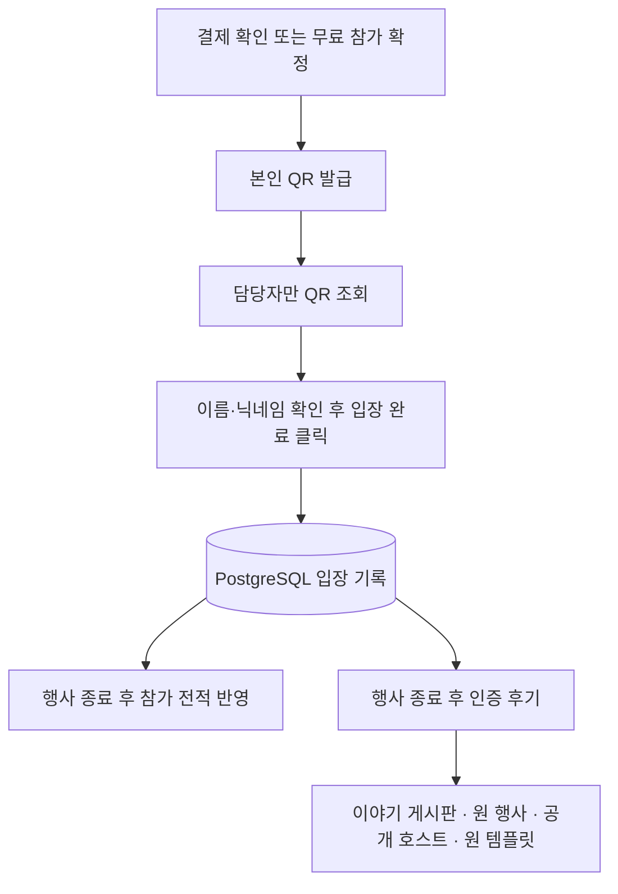

# 행사 운영: QR 입장 · 결제 예외 · 참가 인증 후기

구현 기준: 2026-10-04, C:/Sliper. 회원 로그인이나 전화번호 본인인증과 구별되는 **행사 현장 참가 확인** 기능입니다.

## 이용 순서

1. 담당자는 내 행사 → 행사 관리에서 정확한 시작·종료 시각을 저장합니다.
2. 참가자는 기존 사이트 신청 또는 외부 플랫폼 결제 확인/승인으로 참가를 확정합니다.
3. 참가자는 해당 모집글의 참가 화면에서 **QR 입장권 보기**를 누릅니다. 화면으로 제시하거나 PNG로 저장합니다. 새 입장권을 발급하면 이전 코드는 무효입니다.
4. 담당자는 내 행사 → **QR 입장 확인**에서 카메라·QR 사진·입장 코드로 참가자를 조회합니다. 이름과 닉네임을 현장에서 확인하고 **입장 완료**를 눌러야 기록됩니다.
5. 행사 종료 시각 이후 **행사 종료 · QR 참가 전적 반영**을 누릅니다. QR 입장이 확인된 참가자의 참가 전적을 추가하며 기존 우승·역할 전적은 유지합니다.
6. QR 입장이 확인되고 참가 상태가 확정인 회원은 종료된 모집글에서 **참가 인증 후기**를 한 번 작성합니다. 이야기 게시판에도 나타나며 기존 댓글·좋아요·북마크·신고·수정/삭제 기능을 사용합니다.

공지방 초대는 기존 참가 확정 과정에서 이루어집니다. QR은 현장 입장 확인에 사용하며 공지방 초대 조건을 바꾸지 않습니다.

## 데이터 흐름

Route Handler → 인증·동일 출처 검사 → Zod 검증 → 서비스 권한 검사/트랜잭션 → Drizzle → PostgreSQL 순서입니다. QR 생성과 사진 해독은 브라우저에서 실행하며 QR 사진을 서버에 업로드하지 않습니다. Redis나 별도 QR 확인 큐는 사용하지 않습니다.

## 입장 조건과 중복 방어

- 본인의 확정 신청에만 QR을 발급합니다. 담당자는 모집글 작성자 또는 지정된 공지방 관리자입니다. 플랫폼 운영자 권한만으로 다른 행사의 참가자를 조회할 수 없습니다.
- 32바이트 무작위 입장 코드를 발급하고 DB에는 SHA-256 해시만 저장합니다. QR에는 이름·연락처·회원 인증 ID를 넣지 않습니다.
- 해당 행사에서 시작 2시간 전부터 종료 시각 직전까지 입장을 확인합니다. 조회만으로 입장 기록을 만들지 않으며 종료 시각에 만료됩니다.
- 스캔할 때마다 참가 상태·회원 이용 제한·환불 검토·결제 상태/금액을 다시 검사합니다. 취소·환불·환불 검토 중인 신청은 입장할 수 없습니다. 유료 사이트 신청과 외부 신청은 저장된 유효 결제 확인이 필요합니다.
- 담당자는 자신의 입장을 승인할 수 없습니다. 다른 담당자가 확인해야 합니다.
- 행사 행 → 입장권 → 신청 순서의 잠금으로 동시 요청을 직렬화합니다. 고유 제약으로 중복 기록을 막고 재요청에는 최초 확인 시각을 반환합니다.
- 복합 외래키로 입장 기록의 신청·행사·회원 일치와 후기의 실제 입장 기록 일치를 DB에서도 보장합니다.
- 발급은 회원당 시간당 30회, 조회/확인은 분당 240회로 제한하며 제한 상태도 PostgreSQL에 저장합니다.

QR 이미지 공유를 막는 본인인증은 아닙니다. 담당자가 참가자 정보를 직접 확인하는 운영 방식입니다. 인터넷 연결이 필요하며 오프라인 입장 동기화는 포함하지 않습니다.

## 모바일과 로그인 연결

카메라 API에는 HTTPS 등 보안 컨텍스트가 필요합니다. PC localhost는 예외지만 휴대폰 HTTP Wi-Fi 주소는 예외가 아닙니다. 이 경우 QR 사진 선택 또는 코드 붙여넣기로 확인합니다. 기기 기본 카메라로 QR 링크를 열어 담당자 페이지에 진입하는 방법도 지원합니다. 실제 iPhone/Android 권한·실물 스캔은 별도 검증이 필요합니다.

QR 링크는 `/management/events/{postId}/check-in#ticket={code}`입니다. URL fragment는 표준 HTTP 요청 주소에 포함되지 않으며 체크인 페이지에 `no-referrer`를 지정했습니다. 읽은 코드는 주소에서 제거합니다. 로그인이 필요한 경우 같은 탭의 sessionStorage에 임시 보관해 로그인 후 이어서 확인합니다. 로그인 returnTo에는 행사 경로만 넣으며 조회 후 임시 저장값을 삭제합니다. 저장소가 막힌 환경에서는 다시 스캔합니다.

로컬 시험에서는 참가자와 담당자가 같은 Wi-Fi 사이트 주소로 접속하세요. PC 전용 127.0.0.1로 만든 QR 링크는 다른 휴대폰에서 열 수 없습니다. 운영 환경에서는 하나의 HTTPS 주소를 사용합니다.

## 결제 예외 관리

내 행사 → **결제 예외 관리**에서 20개씩 확인하고 검토 메모를 남깁니다.

| 예외 | 확인할 내용 |
| --- | --- |
| 결제 완료 · 참가 미확정 | 만료 후 결제, 정원 초과, 취소 후 결제 등 |
| 참가 확정 · 결제 미확인 | 유료/외부 신청의 결제 근거 누락 |
| 환불 완료 · 참가 불일치 | 환불 기록과 신청 상태 차이 |
| 금액 불일치 | 신청 금액과 저장된 결제 금액 차이 |
| 환불 검토 대기 | 아직 결정하지 않은 환불 요청 |

기존 서명·금액 검증을 거쳐 payment_orders/external_receipts에 저장된 자료를 비교합니다. 검증에 실패해 저장되지 않은 원시 웹훅 수집 화면은 아닙니다. 메모에 당시 신청/결제/환불 요청의 지문을 남기고, 상태가 바뀐 오래된 화면의 등록을 거절합니다. 같은 금액으로 환불을 재요청해도 이전 메모를 새 요청 검토로 표시하지 않습니다.

메모 등록은 결제 승인/환불 실행이 아닙니다. 기존 행사 관리에서 참가 승인과 외부 환불 확인을 처리합니다. 실제 결제·환불·정산은 외부 플랫폼이 담당하며 플랫폼 어댑터는 아직 실연동하지 않았습니다.

## 인증 후기와 전적

후기는 기존 posts에 저장하며 인증 메타데이터에 원 행사·신청·주최자·템플릿·작성 당시 행사 제목·1~5점 만족도를 연결합니다. 외부 결제 완료만으로 작성 자격을 주지 않으며 QR 입장과 종료 시각을 검사합니다.

닉네임으로 공개하고 수정 시 글 종류·카테고리·익명 옵션을 바꾸지 못하게 합니다. 차단한 호스트의 행사에서는 후기 조회·작성을 제한하며 운영자가 숨긴 후기는 공개 목록에서 제외합니다. 원 행사가 숨겨지거나 삭제되면 제목을 일반 표시로 대체하며 익명 주최자의 프로필 ID를 노출하지 않습니다.

종료 반영은 반복해도 전적을 중복 생성하지 않습니다. 미입장자를 자동 노쇼 처리하지 않으며 기존 우승·역할 기록을 유지합니다. 기존 수동 전적 관리도 유지하지만 QR 입장이 확인된 참가자를 노쇼로 표시할 수는 없습니다.

## 저장소와 API

추가한 네 테이블은 모두 sliper 스키마의 비공개 RLS 테이블이며 anon/authenticated의 직접 접근 권한을 회수했습니다. 테이블 소유자 연결은 RLS를 우회하므로 서비스에서 요청 권한을 검사합니다. 이 단계에서 앱 테이블은 46개였으며 행사 변경 이력까지 추가한 현재는 49개입니다.

| 테이블 | 목적 |
| --- | --- |
| admission_tickets | 신청별 최신 코드 해시·만료 시각 |
| event_admissions | 입장 확인·담당자·확인 시각 |
| event_payment_reviews | 신청/결제 상태별 검토 기록 |
| verified_event_reviews | 후기 게시글과 참가 인증·출처 연결 |

다음 경로는 `/api/participation/events/{postId}` 아래입니다. 모든 변경은 인증·동일 출처 검사를 통과해야 합니다.

| 메서드/경로 | 권한·효과 |
| --- | --- |
| POST /ticket | 본인의 확정 신청 QR 발급/교체 |
| POST /check-in-preview | 담당자 전용 조회 |
| POST /check-in | 담당자 전용 명시적 입장 완료 |
| GET /check-ins | 담당자 전용 이름/닉네임 검색·20개 페이지 |
| GET /reviews | 공개 후기와 본인 작성 가능 상태 |
| POST /reviews | 종료된 행사에 실제 입장한 참가자 |
| POST /finalize | 담당자 전용 종료 후 전적 반영 |
| GET /payment-review | 담당자 전용 결제 예외 목록 |
| POST /payment-review | 담당자 전용 현재 상태의 검토 메모 |

## 검증 및 남은 작업

최종 결과: 전체 단위/DB 테스트 336개, 실제 HTTP QR 통합 검사 1개, 포맷·TypeScript·Drizzle 정합성 검사와 프로덕션 빌드 통과. 새 테이블 4개의 로컬 적용 및 RLS 활성화를 확인했고 HTTP 임시 행사 데이터는 정리했습니다.

- 단위/DB 검사: 소유권·해시·재발급·담당자 범위·동시 중복·시간·취소/환불/이용 제한·자기 확인 방지·전적 멱등성·후기 자격/편집/숨김/차단·복합 외래키·결제 예외/메모/오래된 상태/재환불.
- `npm run test:event-operations-api`: 로컬 서버와 기존 테스트 계정이 필요합니다. 격리된 127.0.0.1:55432/sliper_dev 개발 DB만 허용합니다. 실제 HTTP로 발급·권한/출처 거절·조회/입장 분리·중복·조기 종료/후기 거절·관리 페이지를 확인하고 임시 행사를 정리합니다. 비밀번호를 바꾸지 않습니다.
- 마이그레이션 0026, 0027을 로컬 DB에 적용했습니다. 원격 Supabase에는 별도 적용이 필요합니다.
- 실제 모바일 기기 카메라/사진과 다수 담당자의 현장 운용은 아직 검증하지 않았습니다. 주최자 행사 취소·일정 변경은 [행사 변경](EVENT_LIFECYCLE.md)에 구현했고, 관심 구독·리마인더는 후속 단계입니다.

참고: [MDN getUserMedia](https://developer.mozilla.org/en-US/docs/Web/API/MediaDevices/getUserMedia), [node-qrcode](https://github.com/soldair/node-qrcode), [ZXing Browser](https://github.com/zxing-js/browser).
