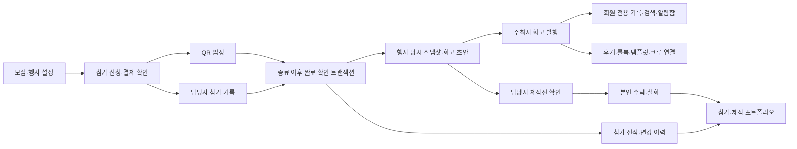

# 행사 기록과 포트폴리오 — 첫 단계 구현

기준일: 2026-10-06 · 프로젝트: `C:\Sliper`

행사 완료와 회고 공개를 분리했다. QR 입장·담당자 참가 확인은 완료 행사의 경험으로, 담당자 확인과 본인 수락을 거친 제작 역할은 제작 경력으로 남는다. 기록과 경력의 원본은 PostgreSQL이며 Redis의 용도는 기존 공지방 갱신 힌트다.

## 사용 순서

1. `/management/events/{행사ID}`에서 정확한 시작·종료 시각을 정하고 참가자를 모집한다.
2. 담당자가 QR로 입장을 확인하거나, 종료 후 참가 전적에서 실제 참가·미참석·우승·게임 역할을 기록한다.
3. 종료 시각 이후 **행사 완료 확인**을 누른다. 모집을 마감하고 완료 담당자·시각과 행사 기록 초안을 한 트랜잭션으로 저장한다.
4. 주최자가 초안의 기획 의도·실제 진행·잘된 점·개선점을 적고, 기존 리치 에디터로 사진·영상·텍스트를 작성한다. 관련 이야기와 아카이브의 룰북·이벤트 템플릿을 검색하여 연결할 수 있다. 모든 자료 출처 링크는 `/archive/{id}`로 이동한다.
5. 주최자가 **회원에게 공개**하면 `/records/{행사ID}`에 회고가 표시된다. 첫 공개 시 실제 참석자와 이미 수락한 제작진에게 알림함 항목을 한 번 생성한다.
6. 주최자 또는 지정 담당자가 플레이어 프로필 링크로 회원을 찾아 제작 역할과 기여 내용을 확인한다. 당사자는 알림함 또는 `/players/me/credits`에서 수락·거절·노출 철회·정정 요청을 한다.
7. 플레이어 프로필에서 참가 경험 / 만든 행사 / 만든 자료를 확인하고, 포트폴리오 공개와 대표 활동 최대 3개를 직접 선택한다. 분야·제작 역할·활동 연도와 20개 단위 페이지로 탐색한다.

회고를 공개하지 않거나 공개를 철회해도 확인된 완료 참가와 수락한 제작 경력은 보존된다. 포트폴리오에는 최소한의 행사 정보만 제공하고, 비공개 회고 본문·미디어를 제공하지 않는다. 회고와 개인 포트폴리오의 공개는 서로 독립적이다.

## 상태와 권한

| 대상                | 상태/권한                                                                                                            |
| ------------------- | -------------------------------------------------------------------------------------------------------------------- |
| 행사 완료           | 종료 시각 이후 주최자·지정 담당자 확인. 반복·동시 요청에도 기존 담당자·시각과 초안 유지                              |
| 회고 초안/공개 철회 | 주최자·지정 담당자만 조회. 주최자만 편집·발행·철회                                                                   |
| 공개 회고           | 활동 가능한 로그인 회원만 조회. 작성자와의 양방향 차단, 계정 이용 제한, 모집글·기록 운영 숨김 적용                   |
| 제작 경력           | pending → accepted / rejected / correction_requested / withdrawn. 자기 역할을 스스로 확인할 수 없음                  |
| 역할·기여 내용 변경 | 담당자 변경 시 기존 수락 해제 후 다시 수락 요청. 버전이 오래된 요청은 409                                            |
| 제작진 표시         | 본인이 수락한 행사별 이름·역할만 표시. 전체 포트폴리오 공개 동의와 별개                                              |
| 포트폴리오          | 본인은 조회 가능, 다른 회원에게는 본인이 공개한 경우만 제공. 참가 상세에는 별도의 전적 공개 설정도 적용              |
| 기존 플레이어 전적  | DB 이력 보존. 다른 회원에게 보여주는 참가·우승·주최·게임 역할은 전적 공개 동의 확인. 매너 온도는 기존 신뢰 지표 유지 |
| 관련 자료           | 제목·원본 링크만 연결. 연결이 유료 자료의 구매 권한을 부여하지 않음                                                  |
| 검색·공유           | 기록 검색은 회원만. 공유 미리보기는 일반 안내만 제공하고 회원 본문·사진·개인 경력을 넣지 않음                        |

행사 기록 화면에서 신고·주최자 차단도 가능하다. 자료의 숨김·차단 상태를 확인한 뒤 관련 기록을 반환하며, 숨긴 자료 ID를 직접 검색해 사용 관계를 알아내는 경로도 차단한다.

## 집계 기준

- 행사 종료 시각 경과나 모집 마감만으로 공식 완료로 간주하지 않는다. 기존 행사는 담당자의 새 완료 확인 후 공식 포트폴리오 집계에 들어간다.
- 실제 `event_results.presence = attended`만 참가 인원에 포함한다. 같은 참가 기록에 QR 입장 근거가 있으면 QR 확인, 없으면 담당자 확인으로 분류한다.
- QR 1명 + 담당자 확인 1명 + 미참석 1명 = 실제 참가 **2명**, 확인 방법별 **1명씩**이다.
- 실제 참석 후 환불·취소된 경우 금융 상태를 참가 사실과 분리해 기존 참석 이력을 유지한다. 완료 확인 때도 실제 QR 입장 근거를 사용한다.
- 참가 경험과 수락한 제작 역할은 행사당 한 번 집계한다. 여러 제작 역할·여러 크루에 속해도 동일 행사 횟수를 늘리지 않는다.
- 주최자는 당시 주최자 ID와 실제 참가 근거가 있는 완료 행사에 **주최 기록**으로 연결된다. 제3자가 검증한 기획 경력으로 표현하지 않는다.
- 주최한 행사의 인원은 참가 연인원이다. QR/담당자 확인 인원을 함께 표시한다. 만족도는 실제 참석 근거가 있는 인증 후기의 평균과 표본 수이며, MC·디자이너 개인 평점이 아니다.
- 샘플·취소 행사·미참석은 공식 완료 참가 지표에서 제외한다. 샘플 자료도 제작 자료 집계에서 제외한다.
- 기존 크루의 확인된 기여는 원본 근거를 유지한 채 수락 대기 경력으로 이관한다. 완료 확인 및 본인 수락 전에는 공식 경력으로 노출하지 않으며 추가 활동점수를 지급하지 않는다.

## 저장 구조와 처리 흐름

| DB 항목                                    | 내용                                                                                        |
| ------------------------------------------ | ------------------------------------------------------------------------------------------- |
| `event_settings.completed_at/completed_by` | 최초 완료 확인 담당자·시각. 모집 닫힘과 별도                                                |
| `event_records`                            | 행사당 1개 초안. 불변 당시 제목·일정·장소·카테고리·주최자·템플릿, 회고 문서, 발행 상태·버전 |
| `event_results` / `event_admissions`       | 담당자 전적과 QR 참가 근거. 기존 이력 그대로 보존                                           |
| `event_result_revisions`                   | 최초 생성과 변경 전/후 값, 담당자·사유·시각. DB 트리거의 추가 전용 감사 이력                |
| `event_credits`                            | 행사·회원·역할, 확인 담당자, 기여 내용, 수락·거절·철회·정정 요청과 버전                     |
| `portfolio_preferences`                    | 회원 공개 동의와 대표 행사 ID 최대 3개                                                      |
| `event_record_links`                       | 관련 게시글·자료의 원본 ID 관계                                                             |
| `media_assets` / `video_assets`            | 기록 부모 ID와 **회원 전용 최초 기록 ID**. 파일은 기존 local/private Storage 경로 사용      |
| `inbox_items`                              | 제작진 수락 요청과 첫 회고 발행 안내. 수신자·원본별 중복 방지                               |

완료 처리와 회고 수정은 모집글 → 기록 순서로 행을 잠근다. 수정·발행·제작진 결정은 PostgreSQL의 정밀한 `updated_at` 버전과 비교해 이전 화면의 덮어쓰기를 막는다. 완료 담당자·시각, 당시 스냅샷, 전적 감사 이력은 DB에서도 변경을 제한한다.

신규 테이블에 RLS와 브라우저 역할 접근 차단을 적용했다. 실제 운영 시 서버 DB 역할·마이그레이션 소유자 분리와 권한 확인은 기존 배포 로드맵에서 수행해야 한다.

## 사진·영상과 알림

기록에는 기존 사진 Canvas 사전 준비·서버 WebP 압축과 영상 비동기 Worker를 재사용한다. 사진 최대 10개, 업로드 영상 최대 3개이며 텍스트 사이에 배치한다.

일반 글과 기록은 동시에 같은 미디어를 소유할 수 없다. 한 번 기록에 첨부된 미디어는 삭제 후에도 회원 전용 분류를 유지하여 공개 이야기 글로 가져갈 수 없다. 기록에서 분리된 첨부는 작성자만 미리 볼 수 있다. 이미지 읽기와 영상 GET/HEAD/Range 모두 파일 접근 전에 동일한 기록 권한을 확인한다. 응답은 `private, no-store`이고 Supabase에서는 비공개 버킷을 사용한다.

공지방 메시지는 기존처럼 PostgreSQL에 저장하고 Redis는 방의 갱신 힌트만 전달한다. **새 제작진·회고 안내는 사이트 알림함만** 사용한다. 해당 두 종류의 기기 Web Push 발송은 추가하지 않았으며 기존 공지·댓글·참가 알림 Push는 유지했다.

## API

| 경로                                               | 기능                                                         |
| -------------------------------------------------- | ------------------------------------------------------------ |
| GET `/api/records`                                 | 회원 기록 목록, 검색·분야·내 기록·자료 연결 필터·20개 페이지 |
| GET/PATCH `/api/records/{행사ID}`                  | 권한에 맞는 상세 조회 / 주최자 회고 저장                     |
| POST `/api/records/{행사ID}/publish`               | 회원 발행·공개 철회                                          |
| GET/POST `/api/event-credits/events/{행사ID}`      | 담당자 제작진 목록·확인 요청                                 |
| PATCH `/api/event-credits/{경력ID}`                | 담당자 역할 수정·확인 철회                                   |
| GET `/api/event-credits/me`                        | 본인에게 요청된 제작 경력                                    |
| POST `/api/event-credits/{경력ID}/decision`        | 본인 수락·거절·철회·정정 요청                                |
| GET `/api/players/me/portfolio`                    | 본인 포트폴리오                                              |
| GET `/api/players/{공개ID}/portfolio`              | 공개 동의를 확인한 다른 회원 포트폴리오                      |
| PUT `/api/players/me/portfolio`                    | 회원 공개·대표 활동 설정                                     |
| POST `/api/participation/events/{행사ID}/finalize` | 기존 종료 API를 정식 완료 처리로 확장                        |

쓰기 요청은 같은 출처 검사를 적용하고 본문 크기·입력값·회원 요청 빈도를 제한한다. 새 API 응답은 캐시하지 않는다.

## 검증과 다음 단계

- 기록/포트폴리오/전적 DB 회귀 검사: 스냅샷 불변, 수정 버전 충돌, 중복 완료·다중 역할, 수락 상태·공개 동의·차단·운영 숨김·금융 상태와 참석 분리, 파일 분리 후 공개 재사용 차단.
- `npm run test:records`: 실제 로컬 PostgreSQL 전체 흐름 1개와 독립 연결의 동시 완료 요청 1개. 전체 흐름의 픽스처는 트랜잭션을 롤백한다. 동시 완료용 빈 행사도 종료 후 정리한다.
- 같은 실제 DB 흐름에서 기록 이미지 비회원 접근, 영상 GET/HEAD/Range 비회원 접근 차단, 회원 HEAD Range 응답, 공개 철회 후 직접 미디어 접근 차단을 확인한다. 이 검사는 서버 읽기 함수와 Request/Response 경계 검사이며 휴대폰에서의 실제 재생 검사를 대신하지 않는다.
- `npm run check`와 `npm run build`로 기존 기능 회귀·타입·형식·마이그레이션·Web 배포 trace를 확인한다.

| 계획 단계                  | 구현 상태와 범위                                                        |
| -------------------------- | ----------------------------------------------------------------------- |
| 2. 운영 지식 재사용 (구현) | 회고 → 템플릿 초안, 룰북·템플릿 발행 버전·파생 출처·변경 이력·이용 조건 |
| 3. 장소 데이터 축적 (구현) | 행사와 등록 장소 ID 연결, 당시 장소 스냅샷, 장소별 완료 행사·운영 팁    |
| 4. 협업형 아카이브         | 지식·연구와 자료 연결, 수정 제안 → 작성자 승인 → 새 버전                |
| 5. 템플릿 시장             | 검증 사용 사례·이용 조건·구매 권한·분쟁 처리와 실제 외부 결제 승인 연결 |

2단계의 회고 → 비공개 템플릿, 발행 버전·파생 출처·이용 조건도 추가했다. [사용법·DB/API·권한 설계](KNOWLEDGE_REUSE_AND_VERSIONS.md)를 참고한다. 3단계 장소 연결·당시 정보 보존·장소별 완료 행사와 운영 팁도 구현했다. [장소 기록 설계](PLACE_HISTORY_AND_EVENT_VENUES.md)를 참고한다. 다음 성숙화 단계는 협업형 아카이브다.

첫 단계는 위 행사 기록·경력·포트폴리오 연결이다. Supabase/OAuth·실제 결제·HTTPS·백업·운영 Worker·휴대폰/브라우저 검증은 [실서비스 준비](PRODUCTION_INTEGRATION.md)와 [전체 로드맵](PROJECT_STATUS_AND_ROADMAP.md)을 병행한다.
