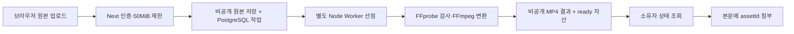

# 브라우저 사진 준비·영상 Worker·공지방 실시간 갱신

2026-10-06 구현 기준. 코드 구현과 실제 외부 서비스·기기 검증을 구분한다.

## 사진 업로드

게시글과 프로필 사진은 전송 전에 브라우저 `createImageBitmap`과 Canvas로 준비한다. JPEG·PNG·GIF·WebP 헤더에서 확인할 수 있는 크기는 디코딩 전에 검사하고, 원본 입력 한도와 2천만 화소 제한을 적용한다. 한 브라우저에서는 사진을 하나씩 처리하며, 게시글은 종횡비를 유지하고 프로필은 중앙의 정사각형을 사용한다.

| 구분   | 원본 한도                  | 준비 결과                |
| ------ | -------------------------- | ------------------------ |
| 게시글 | 10MiB·2천만 화소·글당 10장 | 최대 2400px·2MiB WebP    |
| 프로필 | 5MiB·2천만 화소            | 512×512 이하·256KiB WebP |

품질·크기는 기존 서버와 같은 정책을 단계적으로 적용한다. 실제 전송은 준비 결과가 원본보다 작을 때만 바꾸며, API 미지원·디코딩/인코딩 실패·WebP 미지원·용량 이득이 없는 경우에는 허용 범위 안의 원본을 전송한다. GIF와 움직이는 WebP는 첫 장면을 사용한다. 준비 중에는 “사진 준비 중…”을 표시하고 입력·중복 업로드를 막는다. 화면을 떠나면 전송 전 준비를 취소하고, 중단할 수 없는 네이티브 작업이 끝난 뒤 bitmap과 Canvas 메모리를 정리한다. Object URL이나 WASM 모듈은 사용하지 않는다.

브라우저 처리는 전송량을 줄이는 최적화다. 서버 Sharp가 실제 바이트·크기·형식을 다시 검사하고 WebP로 재인코딩하며 EXIF/GPS를 제거한다. 클라이언트가 보낸 형식·치수를 신뢰하지 않는다. 서버 검증과 소유권·저장소 인가는 계속 필수다.

## 영상 접수와 완료



`POST /api/videos`는 원본 저장을 확인한 뒤 `jobId`, `status=queued`, `statusUrl`을 반환한다. HTTP 요청 안에서 FFmpeg 변환을 기다리지 않는다. 별도 `video:worker`가 원본을 읽고 결과를 저장한 뒤 `video_assets`의 ready 자산과 작업 상태를 같은 DB 트랜잭션으로 확정한다. `GET /api/videos/jobs/ID`는 업로더 본인에게만 `queued`, `processing`, `ready`, `failed` 상태와 ready 결과를 제공한다. 파일 키·원본 주소·업로더 내부 ID는 상태 응답에 포함하지 않는다.

에디터는 영상을 올리는 단계, 접수 후 기다리는 단계, 준비하는 단계를 표시하며 1.5초부터 최대 5초 간격으로 상태를 확인한다. ready인 압축 자산만 본문에 연결한다. 브라우저의 최대 대기 시간은 15분이며, 페이지를 떠나 상태 조회를 중단해도 접수된 작업은 Worker에서 계속 처리할 수 있다. 실패·대기 종료 시 기존 입력 내용은 유지한다. YouTube·Vimeo 링크는 이 대기열을 사용하지 않는다.

원본은 50MiB 이하, 실제 길이 3분·2천만 화소 이하를 Worker에서 검사한다. 결과는 종횡비·회전을 반영한 최대 1280×720 경계의 H.264/AAC MP4·25MiB 이하이며 메타데이터를 제거한다. 저비트레이트 원본은 변환 결과가 원본보다 커질 수 있어 일정 압축률을 보장하지 않는다.

## 작업·재시도·정리

마이그레이션 `0039_mixed_gamma_corps.sql`은 RLS와 직접 접근 차단이 적용된 `video_processing_jobs`, `video_processing_outputs`를 추가한다. 기존 60개에서 총 62개 Sliper 테이블이 된다. 영상 대기열은 PostgreSQL에 영구 기록하며 프로세스 메모리나 Redis Pub/Sub에 작업을 보관하지 않는다.

| 항목             | 현재 정책                                                               |
| ---------------- | ----------------------------------------------------------------------- |
| 업로드 예약      | 15분 안에 비공개 원본 저장 확인                                         |
| 사용자 제한      | 시간당 업로드 6회, 동시에 queued/processing 최대 3개                    |
| Worker 동시성    | 프로세스당 1개, 여러 Worker는 `FOR UPDATE SKIP LOCKED`로 선점           |
| 선점 임대        | 300초, 작업·시도별 UUID 토큰으로 이전 Worker 완료 차단                  |
| 처리 제한        | 작업 전체 240초, 기존 FFprobe/FFmpeg 시간·출력 한도도 적용              |
| 재시도           | 일시 오류 최대 3회, 15초·30초 순으로 지연; 잘못된 영상은 즉시 실패      |
| 정상 종료 중단   | 임대를 반환하고 재시도 횟수를 소모하지 않고 다시 queued                 |
| 원본 유효 기간   | 최대 24시간; ready/failed가 되면 Worker가 정리                          |
| 미공개 결과      | 시도 전에 결과 키를 DB에 기록하고, 버려진 결과를 삭제·재시도            |
| 중단된 결과 정리 | 공개되지 않은 결과는 기본 1시간 후 정리 대상; 삭제 실패는 1분 후 재시도 |

각 변환 시도는 새 UUID 결과 파일을 사용한다. 완료는 현재 토큰·유효 임대·미폐기 결과 행을 다시 검사하므로, 임대가 끝난 오래된 Worker가 새 결과를 덮어쓰거나 게시할 수 없다. 객체 저장 후 DB 확정 전에 프로세스가 중단되어도 결과 원장의 주소로 다시 정리할 수 있다. 공개된 ready 결과는 이 임시 결과 정리 대상이 아니다. 기존 미첨부·소프트 삭제 ready 자산의 장기 보존/파기는 별도 정책 과제다.

TTL은 Worker의 정리 실행 기준이며 저장소가 정확히 24시간에 자동 삭제한다는 뜻은 아니다. Worker가 중단되면 재실행 후 만료·정리를 처리한다. 작업/결과 원장 행 자체를 자동 파기하는 보존 정책은 별도로 정해야 한다.

## 저장소와 실행

- 로컬 원본: `.local/video-sources/UUID.bin`; 압축 결과: `.local/videos/UUID.mp4`.
- Supabase 비공개 버킷 원본: `video-sources/UUID.bin`; 결과: `videos/UUID.mp4`.
- 원본에는 공개·서명 URL이나 HTTP 읽기 경로를 제공하지 않는다.
- 원본·결과는 각각 행에 `local`/`supabase` 저장 방식을 기록한다. 설정 변경은 기존 파일을 이전하지 않는다.
- 비공개 Supabase 버킷은 원본 `application/octet-stream`·50MiB와 결과 `video/mp4`·25MiB를 허용해야 한다.
- Web과 Worker는 같은 PostgreSQL 및 해당 파일 저장소에 접근해야 한다. local 방식이면 `.local/video-sources`와 `.local/videos`를 같은 지속 디스크로 공유한다.

```powershell
npm run db:migrate
npm run video:worker
```

`video:worker`는 별도 터미널/서비스에서 상시 실행한다. `npm run video:drain`은 정리를 실행하고 처리 가능한 영상 한 개를 처리한 뒤 종료한다. 운영은 프로세스 관리자의 재시작 정책과 DB 연결·CPU·임시 디스크·대기 시간 감시를 준비한다. Web Push의 `push:worker`는 별도 프로세스다.

별도 영상 Worker 이미지는 `Dockerfile.video-worker`로 빌드하고 운영에서 같은 Supabase 비공개 버킷에 연결한다. `compose.yaml`은 로컬 Redis 서비스만 제공하며 영상 Worker나 Web 서비스를 함께 띄우지 않는다. 배포 OS에서 `npm ci`를 실행해 해당 플랫폼의 FFmpeg/FFprobe를 설치한다. Windows `node_modules`를 Linux로 복사하지 않는다. Web 요청은 여전히 50MiB 업로드를 받아야 하므로 프록시·서버리스 본문 제한은 별도로 맞춰야 한다. 현재 서버 경유 업로드이며 브라우저의 스토리지 직접 업로드는 구현하지 않았다.

## 공지방 Redis 갱신

PostgreSQL은 공지 본문·멤버·권한·구독·읽음·알림·발송 작업의 원본이다. 공지를 DB와 기존 알림/푸시 작업에 커밋한 뒤 Redis 채널 `sliper:room:방UUID`로 방 UUID만 발행한다. 본문·닉네임·연락처·회원 ID·신청 답변을 Redis에 보내지 않는다. SSE 서버는 이 힌트를 받으면 DB에서 해당 회원의 현재 권한과 방 내용을 다시 조회한다.

한 Next 서버 프로세스의 Redis 발행/구독 연결 두 개가 해당 프로세스의 SSE 연결에 알림을 나눈다. 구독이 정상일 때는 즉시 갱신 힌트와 30초마다 DB 재확인을 사용한다. Redis 미설정·장애·구독 끊김에서는 5초 DB 조회로 돌아간다. SSE는 15초 heartbeat와 약 55초 연결 수명을 유지하고 재연결 때 DB를 다시 읽는다. 힌트 유실·중복·재연결이 메시지 저장 여부나 최종 권한의 원본을 바꾸지 않는다.

Redis Pub/Sub은 끊긴 동안의 메시지를 다시 전송하지 않으므로 내구성 있는 메시지 저장소가 아니다. 이 프로젝트는 DB 재확인으로 유실을 보완한다. [Redis 공식 전달 보장 설명](https://redis.io/docs/latest/develop/pubsub/#delivery-semantics)을 참고한다.

```powershell
npm run redis:local:start
```

Next 서버의 서버 전용 `REDIS_URL`에 Redis 주소를 설정하고 서버를 다시 시작한다. 개발 compose는 호스트 `127.0.0.1:6380`을 컨테이너6379로 연결하므로 `REDIS_URL=redis://127.0.0.1:6380`을 사용한다. Redis 주소/자격증명을 브라우저 환경변수나 로그에 출력하지 않는다. 운영 연결에는 대상 Redis의 인증·네트워크·TLS 정책을 적용한다. `REDIS_URL`이 없어도 DB 조회로 동작한다.

이 Redis 연결은 공지방 SSE 갱신용이다. 통합 알림함·리마인더·Web Push 발송 대기열은 기존 PostgreSQL과 `push:worker`를 사용한다.

## 검증과 남은 확인

```powershell
npm run check
$env:ROOM_REDIS_TEST_URL = "redis://127.0.0.1:6380"
npm run test:room-realtime
Remove-Item Env:ROOM_REDIS_TEST_URL
npm run test:video-api
npm run test:rich-post-api
npm run build
```

사진 회귀 검사는 인코딩된 헤더·한도·크기/자르기·원본 fallback·취소·정리를 확인하며 DOM이 없는 환경에서는 주입한 인코더를 사용한다. 영상 Worker 회귀는 DB 상태·선점·재시도·임대 복구·만료·결과/원본 정리 경계를 대체 변환기와 저장소로 확인한다. 공지방 회귀는 대체 Redis 연결과 DB 읽기로 구독/유실/재연결/fallback을 확인한다. 이번 변경의 `npm run check`는 형식·타입·회귀/DB593개·Drizzle 검사를 통과했다. `npm run test:video-api`는 실제 FFmpeg와 비동기 Worker를 사용하는 HTTP1개 검사를 통과했으며 원본 제거·비공개 접근·Range 재생을 확인했다. `npm audit`는 취약점0개다. 운영 빌드가 통과했다. 공지방 HTTP 검사 1개는 DB fallback 갱신과 참가 취소 후 접근 회수까지 확인했다.

로컬 Redis 컨테이너를 실행했고 healthy·PING/PONG 및 실제 Pub/Sub 프로세스 간 통합 검사 1개가 통과했다. 공지 작성 HTTP→DB 커밋→Redis→SSE 갱신과 참가 취소 후 접근 회수도 3초 이내로 확인했다. 새 비동기 영상 HTTP→실제 Worker→FFmpeg→ready 로컬 흐름은 위 검사로 확인했다. 원격 Supabase, 실제 휴대폰 Canvas 인코딩/영상 재생과 다중 인스턴스 부하는 별도 검증이 필요하다. 2026-10-05의 동기 영상 압축 검사는 과거 결과이며 새 대기열/컨테이너 경로의 검증을 대신하지 않는다.

공식 API 근거: [MDN createImageBitmap](https://developer.mozilla.org/en-US/docs/Web/API/Window/createImageBitmap), [Canvas toBlob](https://developer.mozilla.org/en-US/docs/Web/API/HTMLCanvasElement/toBlob), [HTML ImageBitmap·첫 장면 처리](https://html.spec.whatwg.org/multipage/imagebitmap-and-animations.html#dom-createimagebitmap-dev).

Web 배포는 FFmpeg·FFprobe 바이너리 없이 구성한다. npm run build의 postbuild trace 검사는 서버 배포 목록에서 루트 .env*·.local·.git·.npm-cache를 제외하며, FFmpeg/FFprobe 의존성이 Web trace에 다시 생기면 빌드를 실패시킨다. 개발 데이터와 키 파일은 배포에 복사하지 않고 운영 환경 변수·공유 비공개 저장소를 사용한다.

최종 검증에는 서버 trace 정책 검사 10개가 포함되며, 배포 목록 74개에서 비공개 개발 파일과 Worker 바이너리 항목이 없는 것을 확인했다. docker compose 구성 검사와 로컬 Redis 이미지 기동·health 검사도 통과했다.

Linux 영상 Worker 이미지도 빌드하고 비관리자 계정에서 FFmpeg·FFprobe 실행과 실제 합성 영상 압축을 확인했다. 설치 패키지의 FFprobe 실행 권한을 수정했으며, 검증용 컨테이너에는 DB·개인 설정·호스트 저장소를 연결하지 않았다. 현재 로컬 영상 처리는 기존 별도 Worker 프로세스가 수행한다. 1초 320×180 합성 영상은 81,584바이트에서 14,127바이트로 줄었다. 검증 컨테이너는 네트워크를 차단하고 실행 후 제거했다. 운영 컨테이너의 공유 저장소·DB 설정은 배포 단계에서 적용한다.
