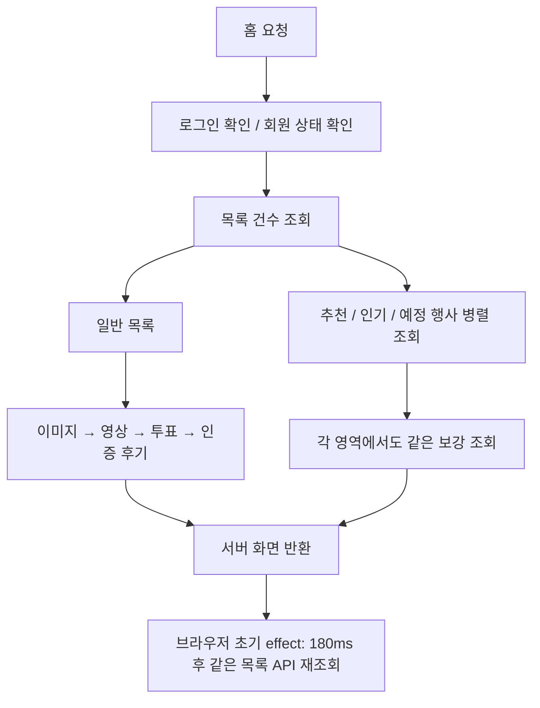

# Sliper 응답 지연 진단 — 2026-10-16

> 아래 내용은 수정 전 진단 기준입니다. 적용한 변경과 이후 측정은 [성능 개선 결과](PERFORMANCE_FIX_2026-10-16.md)를 참고하세요.

## 결론

현재의 주된 병목은 **원격 DB 왕복 지연과 순차 데이터 보강 조회**다. 로그인 연동과 함께 로컬 DB에서 Supabase 실행 환경으로 전환되어 기존 조회 구조의 비용이 커졌다. 로그인·권한 확인의 중복과 최초 화면의 불필요한 재조회도 확인했다.

사용자가 추가로 제공한 `localhost`의 401·403 로그는 **로그인 상태와 요청 원본 불일치, 실패 후 반복 조회** 문제다. 이 오류의 응답은 수십 ms이며 약 2초인 정상 홈 응답 지연과 구분해야 한다.

이번 작업은 소스 분석, 익명 HTTP/Chrome 측정, 읽기 전용 SQL 및 실행 계획 확인이다. 애플리케이션 동작·DB 스키마·사용자 데이터·인증 설정은 변경하지 않았다. 실제 회원의 로그인 쿠키나 토큰을 가져와 측정하지 않았다.

## 1. 측정 범위와 결과

- 환경: Windows 로컬 Next.js 개발 서버 → Supabase Transaction pooler(6543).
- 연결 호스트는 `ap-southeast-2`(시드니) 엔드포인트다. 호스트로 확인한 연결 경로이며 프로젝트의 물리적 배치 정보를 별도로 조회한 결과는 아니다.
- 브라우저: 세션·쿠키가 없는 별도 Chrome 컨텍스트.
- 현재 데이터 규모: 게시글 1개, 좋아요 1개, 프로필 2개.
- 수치는 이 환경의 소규모 측정이며 대규모 부하 검사나 로그인 회원의 응답 시간은 아니다.

| 측정 대상                             | 결과                             | 해석                                                                  |
| ------------------------------------- | -------------------------------- | --------------------------------------------------------------------- |
| `/login` 익명 요청                    | 약 61ms                          | 모든 페이지가 동일하게 느린 상태는 아님                               |
| `/` 반복 요청 3회                     | 2,028~2,070ms                    | 최초 컴파일 이후에도 지연 지속                                        |
| `/api/community` 기본 목록            | 약 1,958ms                       | 주된 지연이 데이터 처리 경로에 있음                                   |
| `/api/community/highlights`           | 약 1,610ms                       | 인기·추천·예정 행사도 같은 보강 조회 구조 사용                        |
| Chrome 첫 문서 TTFB                   | 2,082ms                          | HTML 첫 응답 이전 대기가 큼                                           |
| Chrome DOMContentLoaded / load        | 2,319ms / 2,444ms                | 초기 네트워크 측정에서 대부분의 시간이 첫 응답 대기                   |
| Chrome 초기 요청 종료 후 network idle | 5,285ms                          | 화면 뒤의 목록 재조회 포함. 화면 조작 불가 시간이나 INP를 뜻하지 않음 |
| 단순 `SELECT 1`, 연결 후 반복         | 152~164ms                        | 쿼리 계산과 별개인 원격 DB 왕복 비용                                  |
| 새 DB 연결의 첫 `SELECT 1`            | 1,511~1,556ms                    | 새 연결 수립 비용도 존재                                              |
| 실제 feed 서비스, 준비된 연결         | 1,800ms / 1,817ms, 각각 SQL 13개 | Next.js 렌더링을 제외해도 느림                                        |
| 실제 feed 서비스, 새 풀 첫 호출       | 4,468ms                          | 진단용 새 풀의 첫 호출. 모든 페이지 요청의 고정 지연은 아님           |
| Auth 공개 설정 엔드포인트             | 첫 519ms, 이후 171~179ms         | Auth 경로의 네트워크 참고값. 실제 `getUser()` 측정값은 아님           |

DB 상태를 한 차례 확인했을 때 진단 연결을 제외한 현재 역할 연결은 5개, 역할 제한은 15개였다. 활성 쿼리·트랜잭션 유휴·잠금 대기는 각각 0개였다. 지속적인 연결 포화나 잠금이 이번 지연의 원인이라는 증거는 없으며, 한 시점의 관찰로 다른 시간대까지 보장하지는 않는다.

## 2. 확인한 주요 병목

### A. 목록 1회에 SQL 13개, 독립적인 보강 조회가 순차 실행됨

관련 코드:

- `src/server/community-service.ts:288`: 전체 건수 조회를 기다린 후 목록과 highlights 시작.
- `src/server/community-service.ts:296`: 목록과 highlights는 이미 `Promise.all`로 병렬 실행.
- `src/server/post-reader.ts:330`: 추천·인기·예정 행사도 상위 수준에서는 병렬 실행.
- `src/server/post-reader.ts:97`: 이미지 조회.
- `src/server/post-reader.ts:112`: 이미지가 끝난 뒤 영상 조회.
- `src/server/post-reader.ts:128`: 영상이 끝난 뒤 투표 집계·내 투표 조회.
- `src/server/post-reader.ts:147`: 그 뒤 인증 후기 메타데이터 조회.

현재 데이터에서는 같은 투표 글이 일반 목록과 인기 영역에 모두 등장한다. 두 영역에서 이미지·영상·투표·인증 후기 정보를 각각 다시 읽는다.

| 조회 묶음                              | 현재 SQL 수 |
| -------------------------------------- | ----------: |
| 전체 건수                              |           1 |
| 일반·추천·인기·예정 행사 기본 조회     |           4 |
| 일반 목록의 이미지·영상·투표·인증 후기 |           4 |
| 인기 목록의 동일 메타데이터            |           4 |
| 합계                                   |          13 |

준비된 연결에서 각 실제 서비스 쿼리의 클라이언트 대기는 대체로 281~325ms였다. 이 시간에는 전송·프로토콜·풀 대기·서버 처리가 함께 포함되므로 모두 DB 실행 시간으로 해석하면 안 된다. 핵심은 독립적인 보강 조회를 약 4단계로 직렬 대기하는 구조다.

### B. 서버에서 받은 목록을 첫 렌더링 후 다시 요청함

`src/app/page.tsx:29`에서 서버가 이미 목록과 알림을 만들어 내려준다. 그러나 `src/lib/use-community.ts:201`의 effect가 최초 마운트에서도 `loading=true`로 전환하고 180ms 뒤 전체 feed를 새로 요청한다. 초기화된 `loadedKey`와 같아도 최초 요청을 생략하는 분기가 없다.

별도 Chrome에서도 문서 응답 후 `/api/community`가 한 번 더 호출되어 **1,962ms** 걸리는 것을 확인했다. 개발 Strict Mode로만 설명되는 중복이 아니라 effect 자체의 최초 요청이다.

`src/components/sliper-community.tsx:898`에서는 `store.loading` 중 페이지 번호 버튼을 비활성화한다. 따라서 이미 글이 보여도 불필요한 재조회 동안 일부 조작은 대기하게 된다.

### C. 로그인 확인이 여러 컴포넌트와 API 내부에서 중복됨

- `src/components/notification-bell.tsx:70`과 `src/components/test-account-controls.tsx:51`이 각각 `/api/auth/session`을 요청한다. 초기 Chrome 측정에서 두 요청을 확인했다.
- 푸시 안내는 별도로 `/api/push/settings`를 요청한다. 각 컴포넌트는 경로 이동·포커스·설정 변경 때 재확인한다.
- `src/server/identity.ts:21`은 `auth.getUser()`로 Auth 서버에서 사용자 신원을 확인하고, `currentActor()`는 그 뒤 회원 제재 상태를 DB에서 조회한다.
- `src/app/api/auth/session/route.ts:13`은 `authenticatedActor()` 후 `currentActor()`를 호출한다. `currentActor()`가 다시 `authenticatedActor()`를 호출한다.
- 현재 memoization은 React `cache()`다. React 컴포넌트 밖에서는 캐시를 읽거나 갱신하지 않으므로 Route Handler의 중복 호출 제거 수단으로 의존할 수 없다. 회원 요청에서는 원격 사용자 확인이 두 번 실행되는 경로다.
- 그 뒤 닉네임 조회와 운영 역할 조회도 순차 실행된다.

참고: [React cache 공식 문서](https://react.dev/reference/react/cache). 요청 내부에서만 인증 결과를 공유하고, 로그아웃·제재·탈퇴 검사를 유지해야 한다. 사용자별 최종 응답을 전역 캐시에 넣거나 검증되지 않은 세션 객체를 신뢰하는 방식으로 개선하면 안 된다.

Proxy의 `getClaims()`가 모든 요청에서 원격 사용자 API를 호출한다고 단정할 수는 없다. 공개 JWKS에서 ES256 키 1개를 확인했고, 현재 Supabase Auth SDK는 서명키 캐시를 제공한다. 현재 식별 경로에서 명확한 원격 사용자 조회 지점은 `getUser()`다. [Supabase SSR 공식 문서](https://supabase.com/docs/guides/auth/server-side/advanced-guide).

## 3. 추가 콘솔 로그: 401·403 재현 결과

현재 서버의 `APP_ORIGIN`은 `http://127.0.0.1:3000`이다. Supabase 모드에서는 로컬 DB 개발 모드에만 허용되는 `localhost` 별칭 예외가 적용되지 않는다.

쿠키가 없는 익명 요청으로 아래를 재현했다. 익명 활동 수집은 실제 DB에 기록하지 않는다.

| 실제 요청 주소 / Origin | 경로                        | 응답                     |
| ----------------------- | --------------------------- | ------------------------ |
| `http://127.0.0.1:3000` | `POST /api/analytics/visit` | 200, collected=false     |
| `http://localhost:3000` | `POST /api/analytics/visit` | 403 FORBIDDEN            |
| 양쪽 각각               | `GET /api/push/settings`    | 401 UNAUTHENTICATED      |
| 양쪽 각각               | `GET /api/auth/session`     | 200, authenticated=false |

- **visit·view의 403**: `src/server/http.ts:7`의 요청 원본 검사가 원인인 경로다. 방문 기록과 조회수 POST에도 같은 검사가 적용된다. `localhost`와 `127.0.0.1`은 서로 다른 origin이다.
- **settings의 401**: 로그인되지 않은 상태에서 회원 전용 푸시 설정을 조회한 응답이다. 로그인 쿠키도 두 호스트 간 공유되지 않는다. 이 오류만으로 Google·Kakao 공급자 설정 실패라고 판단할 수 없다.
- **반복 이유**: `src/components/push-onboarding.tsx:125`는 focus와 visibilitychange에 설정을 재조회하고, 169행은 페이지 이동 때도 조회한다. 로그아웃 상태에서도 매번 회원 전용 API를 호출한다. 네트워크 요청을 영구 반복하는 단일 while 루프는 아니다.
- `src/components/activity-day-tracker.tsx:35`는 1분마다 방문 기록을 다시 시도하고, 페이지 이동·표시 상태 변경에도 실행된다. 성공하지 못한 403은 기록 완료로 표시하지 않아 이후에도 다시 요청한다.
- 이번 비교의 오류 응답은 약 19~35ms였다. **오류의 원인과 약 2초인 정상 목록 지연을 구분**해야 한다.
- `Download React DevTools`, `[HMR] connected`, `Fast Refresh`는 개발 모드 안내다. 기록된 약 0.5초 재빌드는 편집 후 일시적 지연에 영향을 줄 수 있으나, 준비된 상태에서 매번 발생한 목록 지연을 설명하지 못한다.

현재 사용 방법은 `http://127.0.0.1:3000/login`에서 로그인하고 같은 주소로 계속 이용하는 것이다. 현재 탭이 127.0.0.1이어도 콘솔에 이전 localhost 로그가 남아 있을 수 있으므로 콘솔을 비운 후 새 요청을 기준으로 확인한다.

## 4. 사용자가 제시한 가설 검증

| 가설                                              | 판단                                                                                                                                                                                                                                               |
| ------------------------------------------------- | -------------------------------------------------------------------------------------------------------------------------------------------------------------------------------------------------------------------------------------------------- |
| 모든 홈 섹션을 순차 페칭한다                      | 부분 해당. 상위 섹션은 병렬이고, 각 게시글 묶음의 메타데이터 보강은 순차다. 최근 완료 기록은 로그인 회원에게 클라이언트의 별도 API로 요청한다.                                                                                                     |
| 오늘 인기 글을 매번 실시간 집계한다               | 해당. `src/server/popularity.ts`의 SQL에서 직접 집계한다. 1분 주기 프론트 갱신이며 Redis 집계 캐시가 아니다. 다만 현재 인기 SQL 실행 시간은 약 33ms로 주된 초 단위 병목은 아니다.                                                                  |
| 오늘 필터가 타임존 함수 때문에 인덱스를 못 쓴다   | 기본 요청에는 해당하지 않는다. `period=today`는 인기 점수 기간이고 latest 게시글의 날짜 필터가 아니다. 좋아요는 미리 계산한 timestamptz 범위를 사용한다. 고급 행사 날짜 검색에는 별도로 타임존 변환이 있으나 이번 기본 요청에서 활성화되지 않는다. |
| 인덱스가 없다                                     | 현재 원인으로 확인되지 않았다. 원격 DB에 `posts_latest_idx`, `posts_category_feed_idx`, `post_likes_period_idx(post_id, created_at, user_id)` 등이 존재한다.                                                                                       |
| 글마다 작성자·태그·좋아요를 개별 조회하는 N+1이다 | 전형적인 앱 수준의 글별 N+1은 확인하지 못했다. 기본 조회는 JOIN/서브쿼리, 추가 메타데이터는 IN 일괄 조회다. 영역 간 중복 조회와 순차 대기가 실제 문제다.                                                                                           |
| Next 개발 모드 및 원격 DB 지연이다                | 해당. 다만 준비된 요청의 대부분은 application-code 처리 시간이므로 개발 컴파일만 원인으로 볼 수 없다. 원격 왕복과 조회 구조가 핵심이다.                                                                                                            |
| Redis 또는 영상 Worker가 막고 있다                | 이번 측정에서 증거 없음. Worker의 주기적 DB 조회는 존재하지만 관찰 시 잠금·연결 포화가 없었다. Redis를 홈 전체에 추가하는 것이 첫 해법은 아니다.                                                                                                   |

9개 고유 SELECT를 읽기 전용 트랜잭션에서 `EXPLAIN (ANALYZE, BUFFERS, FORMAT JSON)`으로 확인했다. 실행 시간은 약 0.035~32.967ms였고 일반 목록은 2.480ms, 인기 목록은 32.967ms, 예정 행사는 24.351ms였다. 실제 앱 SQL 요청의 수백 ms 대기와 차이가 크다. 현재 표본만으로 데이터 증가 후 성능까지 보장하지는 않는다.

## 5. 권장 수정 순서

1. **주소 일관성과 인증 상태 처리**
   - 개발 서버의 대표 주소를 127.0.0.1로 통일하고 localhost 진입은 안전한 대표 주소로 안내/정규화한다.
   - 별칭 정규화 시 요청 원본 검사나 OAuth returnTo 검증을 완화하지 않는다. 상태 변경 요청에 일괄 리다이렉트를 적용하지 않는다.
   - 공통 세션 상태를 공유하고, 익명 사용자에게 회원 전용 푸시 설정을 자동 요청하지 않는다. 401·403 뒤 즉시 반복하지 않고 로그인/상태 변경 때 재확인한다.
   - 실제 OAuth 로그인·로그아웃·제재·만료·복귀 경로를 함께 검증한다.
2. **초기 목록 재조회 제거**
   - 서버 초기 데이터의 정규화된 필터·페이지·인기 기준 시각이 현재 요청과 같은 경우 그대로 사용한다.
   - 페이지 이동·필터 변경·저장 후 갱신·명시적 재시도·뒤로 가기에서는 필요한 조회를 유지한다.
   - 이 변경으로 첫 렌더링 뒤 약 2초의 중복 작업과 페이지 번호 비활성화를 제거할 수 있다. 최초 문서 TTFB 개선과는 별개다.
3. **DB 조회 구조 개선**
   - 기본 행을 받은 뒤 독립적인 이미지·영상·투표·인증 후기 조회를 병렬화한다.
   - 요청 내 여러 섹션의 게시글 ID를 합쳐 동일 메타데이터 조회를 공유한다.
   - 목록 페이징과 상대적으로 덜 변하는 highlights 갱신을 분리한다. 건수와 요청 페이지 보정의 의미를 보존하며 대기 단계를 줄인다.
   - Route Handler 안에서 사용자 신원을 한 번만 검증하고 안전하게 재사용한다. 닉네임·역할 등 독립 조회의 순차 대기를 줄인다.
4. **서버·DB 거리와 실행 모드 정리**
   - 한국 사용자 중심이라면 서울 리전의 앱·DB 배치를 검토한다. DB 리전 변경은 새 대상 준비·백업·검증·전환이 필요한 별도 작업이다.
   - 현재 DB를 유지한다면 먼저 조회 왕복 횟수를 줄이고, 실제 배포 후보 위치에서 다시 측정한다.
   - 배포 모드 비교는 개발 서버의 `.next`와 충돌하지 않는 별도 빌드/실행 환경에서 진행한다.
5. **규모가 커질 때 집계·캐시 및 인덱스 검토**
   - 공개/개인화 경계와 차단·숨김·탈퇴 정책을 유지하며 인기 후보/공통 데이터에 제한적인 캐시와 무효화를 도입한다.
   - 실제 데이터 규모와 실행 계획에 따라 집계 테이블·추가 인덱스를 결정한다. 최종 개인화 DTO를 사용자 구분 없이 공유하지 않는다.
   - Transaction pooler의 `prepare:false` 및 현재 호환성 검증을 거친 파이프라이닝 제한을 성급히 제거하지 않는다.

## 6. 수정 후 검증 기준

- 같은 초기 조건에서는 SSR 뒤 전체 feed GET이 0회다. 첫 로드·필터 변경·인기 기준 시각·뒤로 가기에서 화면과 URL이 일치한다.
- 공통 UI가 동일한 세션 조회를 공유하고, 익명 상태의 페이지 이동·focus에서 푸시 401과 방문 403이 반복되지 않는다.
- 동일 요청 내 불필요한 재인증과 동일 게시글 메타데이터 중복 조회가 제거된다.
- SQL 횟수뿐 아니라 직렬 대기 단계, 문서 TTFB, 목록 API, 필터/글 열기, 로그인 회원/비회원 응답을 전후 비교한다.
- Google·Kakao, 계정 제한, 신청/댓글, 알림·푸시, QR, 기록 비공개, CSRF 회귀를 보존한다.
- 현재 문서는 진단 결과이며 수정 완료나 성능 목표 달성을 선언하지 않는다.

## 7. 재현 자료와 취급

Git 제외된 로컬 산출물:

- `.local/performance-home-service.ts`, `.local/performance-home-service.json`: 실제 feed 계측 및 SQL 실행 계획 요약.
- `.local/performance-home-browser.mjs`, `.local/performance-home-browser.json`: 별도 익명 Chrome의 초기 요청 순서.
- `.local/performance-infrastructure.mjs`, `.local/performance-infrastructure.json`: 단순 DB 왕복·현재 역할의 연결 수·인덱스·공개 Auth 설정 응답 시간.
- `.local/performance-origin-check.json`: 쿠키 없는 주소별 401·403 비교.

결과에는 비밀번호·연결 문자열·개인 글 본문·닉네임·쿠키·토큰·원시 SQL 파라미터를 저장하지 않았다. 실제 쿼리와 EXPLAIN 파라미터는 진단 프로세스 메모리에서만 사용했다. 조회 횟수와 지연은 현재 데이터·세션·환경에 따라 달라진다.
