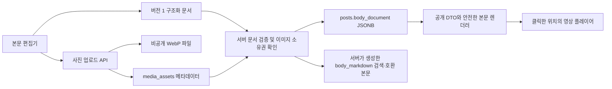

# Sliper 본문 편집기와 영상 첨부

2026-10-05 구현 기준. 글쓰기에서 커서 위치에 사진·영상·링크를 넣고 다시 글을 이어 쓸 수 있도록 Tiptap 편집기를 사용한다. 이야기뿐 아니라 기존 모집·투표·후기 양식의 본문에도 같은 편집기를 연결한다.

## 사용자 흐름

1. 본문을 작성하고 사진이나 영상을 넣을 위치에 커서를 둔다.
2. 사진 버튼으로 파일을 선택하거나 이미지를 붙여 넣는다. 여러 장도 선택할 수 있다.
3. 영상 버튼으로 HTTPS 영상 주소를 입력한다. 링크 버튼은 선택한 텍스트 또는 새 링크에 주소를 연결한다.
4. 사진·영상 아래에 글을 이어 쓰고 미리보기로 순서를 확인한 뒤 등록한다.

굵게·기울임·밑줄·취소선·인라인 코드, 제목, 목록, 인용, 실행 취소/다시 실행을 지원한다. 시스템 파일 선택창과 링크 입력창을 열기 전 선택 위치를 보관해 삽입 위치를 유지한다. 외부 이미지 주소를 그대로 저장하는 방식은 제공하지 않는다.

## 저장과 요청 경계



편집기 코드는 글쓰기 창을 열 때만 불러오며 일반 목록 조회에 필요한 초기 스크립트에서 분리한다.

새 본문은 임의 HTML이 아니라 `version: 1`, `type: doc` 형태의 JSON이다. `src/domain/post-document.ts`에서 노드 종류·부모와 자식 관계·속성·URL·길이·중첩 깊이를 검사한다. 최대 30,000자, 500개 노드, 8단계 중첩이며 사진과 영상은 각각 10개까지다. 구조화 문서를 바탕으로 서버가 검색·기존 호환용 Markdown을 다시 생성하므로 클라이언트가 보낸 검색 본문을 그대로 신뢰하지 않는다.

글 등록/수정 REST 요청만 JSON 본문 한도를 350,000바이트로 조정하고 나머지 API의 기존 한도는 유지한다. Server Actions와 REST 모두 기존 커뮤니티 서비스와 트랜잭션·수정 버전 검사·소유권 검사를 사용한다.

사진은 파일당 10MiB 이하다. 서버에서 실제 이미지를 디코딩하고 WebP로 변환하여 메타데이터를 제거한다. 이미지 파일은 `.local/uploads`에, 소유권과 글 연결은 PostgreSQL의 `media_assets`에 저장한다. 본문에는 파일 경로나 외부 주소 대신 이미지 자산 ID만 저장하고 `/api/media/{id}`가 기존 게시 상태와 접근 권한을 확인한다. 편집기에서 사진을 삭제하면 등록할 첨부 ID 목록에서도 제외한다.

## 영상과 링크

YouTube 일반·공유·Shorts·라이브 링크는 정규화한 `youtube-nocookie.com` 플레이어를 사용한다. Vimeo는 공식 플레이어를 사용하고 비공개 공유 해시를 보존한다. HTTPS MP4·WebM·OGG 주소는 브라우저 기본 플레이어를 사용한다. 다른 안전한 HTTPS 영상 주소는 원본 링크 카드로 표시한다. 모든 플랫폼을 임의 iframe으로 삽입하지 않는다.

상세 화면을 열 때 영상 제공 사이트의 iframe·영상 파일·썸네일을 자동 요청하지 않는다. 이용자가 재생 버튼을 누르면 플레이어가 로드되며 원본 링크도 제공한다. 자동재생은 지정하지 않는다. 영상 소유자의 임베드 차단·로그인 요구나 브라우저 코덱 지원에 따라 재생 여부가 달라질 수 있다.

서버는 링크 미리보기나 영상을 가져오지 않는다. HTTP(S) 텍스트 링크만 허용하고, 영상은 HTTPS만 허용한다. 스크립트 URL·자격증명 포함 URL·로컬/사설 네트워크 주소·추가 HTML/이벤트 속성을 거절한다. iframe 주소는 허용한 공급자의 코드로만 만든다.

## 기존 글 호환

`body_document`가 없는 글은 기존 Markdown과 첨부 사진을 그대로 표시한다. 일반적인 기존 Markdown은 편집기를 열 때 변환한다. 지원하지 않는 표·코드 블록 등은 원문을 유지하는 기존 내용 블록으로 제공해 변환으로 내용이 사라지지 않도록 한다. 이 블록의 앞뒤로 새 사진·영상을 넣을 수 있고 기존 원문도 수정할 수 있다. 댓글과 룰북 등 다른 Markdown 입력 흐름은 유지한다.

이미 구조화 문서가 있는 글을 예전 클라이언트가 `bodyDocument` 없이 수정하면 서버는 거절한다. 명시적인 `null` 전환은 호환 API에서 지원한다. 기존 문서는 업그레이드 작업 없이 읽을 수 있다. 글을 삭제하면 기존 DB 삭제 트리거가 JSON 본문도 함께 비우며, 사진 접근은 기존 공개 상태 검사로 차단된다.

## 검증

```powershell
npm run check
npm run test:rich-post-api
npm run build
```

도메인 및 임시 PostgreSQL 검사로 문서 정규화·URL 제한·이미지 소유권·문서 수정·기존 글 호환을 확인한다. React 서버 렌더링 검사는 텍스트/사진/영상 순서와 외부 자동 로드 방지, 이미지 중복 방지, HTML 이스케이프를 확인한다. 실제 HTTP 검사는 격리된 로컬 DB에 테스트 이미지와 글만 생성하여 저장·수정 충돌·권한·삭제 후 이미지 차단을 확인하고 테스트 데이터를 정리한다. 브라우저 실제 클릭·모바일 시각 검증 및 외부 영상 재생은 별도 확인이 필요하다.

2026-10-05 검증 결과: 전체 회귀 테스트 412개, 실제 로컬 HTTP 본문 CRUD 검사 1개, 포맷·TypeScript·Drizzle 검사와 Next.js 운영 빌드 통과. 마이그레이션 32·33을 로컬 DB에 적용했고 재시작 후 홈·이야기 페이지의 HTTP 200 응답을 확인했다.

참고: [Tiptap Next.js](https://tiptap.dev/docs/editor/getting-started/install/nextjs), [Markdown 변환](https://tiptap.dev/docs/editor/markdown/getting-started/basic-usage), [Vimeo Player](https://developer.vimeo.com/player/sdk/basics).
