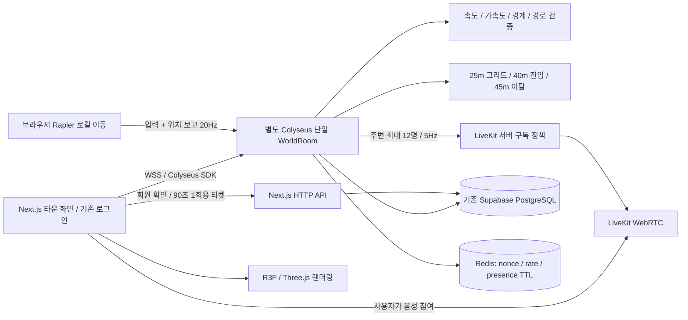

# 슬리퍼 타운 설계·구현과 검증

작성일: 2026-11-02. 기존 `SLIPER_TOWN_REQUIREMENTS.md`와 사용자가 추가한 소셜 오픈월드 명세를 함께 적용한다. 현재 문서는 구현 범위와 시험 근거를 구분한다. 운영 반영 결과는 마지막 항목에서 갱신한다.

## 확정 정책과 기존 서비스 통합

- 로그인 회원만 입장하는 호스트 없는 공용 광장 하나. 기본 공개 정원은 **8명 베타**다. 100~150명은 성능·장시간 검증을 위한 목표이며 지원 보장이 아니다.
- `/games`의 타운 카드 → `/games/town`. 게임 라운지에서 기존 게임을 선택하고 호스트가 방을 만들거나 받은 링크·코드로 입장한다. 게임방의 로그인·게스트·정원·준비·역할·SSE 정책은 기존 서비스를 따른다.
- 게임으로 이동하면 광장 자리를 비운다. 타운으로 돌아오는 링크를 제공하며 다시 만석이면 입장을 재시도한다. 재접속 손실은 30초 동안 아바타를 유지한다. 같은 계정의 중복 탭은 마지막 연결을 사용한다.
- 닉네임은 기존 프로필을 사용한다. 계정 UUID·전화·이메일·기존 게임의 역할/정답은 다른 이용자에게 보내지 않는다. 공개 패킷에는 월드 내 임시 아바타 ID만 사용한다.
- 광장 전체 / 근처 15m 텍스트 채팅. 근처 채팅은 **전송 시점의 수신 대상**에만 이력을 제공한다. 나중에 걸어왔다고 이전 근처 대화를 열람할 수 없다.
- 최근 30분·최대 100개 대화는 프로세스 메모리에서만 제공한다. 서버 재시작 시 지워진다. 신고를 접수하면 해당 대화의 서버 원본·시각·닉네임을 기존 신고의 상세 근거에 보관한다. 기존 신고 보존 정책을 따른다.
- 차단은 양방향 가시성·채팅·음성 대상에서 제외한다. 운영 제한/탈퇴도 재검사한다. 회원 제한·차단은 입장/갱신과 최대 15초 주기 재검사에 반영하며 즉시 차단 요청에서는 재검사를 호출한다.

## 책임과 실제 기술 구성



- 현재 서비스의 npm/Next.js/Drizzle/네이티브 배포를 유지하며 모듈을 분리했다. 첨부의 신규 `users`, 로그인 API, 별도 PostgreSQL을 중복 생성하지 않았다. 기존 Auth·프로필·차단·신고 테이블을 재사용한다.
- 기존 저장소 전체를 pnpm/Turborepo 모노레포로 이전하지 않았다. 이는 작동 중인 커뮤니티를 옮기는 별도 작업이며, 웹/게임 프로세스 분리는 현재 저장소에서도 보장한다. Docker 실행 구성도 별도로 제공한다.
- 브라우저는 R3F Canvas와 Rapier kinematic character controller를 사용한다. 평면 월드에서 로컬 이동·충돌을 즉시 계산하고 입력과 시뮬레이션 좌표를 보고한다. 현재 아바타는 걷기·정지·손 흔들기·앉기를 지원한다. 점프/복잡한 높이 지형은 범위에 포함하지 않는다.
- 서버는 모든 물리를 다시 실행하지 않는다. 서버 시간으로 이동 예산·가속도·단조 sequence·입력 방향·월드 경계·정적 장애물의 **이동 경로**를 검사하고 잘못된 보고는 마지막 정상 위치로 보정한다.
- 논리 월드는 500m × 500m다. 중앙 약 30m 광장에 조형물·나무·게임 라운지·게시판·벤치를 배치했다. 확장 공간은 기본 잔디 지형이다.
- Colyseus Schema에는 월드 식별자/인원 같은 메타데이터만 둔다. 전체 플레이어 좌표를 공용 MapSchema에 넣지 않는다. 서버의 AOI 결과에 따라 `player:joined`, `player:left`, `player:snapshots`를 개별 전송한다.
- 반복 전송은 임시 숫자 인덱스와 1cm/0.01rad 단위의 좌표 배열로 줄인다. 움직임 없는 아바타는 반복 패치를 생략한다. 전체 상태는 최초·채팅 변경·10초 재동기화에 사용한다. 느린 소켓의 대기열은 제한한다.
- 모바일은 DPR 최대 1.5·약 30fps의 요청 기반 렌더링, PC는 약 60fps 요청을 사용한다. 이는 프레임 요청 설정이며 실제 기기 FPS 보장이 아니다. 배경 탭에서는 그림 갱신을 멈춘다. 이동은 PC 방향키/WASD·터치 패드와 키보드 접근 가능한 버튼을 제공한다.
- GPU 사용이 어렵다면 2D 광장으로 전환할 수 있다. AOI에서 떠난 아바타의 GPU geometry·label texture를 즉시 해제한다.

## 주요 코드

| 역할 | 파일 |
| --- | --- |
| 좌표/장애물/메시지 계약 | `src/domain/town.ts` |
| R3F·광장·아바타 | `src/components/town-r3f.tsx`, `town-scene.ts` |
| Rapier 로컬 이동 | `src/components/town-motion.ts` |
| 화면·채팅·모바일·게임 연결 | `src/components/town-client.tsx`, `town.module.css` |
| Colyseus 단일 월드 / 접근 게이트 | `src/server/town-gateway.ts` |
| 회원 / 위치 / 좌석 / 채팅 | `src/server/town-world.ts`, `town-members.ts` |
| 이동 검증 / 공간 인덱스 | `src/server/town-movement.ts`, `town-spatial.ts` |
| 일회용 티켓 / Redis TTL | `src/server/town-ticket.ts`, `town-cache.ts` |
| 음성 서버 정책 / 공간 음향 | `src/server/town-voice.ts`, `src/components/town-voice.tsx` |
| 별도 서버 진입점 | `scripts/town-server.ts` |
| 입장 / 음성 API | `/api/v1/world/ticket`, `/api/v1/voice/token` |
| 기존 운영 신고 연결 | `/api/town/safety` |
| 공개 최소 health | `/api/town/health` |

위치·채팅·미디어를 새 DB에 매 프레임 저장하지 않는다. **DB 구조 변경은 없다.** 기존 아바타 꾸미기/인벤토리는 이번 광장의 기능으로 주장하지 않는다. 마지막 접속 위치의 영속 저장도 도입하지 않고 재시작 시 광장 입구에서 시작한다.

## 인증과 운영 보안

1. 기존 `currentActor()`가 Supabase 세션과 회원 제한을 확인하고 서명 티켓을 발급한다. 티켓은 세계 ID·계정 ID·nonce·만료를 포함하지만 URL/로그/다른 참가자 상태에는 넣지 않는다. 클라이언트 메모리에서만 사용한다.
2. Colyseus 진입에서 서명·90초 만료·nonce 재사용·회원 상태를 다시 확인한다. 45초마다 새로운 티켓으로 연결 인증을 갱신한다. 로그아웃하면 광장도 종료한다.
3. 새 방 생성/목록/다른 matchmake 동작은 HTTP 진입 게이트에서 막는다. 지정된 단일 방에 대한 `joinById`만 허용한다. WSS/HTTP Origin을 검증한다. 운영 프록시는 내부 API를 공개하지 않는다.
4. 내부 증거/회원 갱신/세션/metrics API는 loopback에서 HMAC+10초 시간 창을 검증한다. 일반 웹 사용자는 현재 회원·자신이 볼 수 있는 대상에 대해서만 신고/차단을 요청한다.
5. 채팅은 기존 텍스트 정책, 사용자별 1.5초 간격, Redis 연결 시 분당 20회 제한을 적용한다. 입장 티켓/신고는 기존 PostgreSQL 원자적 요청 제한도 적용한다.
6. 타운 전용 `TOWN_REDIS_URL`이 있으면 이를 우선 사용해 기존 공지방의 `REDIS_URL`·Supabase Realtime 선택을 바꾸지 않는다. Redis가 설정되면 nonce는 NX+TTL, 채팅 제한은 원자적 카운터, 임시 아바타 presence는 60초 TTL로 저장한다. 좌표/AOI는 Colyseus 메모리에 둔다. 개발 중 Redis를 설정하지 않은 단일 서버에서도 메모리 nonce·채팅 간격 검증은 유지한다.

## 음성: 연결 준비 완료, 현재 비활성

사용자가 LiveKit 서버가 아직 없다고 답해 **서버 생성·유료 가입·UDP 공개 없이** 연결 코드를 준비했다. 화면은 ‘근접 음성 · 연결 준비 중’을 표시하며 마이크 권한을 자동으로 요청하지 않는다.

- 연결 15m / 해제 18m, 가장 가까운 최대 12명, 200ms 주기로 서버가 계산한다. AOI와 별개이며 차단 대상은 제외한다.
- 음성 토큰은 월드 입장 중인 회원에게만 발급한다. 계정 ID 대신 아바타 임시 ID를 사용한다. 마이크 발행만 허용하고 카메라/데이터/직접 구독/방 관리 권한을 주지 않는다.
- 서버가 LiveKit RoomService로 이전 구독을 먼저 회수하고 새 대상만 추가한다. 변경된 트랙도 검사하고 더 이상 월드에 없는 연결은 제거한다. API 실패 시 기존 구독자 제거를 시도하고 오류를 안내한다.
- 브라우저의 `autoSubscribe:false`는 편의 설정일 뿐 접근 제어가 아니다. 토큰의 `canSubscribe:false`와 서버 RoomService 제어를 함께 사용한다. **일부 LiveKit 버전에서는 canSubscribe=false 참가자에게 관리자 구독 추가가 동작하지 않은 공식 이슈가 있으므로, 실제 SFU 검증 전에는 활성화하지 않는다.** 설정의 `TOWN_VOICE_SERVER_SUBSCRIPTIONS_VERIFIED=true`는 그 검증 후에만 켠다. 제약이 있는 서버에서 canSubscribe를 true로 완화하면 안 된다.
- 사용자가 ‘음성 참여’를 눌렀을 때 AudioContext를 시작하고 마이크 권한을 요청한다. Web Audio PannerNode로 상대 위치·방향·거리 감쇠를 적용한다. 기본 자동 음성 참여는 없다.

필요 설정은 `town.env.example`에 키 이름만 준비했다. 공개 WSS 주소/Key/Secret 저장, SFU의 직접 구독 거부 시험, 13명 이상·거리 이동·차단·새 트랙·이탈·API 장애 시험과 Android/iPhone 실제 오디오 시험이 활성화 조건이다.

참고 공식 자료: [R3F Canvas](https://r3f.docs.pmnd.rs/api/canvas), [Rapier Character Controller](https://rapier.rs/docs/user_guides/javascript/character_controller/), [Colyseus](https://docs.colyseus.io/), [LiveKit 구독 API](https://docs.livekit.io/reference/other/roomservice-api/), [LiveKit 구독 제약 이슈](https://github.com/livekit/livekit/issues/4651).

## 실행과 배포

로컬 `.env`에 `town.env.example`의 TOWN 설정을 추가하고 같은 APP_ORIGIN의 기존 로그인·DB를 사용한다.

```sh
npm run town:server
npm run dev
```

로컬 게임 서버는 기본 loopback 13003을 사용한다. 개발 기본 127.0.0.1 웹에서 접속한다. 모바일 LAN 시험에는 HTTPS와 같은 Origin 프록시를 구성한다. 운영은 기존 sliper.kr의 `/town-ws`로 라우팅하므로 외부 13003 포트를 열지 않는다.

- 네이티브: `deploy/native/sliper-town.service`, `sliper-town.nginx.conf`. `/etc/sliper/town.env`의 새 서명 키를 웹과 타운에 같은 파일로 주입한다. 기존 비밀 파일을 복제하지 않는다. 기존 웹만 새 UI로 교체하며 영상/알림 워커·다른 사이트를 재시작하지 않는다.
- 타운 프로세스: 최대 512MB / CPU 0.75 core / 비정상 종료 자동 재시작. 현재 서버에서는 8명 제한을 유지한다. 재시작 시 이용자에게 재연결 안내와 최신 월드 상태를 제공한다.
- Docker: `Dockerfile.town`, `compose.town.yaml`. 외부 노출은 loopback 매핑만 제공한다. Docker를 기존 운영 서버에 자동 설치하지 않는다.
- `/api/town/health`는 별도 BetterStack 모니터에 추가할 수 있다. 상세 인원·tick 지표는 HMAC 내부 metrics API에서만 제공한다. Prometheus/Grafana/Sentry의 별도 설치·외부 계정 연결은 수행하지 않았다.
- 릴리스 보존 시 **타운 프로세스의 실제 cwd도 보호 대상**에 추가한다. 새 서비스를 current 링크만 보고 정리하면 안 된다.

## 검증과 완료 구분

- `tests/town.test.ts`: 티켓 변조/만료, 재접속, 정원, 순서 위조, 이동 예산/경로, 공간 인덱스, 차단/채팅/증거, 근처 대화 수신자, 채팅 정책, 좌석 경합, 음성 12명·거리·토큰·서버 회수 순서.
- `tests/town-network.test.ts`: 실제 Colyseus SDK 2인 연결, 금지된 방 생성, 잘못된/재사용 티켓, 만석, 이동, 채팅, 내부 증거 인증, 차단, 재접속, 회원 권한 취소.
- `scripts/test-town-browser.mjs`: 격리된 Chrome 두 세션, 실제 WebGL/R3F/Rapier/Colyseus. PC·모바일 뷰와 320/393/720/1440px 가로 넘침/입력창을 검사한다. 운영 DB에는 시험 회원/방을 생성하지 않는다.
- `scripts/test-town-load.mjs`: 실제 SDK 봇 20/50/100/150명. `TOWN_LOAD_CLIENTS`, `TOWN_LOAD_SCENARIO=dense|spread`, `TOWN_LOAD_SECONDS`로 조건을 바꾼다. **로컬 서버와 봇이 같은 프로세스인 네트워크 시험**이며 WebRTC·실기기 GPU 부하를 재현하지 않는다.
- 2시간 이상 soak, 실제 Android/iPhone 발열/FPS, Ncloud 별도 게임 서버 100/150명 자원·네트워크, LiveKit 실음성 검증은 완료되지 않았다. 전체 오픈월드 명세의 정식 출시 합격으로 간주하지 않는다.

### 운영 반영 결과

**운영 반영 완료: `20261102-sliper-town-05`**, 공개 주소 [슬리퍼 타운](https://sliper.kr/games/town). 이전 서비스는 롤백용으로 보존한다.

- 전체 검사 1,191개 통과. 이후 캐시 복구 health 조건을 추가한 타운 규칙/네트워크 14개도 통과했다. PC·모바일 WebGL/Rapier/Colyseus 브라우저는 짧은 터치 입력까지 9개 통과했다.
- 100명 밀집 15초 시험: 연결 100명 유지, 단절 0, 추정 JSON 56,861,892B. 초기 전체 상태 전송 방식의 400,317,819B 대비 약 86% 줄었다. 전송량은 디코딩한 JSON의 추정치이며 실제 WSS 압축/프레이밍 비용과 다르다.
- 150명 분산 20초 시험: 연결 150명 유지, 단절 0이지만 event-loop p95 약 115ms와 많은 이동 보정이 발생했다. 봇과 서버가 같은 프로세스이므로 결과를 운영 서버 성능으로 환산하지 않는다. 150명 정식 지원 판정은 보류하며 8명 베타를 유지한다.
- 운영 Redis가 없어서 공식 [Redis 8.2.11 소스와 해시](https://github.com/redis/redis-hashes)를 검증해 타운 전용 실행 파일을 준비했다. 기존 패키지/Redis 서비스/방화벽은 수정하지 않았다.
- 전용 Redis: loopback 16379, 메모리 64MB, 프로세스 제한 128MB/CPU 25%, 비밀번호와 `sliper:town:*` ACL, RDB/AOF 저장 없음. 키 값은 서버 안에서만 생성하고 Git/로그/브라우저에 넣지 않는다. 서비스는 `sliper-town-redis.service`다.
- 캐시 장애 중에는 offline 명령을 누적하지 않고 거부한다. 재연결은 짧은 backoff로 자동 재시도하고 타운 health가 503을 반영한다. 게임 서버의 월드/좌표는 캐시에 저장하지 않는다.
- 중간 후보 01/02/04는 공개 활성화하지 않았다. 03은 로컬 패키지만 만들었고 서버에서 실행하지 않았다. 기존 릴리스·업로드·DB 파일은 삭제하지 않는다.


최종 확인:

- 실제 Linux 빌드/TypeScript/서버 trace 134개 통과. standalone 5,006개 파일, 비밀 파일·예상하지 않은 링크 없음.
- 최종 미리보기와 공개 빌드의 타운 UI 각 9개 통과. 기존 여섯 게임 종류의 설정 PC/모바일 30개도 통과했다. 브라우저 시험은 별도 회원/게임 서버로 격리해 운영 DB에 시험 사용자·게임방을 만들지 않았다.
- 실제 운영 Redis에서 nonce 재사용 거부·분당 채팅 제한·presence TTL 동작과 Supabase 회원 조회 권한을 검증했다. 전용 Redis 중단/재시작 후 자동 재연결과 새 명령 성공도 확인했다.
- 실제 공개 WSS 경로로 잘못된 티켓을 보냈을 때 월드 인증 단계에서 거부된다. `/town-ws/internal/*`는 Nginx에서 404, 익명 티켓 요청은 401이다. 최종 프록시 설정은 원본 빌드 템플릿에 내부 경로 차단을 추가한 운영 설정으로 별도 SHA-256 검증했다.
- 웹·타운·Redis 정상, `/ops/health`, `/api/health`, `/api/town/health`, 기존 별도 사이트 모두 200. 알림/영상 워커 PID는 각각 3452422/3452423으로 유지했다. 기존 커뮤니티 Realtime 설정은 바꾸지 않았다.
- 디스크 사용률 68.4%, 남은 공간 약 12.97GiB. 새 중간 후보 02/04의 재생 가능한 컴파일 캐시만 제외했고 기존 릴리스·업로드·DB는 삭제하지 않았다.
- LiveKit 실제 연결, 2시간 soak, Android/iPhone 실기기 FPS·발열·마이크와 100~150명 운영 수용량 승인은 아직 남아 있다. 현재 공개 범위는 **회원 8명 타운 베타**다.
