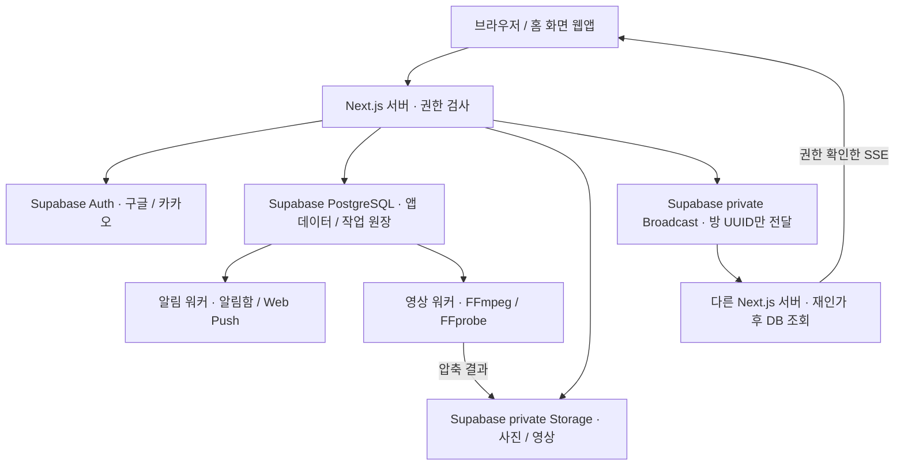

# Supabase 통합과 운영 배포 가이드

> **2026-10-26 후속:** HTTPS Compose·Node 24 Linux 이미지·진행 기반 워커 상태 점검·원격 백업 사전 검사를 보완했다. 아래에는 당시 검증 기록이 포함된다. 최신 명령과 검증 범위는 [Ncloud 실행 구성 준비](NCLOUD_RUNTIME_PREPARATION_2026-10-26.md)를 참고한다.

기준: 2026-10-16 · 프로젝트: `C:\Sliper`

현재 실행 사이트는 Supabase PostgreSQL·Auth·private Storage·Realtime을 사용한다. 기존 로컬 DB와 업로드는 보존했지만 활성 사이트의 저장소로 사용하지 않는다. 공개 호스팅·도메인은 아직 준비하지 않았으며, 현재 PC를 끄면 웹과 워커는 종료된다.

## 데이터와 처리 위치



| 항목                                                            | 저장·실행 위치                                                        |
| --------------------------------------------------------------- | --------------------------------------------------------------------- |
| 글·댓글·모집·신청·결제 확인·공지 메시지·읽음·알림함·회원 프로필 | Supabase PostgreSQL, 기존 Drizzle와 서버 권한 검사 유지               |
| 로그인·회원 계정·세션                                           | Supabase Auth, 기존 카카오·Google 연동 유지                           |
| 프로필 사진·본문 사진·영상 원본·압축 결과                       | Supabase의 기존 private 버킷, 파일 메타데이터는 DB                    |
| 공지방 즉시 갱신                                                | 서버만 구독하는 Supabase private Broadcast → 권한 검사한 SSE          |
| 영상 압축                                                       | 별도 Node 워커, 처리 중 임시 파일만 `/tmp`, 완료·실패 후 정리         |
| 알림 생성·발송 대기열                                           | PostgreSQL에 보관, 별도 알림 워커가 처리                              |
| 휴대폰 푸시                                                     | Web Push / VAPID. Realtime과 별개이며 HTTPS·VAPID·기기 권한 필요      |
| Redis                                                           | 활성 사이트에서 사용하지 않음. 격리 개발용 코드와 compose.yaml만 보존 |

브라우저 localStorage에는 보기 설정·유도 배너 닫기 같은 UI 설정만 남는다. 사용자 콘텐츠 원본 저장소가 아니다. 네이버 지도는 기존 외부 지도 서비스를 사용한다. 결제는 외부 플랫폼 선정·검증 전까지 연동 완료로 보지 않는다.

## 클라우드 전용 설정과 실시간 권한

활성 `.env`에 `SLIPER_CLOUD_ONLY=true`, `LOCAL_DATABASE=0`, `SLIPER_AUTH_MODE=supabase`, `MEDIA_STORAGE_BACKEND=supabase`, `ROOM_REALTIME_PROVIDER=supabase`, `PUSH_WORKER_MODE=external`을 적용했다. `REDIS_URL`은 비웠다. 이전 환경은 Git에서 제외된 `.local/before-cloud-only-*.env`에 보존했다. 이 백업과 `.env.supabase.local`은 비밀 파일이므로 배포 이미지·저장소에 넣지 않는다.

클라우드 전용 모드는 로컬 DB·소유자 DB 역할·TLS 없는 연결·로컬 파일 저장·로컬 테스트 계정을 거부한다. Storage와 Auth 프로젝트가 다르면 저장 설정도 거부한다. 현재 원격 DB에서 로컬 방식의 본문 이미지·프로필 사진·영상·미정리 영상 원본은 모두 0개여서 파일 이전 작업은 필요하지 않았다. 과거 개발 DB의 데모 데이터·회원은 자동 복사하지 않았다.

Realtime은 `NEXT_PUBLIC_SUPABASE_URL`과 서버 비밀키를 사용한다. 선택형 `SUPABASE_REALTIME_SECRET_KEY` → `SUPABASE_SERVER_SECRET_KEY` → 기존 `SUPABASE_STORAGE_SECRET_KEY` 순서로 비어 있지 않은 키를 선택한다. 같은 프로젝트의 기존 Storage 서버 키가 이미 설정되어 있어 새 키 입력 없이 동작한다. 키는 브라우저에 전달하지 않는다.

공지 저장 트랜잭션이 커밋된 뒤 방 UUID만 전송한다. 메시지 본문·회원·연락처를 Broadcast에 넣지 않는다. 브라우저가 Broadcast를 직접 구독하지 않으며 기존 `/api/participation/rooms/{id}/stream`에서 참가 권한을 검사한다. 신호를 받을 때마다 DB와 권한을 다시 조회한다. public/회원 전체 허용 RLS 정책·WAL publication·DB 트리거 추가는 필요하지 않다.

서버당 하나의 Supabase 클라이언트를 사용하고 같은 방의 SSE 구독은 공유한다. 마지막 구독을 해제하면 채널도 해제한다. 서버당 방 채널 한도를 넘으면 DB 재조회로 전환한다. 초기 연결과 발신 대기는 450ms로 제한한다. 정상 연결에서는 30초, 장애에서는 5초 간격으로 DB를 재확인하며 SSE는 약 55초마다 재연결한다. 신호 유실이 이미 저장한 공지를 실패로 바꾸지 않는다. 운영에서 동시 접속·요금제 채널 한도·DB 연결 수·SSE 유지 수를 실제 측정해야 한다.

## 지금 실행하고 확인하기

```powershell
npm run dev
# 별도 터미널 또는 배포 서비스별 실행
npm run video:worker
npm run push:worker
# 읽기 전용 DB 잔존 파일 개수와 private 버킷 확인
npm run cloud:check
# 임시 파일 하나를 업로드·읽기·삭제하고 실시간 서버 간 수신/비회원 차단 검사
npm run cloud:check -- --verify-storage --verify-realtime
npm run check
```

검증 스크립트는 비밀값·회원 내용·개인 식별자를 출력하지 않는다. Storage 검사에는 임시 오브젝트 한 개를 사용하고 finally에서 제거한다. Realtime 검사는 실제 행사 대신 임의 UUID를 쓰며 행사·회원·메시지 DB 행을 만들지 않는다. `deploy:check`와 관리자 준비 화면은 설정 형식 검사이고 `cloud:check`는 실제 연결 검사다. 어느 것도 운영 백업 복원·휴대폰 수신·부하 검증을 대신하지 않는다.

## 배포 준비물과 설정 순서

Supabase는 DB·Auth·Storage·Realtime을 제공하지만 이 프로젝트의 Next.js 서버와 FFmpeg 프로세스를 대신 실행하지 않는다. HTTPS 웹 서비스 1개와 상시 실행 백그라운드 워커 2개를 지원하는 컨테이너 호스팅이 필요하다. 서비스를 선택하면 `Dockerfile.web`, `Dockerfile.notification-worker`, `Dockerfile.video-worker`를 각각 지정한다. 같은 Linux 서버에서 실행할 경우 `compose.production.yaml`을 사용할 수 있다.

1. 저장소의 `production.env.example`을 참고해 배포 서비스의 비밀 환경변수에 값을 등록한다. 서버 실행용 `DATABASE_URL`과 서버 Storage 키는 기존 활성 `.env`의 값을 사용한다. 마이그레이션 소유자 연결은 웹·워커에 넣지 않는다.
2. `APP_ORIGIN`을 실제 공개 HTTPS 원본 주소로 바꾼다. 웹 서비스는 컨테이너의 3000 포트에 연결한다. Compose는 127.0.0.1:3000으로만 열기 때문에 HTTPS 역방향 프록시를 별도로 연결한다.
3. Supabase Auth의 Site URL·Redirect URLs에 새 HTTPS 주소와 `/auth/callback`을 등록한다. 카카오·구글의 Supabase 콜백 주소는 유지하고 필요한 사이트 원본만 공급자 콘솔에 추가한다.
4. 세 프로세스가 같은 Supabase DB·버킷을 사용하게 한다. 워커는 네이티브 바이너리 실행이 가능한 Linux Node 환경에서 운영한다. Supabase Edge Functions에 FFmpeg를 올리는 구성은 사용하지 않는다.
5. Web Push를 운영한다면 VAPID 키와 연락 URI를 비밀 환경변수로 등록한다. 기존 구독이 있는 키는 교체하지 않는다. 현재 Supabase 모드에는 VAPID가 미설정이므로 알림함 처리는 동작하지만 휴대폰 발송은 별도 설정이 필요하다.
6. NAVER Maps 허용 도메인, AdSense 사이트 심사·광고 단위·실제 결제 공급자를 각각 마무리한다. 준비되지 않은 연동은 비활성화한다.

공개 값: `NEXT_PUBLIC_SUPABASE_URL`, `NEXT_PUBLIC_SUPABASE_PUBLISHABLE_KEY`, 지도 Key ID. 서버 비밀: `DATABASE_URL`, `SUPABASE_STORAGE_SECRET_KEY`, 선택형 Realtime 키, `VISITOR_HASH_SECRET`, `VAPID_PRIVATE_KEY`, 결제 서명 키. `production.env.example`에는 실제 비밀값이 없다. `.env.production`과 다른 `.env.*`는 Git·Docker 전송 대상에서 계속 제외한다.

컨테이너 웹 빌드에는 공개 식별자만 전달한다. Next standalone 산출물과 public·정적 자산만 런타임 이미지에 복사하며 `.env`나 소유자 키를 빌드 인자로 전달하지 않는다. 운영 이미지는 비루트 사용자로 실행한다. 워커의 변환 임시 공간은 메모리 제한이 있는 tmpfs이며 사용자 파일의 영속 저장 볼륨은 없다. 현재 구조는 원본 업로드 요청을 웹 서버가 받으므로 영상 50MiB를 허용하는 프록시 크기·시간 제한을 설정해야 한다.

단일 서버 Compose 예시:

```powershell
# 새 파일일 때만 생성. 실제 값을 채운 파일은 커밋하지 않는다.
Copy-Item production.env.example .env.production
# 값과 HTTPS 프록시 설정을 준비한 뒤, 배포할 Linux Docker 호스트에서 실행
# Dockerfile 빌드 ARG는 공개 식별자뿐이다.
docker compose --env-file .env.production -f compose.production.yaml config --quiet
docker compose --env-file .env.production -f compose.production.yaml up -d --build
```

웹·알림·영상은 한 실행 DB 역할을 사용하며 연결 풀은 각각 5·2·2개다. 서버/워커를 늘리면 이 합계와 Supabase 연결 한도를 함께 계산한다. 현재 구현에는 Postgres 작업 선점과 임대·재시도가 있지만 트래픽 폭주를 실측 검증한 상태는 아니다.

## 실제 확인한 범위와 남은 운영 검증

- 실제 Supabase DB 연결, 회원 2명, 로컬 미디어 참조 0개 확인.
- private 버킷과 임시 파일 업로드 → 읽기 → 삭제 성공.
- 독립 서버 클라이언트 2개 사이 Broadcast 수신과 비회원 private 채널 구독 거부 확인.
- 개발 웹과 영상·알림 워커를 Supabase 전용 환경으로 재시작.
- 전체 검사 959/959, 비밀값·형식·타입·Drizzle 검사 통과. 별도 소스 사본의 webpack 운영 빌드와 서버 추적110개 검사 통과.
- standalone 파일2505개를 검사해 비밀 환경파일0개·영상 워커 바이너리0개를 확인. 사본용 node_modules junction만 제거한 뒤 검사했으며 실제 컨테이너 의존성은 npm ci로 설치한다.
- Docker 엔진이 현재 PC에서 실행되지 않아 실제 Linux 컨테이너 빌드·기동은 미검증. 구성 파일 검사와 Node 운영 빌드 검증을 구분한다.
- 공개 HTTPS 배포, Android/iOS 실기기 푸시, 실제 회원 2명 간 미디어·공지방 권한 회수, 운영 백업/복원·재시작 장애 복구·부하 측정은 후속 검증 대상.

공식 근거: [Supabase Broadcast](https://supabase.com/docs/guides/realtime/broadcast), [Realtime 권한](https://supabase.com/docs/guides/realtime/authorization), [서버 API 키](https://supabase.com/docs/guides/getting-started/api-keys), [Postgres 연결](https://supabase.com/docs/guides/database/connecting-to-postgres).
