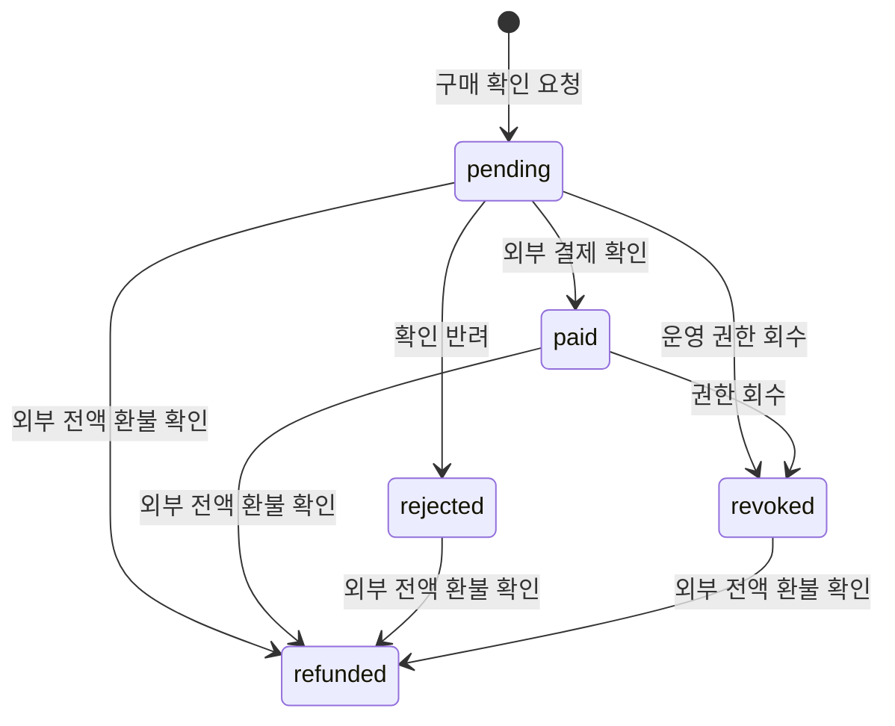

# 템플릿 시장: 구매 기록·이용 조건·운영 사례

기준일: **2026-10-08** · 프로젝트: **C:\Sliper**

커뮤니티 성숙화 5단계다. 통합 아카이브의 룰북과 템플릿에 구매 당시 버전·금액·이용 조건을 보존하고, 외부 플랫폼의 결제 확인부터 이용 승인·분쟁·환불 확인까지 연결한다. 자료 상세에는 사용 버전별 실제 완료 행사와 참가 인증 후기 집계를 제공한다.

현재 로컬 PostgreSQL과 Next 화면·API 검증을 완료했다. **실제 결제 업체는 연결 전**이며 Sliper에서 돈을 결제하거나 환불·정산하지 않는다. 기존 행사 참가비 결제와 자료 구매 결제는 별도 흐름이다.

외부 업체가 준비되기 전에는 로컬 개발 환경에서 **테스트 구매하고 열람하기**로 가이드를 즉시 열 수 있다. 실제 금액 청구 없이 별도 테스트 내역을 저장하며 외부 사이트 이동과 구매 번호 입력이 없다. [구매 화면·로컬 테스트 조건·검증](LIBRARY_TEST_PURCHASE.md)을 참고한다.

## 이용 흐름

1. `/archive`에서 자료를 찾고 가격·이용 조건·파생 허용·상업적 이용 여부를 확인한다.
2. 자료 상세의 외부 구매 링크에서 구매한 후, 외부 구매 번호와 선택적 메모를 제출한다. 현재 발행 버전의 조건 확인과 정보 전달 동의가 필요하다.
3. 서버가 자료 버전·금액·판매자를 확인해 구매 내역을 만든다. 클라이언트는 금액·회원·상태를 지정할 수 없다. 화면에 있는 버전이 오래되었으면 새 조건을 확인하도록 요청한다.
4. 판매자가 외부 결제 완료를 확인해 승인하거나, 연동 브리지의 서명된 결제 완료 알림이 도착하면 기존 자료 열람 권한을 활성화한다.
5. 구매자는 영수증·당시 이용 조건·처리 이력을 보고 자료 제공·이용 조건·결제/환불 문제를 접수한다. 판매자는 답변하고, 거래 당사자가 아닌 운영자가 처리한다.
6. 전액 환불 완료가 확인되면 권한을 회수한다. 기존 개설 행사의 진행 사본과 행사 기록은 보존한다. 다음 행사 개설은 현재 자료 권한과 이용 조건을 다시 검사한다.

| 화면                               | 경로                                           |
| ---------------------------------- | ---------------------------------------------- |
| 내 구매                            | `/archive/purchases`                           |
| 판매 관리                          | `/archive/purchases?scope=selling`             |
| 운영자 분쟁 목록                   | `/archive/purchases?scope=disputes`            |
| 구매 상세·당시 조건·문의·처리 이력 | `/archive/purchases/{purchaseId}`              |
| 운영 사례·버전 선택                | `/archive/{entryId}`의 ‘출석 확인된 운영 사례’ |

목록은 20개 단위다. 파란색·흰색·회색과 Pretendard를 유지하며 모바일에서는 구매 카드와 세로 폼으로 배치한다. 구매 상세는 최신 상태 새로고침을 제공한다. 이 기능은 별도의 자동 푸시 발송을 추가하지 않는다.

## 구매 당시 정보와 권한

구매 한 건은 자료의 정확한 발행 버전에 연결한다. 제목·버전 번호·가격·이용 조건·파생 허용·상업적 이용 여부·구매 URL을 스냅샷으로 보존한다. 자료를 나중에 수정해도 영수증의 당시 조건은 바뀌지 않는다. 구매 DTO와 스냅샷에는 시나리오 전문·진행 가이드·사진·영상이 없다.

열람 권한은 기존 자료 단위 `library_access_requests`를 호환용으로 유지한다. 새 구매 원장은 `library_purchases`이며, 상태 변경·권한 갱신·감사 이력을 같은 트랜잭션에 저장한다. 승인된 회원은 기존 정책에 따라 해당 자료의 공개된 유료 버전과 현재 발행본을 열람할 수 있다. 구매 당시 조건의 보존과 특정 버전만 열람하는 권한 정책은 구분한다.

자료의 현재 발행 상태·차단·운영 숨김·활성 회원 조건은 매번 확인한다. 거래 당사자는 숨겨진 자료의 구매 영수증을 볼 수 있지만 자료 본문·다운로드·행사 개설 권한이 복원되지는 않는다. 영수증은 구매자·판매자·운영자에게만 제공하고 비회원과 관계없는 회원은 접근할 수 없다. 회원 ID는 DTO에 포함하지 않는다. 공유 메타데이터는 일반 제목과 설명만 사용한다.

구매 상태:



종료된 주문은 다시 승인하지 않는다. 환불보다 결제 알림이 늦게 도착하면 종료 상태를 유지하고 처리 이력에 남긴다. 재구매는 새로운 외부 구매 번호로 별도 주문을 만든다. 예전 주문의 환불 알림이 새 주문의 권한을 회수하지 않도록 구매 번호를 비교한다.

자료당 동일 구매 번호의 재사용, 회원별 동시 진행 주문, 결제 플랫폼별 동일 결제 ID의 여러 주문 연결을 차단한다. 쓰기는 자료 → 구매 → 분쟁 순서로 행 잠금을 사용한다. 수동 결정과 분쟁 처리는 마이크로초까지 보존한 `expectedUpdatedAt`으로 오래된 화면의 덮어쓰기를 막는다.

## 분쟁 처리

구매자만 문의를 등록하거나 철회할 수 있고 주문당 진행 중 문의는 하나다. 판매자는 답변을 한 번 남기며 제출된 문의와 답변을 덮어쓰지 않는다. 운영자는 처리 사유와 함께 유지·권한 회수·외부 전액 환불 확인으로 처리한다. 운영자여도 자신의 구매 또는 판매 건은 직접 처리할 수 없다.

환불 확인은 외부 플랫폼에서 **전액 환불 완료를 확인했다는 명시적 체크**가 필요하다. 처리 메모는 최대 500자로 제한해 기존 권한 테이블과 일관되게 저장한다. 분쟁 해결과 권한 변경은 원자적으로 처리하며, 결제·승인·문의·답변·철회·처리 이력을 보관한다. 종료된 문의는 변경하지 않는다.

자료 구매에는 행사 참가비의 ‘한국 날짜 기준 5일 전부터 차감’ 정책을 자동 적용하지 않는다. 부분 환불·금액 대사·플랫폼별 환불 요청 API는 실제 업체 계약과 연동 단계에 남아 있다. 현재 확인 버튼은 송금·환불을 실행하는 버튼이 아니다.

## 확인 가능한 운영 사례

자료 상세에서 현재 회원 권한을 확인한 뒤 회원 공개 완료 기록만 탐색한다. 사용한 자료 ID, 개설 당시 버전 ID와 번호, 행사 완료 기록의 당시 스냅샷이 모두 일치해야 특정 버전의 사례로 집계한다. 이전 행사에 버전 근거가 없다면 ‘버전 기록 이전’으로 구분하고 최신 버전의 성공 사례로 추정하지 않는다. 상충하는 근거는 집계에서 제외한다.

각 사례는 당시 행사 제목·일정·장소·분야, 참가 인원과 QR/담당자 확인 인원, 참가 인증 후기 평균과 표본 수를 보여준다. 미참석·샘플·취소·미발행·숨김 행사는 제외한다. 실제 출석 후 환불된 참가자는 금전 처리와 별도로 실제 참가 지표에 남는다. 인증 후기의 숨김·차단 상태도 집계에 반영한다.

참가자 명단·회고 본문·미디어는 사례 API에 넣지 않는다. 등록 장소가 숨겨졌거나 차단된 경우 장소 정보를 가린다. 행사 기록 링크를 열 때는 해당 기록의 현재 권한을 다시 확인한다. 완료 사례나 후기 연결은 유료 자료 열람 권한을 부여하지 않는다. 출석 확인은 자료 품질 보증 또는 개별 제작진의 평점이 아니다.

## DB와 API

PostgreSQL을 원본으로 유지한다. Redis는 기존 공지방 갱신용으로만 사용하며 구매·분쟁·운영 사례는 Redis에 저장하지 않는다.

| 테이블                      | 역할                                                          |
| --------------------------- | ------------------------------------------------------------- |
| `library_purchases`         | 정확한 구매 버전·당시 조건·회원·외부 번호·금액·상태·결제 매핑 |
| `library_purchase_audit`    | 처리 담당자·동작·사유·시각의 변경 불가 이력                   |
| `library_webhook_receipts`  | 외부 이벤트 ID·정규화된 본문 해시·처리 결과                   |
| `library_purchase_disputes` | 구매자 문의·판매자 답변·운영자 처리·낙관적 버전               |
| `library_access_requests`   | 기존 자료 단위 열람 권한과 이전 수동 요청의 호환              |

0052는 테이블·RLS·인덱스·제약을, 0053은 당시 버전 스냅샷 및 거래 근거의 변경 방지·종료 상태 보호·분쟁 처리 관계·외부 직접 접근 차단을 추가한다. 서버 DB 역할의 인가 검사는 RLS와 별도로 수행한다. 현재 로컬 DB에 적용했다.

| 메서드     | 경로                                                             | 기능                                      |
| ---------- | ---------------------------------------------------------------- | ----------------------------------------- |
| POST       | `/api/library/{entryId}/purchase`                                | 정확한 발행 버전 구매 확인 요청           |
| GET / HEAD | `/api/library/{entryId}/evidence?page=1&version=1`               | 회원 전용 운영 사례                       |
| GET / HEAD | `/api/library-market?scope=buying&page=1`                        | 구매·판매·운영 분쟁 목록                  |
| GET / HEAD | `/api/library-market/{purchaseId}`                               | 권한별 구매 상세                          |
| POST       | `/api/library-market/{purchaseId}/decision`                      | 판매자 결제 확인·반려·회수·전액 환불 확인 |
| POST       | `/api/library-market/{purchaseId}/disputes`                      | 구매자 문의 접수                          |
| POST       | `/api/library-market/{purchaseId}/disputes/{disputeId}/response` | 판매자 답변                               |
| POST       | `/api/library-market/{purchaseId}/disputes/{disputeId}/resolve`  | 거래 당사자가 아닌 운영자 처리            |
| POST       | `/api/library-market/{purchaseId}/disputes/{disputeId}/withdraw` | 접수자 철회                               |
| POST       | `/api/payments/library-webhook`                                  | 전용 브리지의 서명 결제/환불 알림         |

API는 기존 `{ok,data}` 또는 `{ok:false,error}` 응답과 `Cache-Control: private, no-store`를 사용한다. 로그인 쓰기는 같은 출처를 확인한다. 목록·검색의 알 수 없는 조건과 중복 조건을 거부한다. 구매 상세는 최근 감사 이력 50개·문의 20개를 반환한다. 구매 요청과 문의 접수에는 기존 PostgreSQL 요청 제한을 적용한다.

### 이전 구매 호환

과거 수동 구매 요청과 승인을 보존한다. 구매 당시 발행 버전·이용 조건을 추정해 새 원장으로 옮기지 않는다. 자료 상세의 ‘이전 구매 확인’에서 이전 요청을 관리한다. 새 거래는 구매·판매 관리에서 처리해야 하며 이전 승인 API로 새 원장의 승인·회수·종료 상태를 우회할 수 없다.

### 외부 결제 브리지 계약

서버에 다음 두 값을 함께 설정한다. 비밀키는 공개 환경변수·클라이언트·채팅에 넣지 않는다. 기존 행사 결제 키는 이 엔드포인트를 승인할 수 없다.

```dotenv
LIBRARY_PAYMENT_PROVIDER=your-library-bridge
LIBRARY_PAYMENT_WEBHOOK_SECRET=서버에서만_보관할_32자_이상의_임의키
```

Provider는 영문·숫자·밑줄·하이픈 1~40자다. `manual`, `local-test`는 운영 브리지 이름으로 쓰지 않는다. 설정이 없거나 일부만 유효하면 자동 승인 엔드포인트는 409로 거부한다. `npm run deploy:check`는 `library-payment` 항목으로 형식과 미연동 상태를 표시하며 실제 접속 성공을 증명하지 않는다.

외부 어댑터가 해당 플랫폼의 실제 결제·회원·금액·전액 환불 완료를 검증하고 Sliper 구매 ID와 연결한 뒤 전달해야 한다. 플랫폼 고유 웹훅을 그대로 받는 범용 결제 API가 아니다. 외부 플랫폼이 임의 메타데이터를 지원하지 않으면 안전한 주문 매칭을 위한 별도 어댑터가 필요하다.

```json
{
  "eventId": "unique-provider-event-id",
  "purchaseId": "Sliper 구매 UUID",
  "paymentId": "provider-payment-id",
  "type": "paid",
  "amountKRW": 10000,
  "currency": "KRW"
}
```

전액 환불은 `type: "refunded"`와 원 결제 총액을 전달한다. 회원·자료·금액·상태는 서버의 기존 구매와 비교한다. 본문은 JSON·최대 64,000바이트이며 등록되지 않은 필드는 거부한다.

서명 헤더는 `x-sliper-timestamp`에 10자리 Unix 초, `x-sliper-signature`에 소문자 hex HMAC-SHA256을 넣는다. 서명 대상은 **timestamp + "." + 전송한 원본 본문 바이트**이며 허용 시각 차이는 5분이다. 재시도마다 현재 시각으로 다시 서명하고 같은 `eventId`를 유지한다.

같은 이벤트 ID와 동일한 의미의 본문은 기존 처리 결과를 반환한다. 같은 ID에 다른 금액·주문·결제·동작은 409다. 결제 ID는 플랫폼과 함께 한 주문에만 연결한다. 권한 변경 실패 시 구매·감사 이력·이벤트 접수 모두 롤백해 재시도할 수 있다.

## 검증과 남은 작업

- 전체 `npm run check`: 형식·TypeScript·회귀/DB **687개**·Drizzle 검사 통과.
- `npm run test:market`: 실제 PostgreSQL 독립 연결 동시 승인·조건 보존·운영자 환불·서명 라우트 호출·재전송·역순 알림 **1개** 통과.
- `npm run test:market-api`: 실제 Next HTTP 구매·판매·회원/비회원·거래 당사자 분쟁 금지·환불·SSR 페이지 **1개** 통과.
- 기존 `test:records` **2개**, `test:knowledge` **2개**, `test:collaboration` **1개**, `test:features` **2개** 통과.
- 표준 `npm run build`와 서버 trace **89개**, 오류 **0개** 통과.

687개에 포함된 새 시장/운영 사례 테스트는 QR1명·담당자 확인1명·미참석1명의 집계가2명이며 인증 후기 표본이 정확한지, 숨김·차단·샘플·버전 불일치·20개 페이지, 구매 영수증 비공개와 당사자 운영자 금지, 500자 처리 메모·501자 입력 거부, DB의 당시 조건 및 감사 이력 변경 방지를 검사한다.

기능 개발 기준으로 성숙화 1~5단계를 완료했다. 다음은 기존 실서비스 준비 로드맵의 Supabase·OAuth·HTTPS·private 저장소·결제 업체 어댑터·실제 거래와 환불 대사·백업·운영 감시·휴대폰/부하 검증이다. 외부 정보가 준비되기 전에는 파일 보관/정리·운영 상태·백업 리허설을 진행할 수 있다. 실제 모바일 화면 조작·푸시 수신·실제 결제는 이번 코드·HTTP 검증에 포함하지 않았다.
