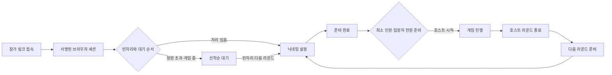

# Sliper 웹 게임 공통 템플릿 — 2026-10-30

## 제공 범위

`/games`에서 로그인한 회원이 방 이름·정원(2~30명, 기본 8명)·시작 최소 인원을 정한다. 호스트는 진행 전용이며 참가 정원에 포함되지 않는다. 참가자는 로그인 없이 공유 링크 `/games/{UUID}`로 들어온다. 먼저 서버에서 입장이 확정된 순서대로 입장한다. 실제 문제·미션·승리 규칙은 아직 정하지 않았으며, 이번 구현은 게임을 붙일 수 있는 공통 대기실과 라운드 생명주기다.

## 식별·권한

- IP는 기기 ID가 아니다. 같은 와이파이·NAT·통신사망을 쓰는 여러 참가자가 같은 IP를 가질 수 있다. IP 변경도 참가자의 신원을 바꾸지 않는다.
- 전용 HttpOnly·SameSite=Lax 쿠키 `sliper-game-device`를 HMAC으로 서명한다. 운영 HTTPS에서는 Secure를 사용하며 발급 후 24시간 유효하다. 서버 키는 기존 `VISITOR_HASH_SECRET`을 재사용하되 별도 도메인 문자열로 서명한다.
- 참가자 키는 방마다 다르게 해시하여 저장한다. 쿠키 원문·기기 UUID·원본 IP를 DB에 저장하지 않는다. 네트워크 해시는 정원이 아니라 방별 과도한 신규 접속 제한에만 사용한다.
- 같은 브라우저의 여러 탭은 한 자리다. 시크릿 창·다른 브라우저·쿠키 삭제는 다른 세션이므로 물리 기기나 실제 사람 1명을 완벽히 보증하지 않는다.
- 방 생성과 호스트 명령은 Supabase가 확인한 로그인 ID와 방 소유자 ID를 비교한다. `?host=1`은 호스트 화면 선택일 뿐 권한을 부여하지 않는다. 계정 이용 제한도 서버에서 확인한다.
- 참가자의 닉네임·준비·퇴장은 서버가 읽은 쿠키의 본인에게만 적용한다. 본문으로 보낸 playerId·hostId 등의 권한 주장은 거부한다.
- 게임용 게스트 권한은 커뮤니티의 글·댓글·결제·공지방 권한으로 확장되지 않는다.

## 저장·동시성

원본은 Supabase PostgreSQL의 비공개 `sliper` 스키마에 있는 `game_rooms`, `game_players`, `game_request_limits`다. 세 테이블에 RLS를 켜고 PUBLIC·anon·authenticated의 직접 접근을 취소한다. 신뢰하는 웹 서버만 명시적 DTO를 반환한다.

방 행의 `SELECT FOR UPDATE` 잠금을 잡은 짧은 트랜잭션 안에서 순번 배정·자리 계산·대기자 승격·준비 확인·시작을 처리한다. 같은 방의 명령은 모든 서버 프로세스에서 직렬화된다. 방+브라우저 해시, 방+순번은 고유하며 입장 중 닉네임은 대소문자를 구분하지 않고 중복을 막는다. 닉네임 변경은 준비를 해제한다. 호스트 명령은 revision을 확인하고 시작·종료·방 닫기의 중복 요청은 같은 상태를 유지한다.

정원에 못 들어온 참가자는 최대 100명까지 대기한다. 이력 포함 브라우저 세션은 방당 500개로 제한해 한 방의 조회 크기를 제한한다. 신규 입장에는 기기별 20회/분·네트워크별 180회/분, 참가자 명령은 50회/분을 DB에서 제한한다. 호스트 방 생성은 계정별 5회/시간이다. 이는 대규모 공격 방어 전체를 대체하지 않는다.

## 실시간·복구

- 기존 `roomRealtime()`의 서버 전용 Supabase private Broadcast를 사용한다. 환경에 따라 기존 Redis 또는 폴링 어댑터도 동작한다. 추가 유료 서비스는 생성하지 않는다.
- 커밋 후 방 UUID만 갱신 신호로 발행한다. 닉네임·계정·쿠키·게임 내용은 Broadcast에 싣지 않는다.
- 브라우저는 `/api/games/{id}/stream`의 SSE를 받는다. 각 갱신은 DB에서 방·참가 권한을 다시 확인한다. 참가 전·퇴장 후에는 스트림을 유지할 수 없다.
- 스트림은 55초 단위로 갱신되고 정상 연결 중 30초마다 DB 상태를 재확인한다. 브로커 장애 시 기존 5초 재확인으로 복구한다. SSE 연결 복구 중에는 브라우저도 8초 간격으로 상태를 확인한다.
- 열린 참가 화면은 25초마다 본인 접속을 갱신한다. 대기실에서 2분간 접속 갱신이 없으면 다음 재확인 시 자리를 해제하고 가장 오래 기다린 사람을 올린다. 진행 중에는 연결이 끊겨도 자동으로 게임 참가 자리를 바꾸지 않는다.
- 새로고침·일시 단절 후 같은 세션은 기존 자리에 연결된다. 스스로 나간 후 다시 입장하면 새 순번을 받는다. 퇴장 처리는 해당 브라우저 세션의 재입장을 막는다.
- 방 이용 가능 시간은 생성 후 24시간이다. 이는 DB 행의 물리 삭제 주기를 의미하지 않는다. 만료된 세션·닉네임·접속 제한 행의 정리 일정은 운영 보존 정책과 별도로 연결해야 한다.

## API

| 메서드·경로 | 동작 |
|---|---|
| POST /api/games | 로그인한 호스트의 방 생성 |
| GET /api/games | 본인이 연 최근 24시간 방 12개 |
| POST /api/games/{id}/connect | 게스트 입장·재접속 또는 로그인 호스트 연결 |
| GET /api/games/{id} | 본인에게 허용된 방 상태 |
| PATCH /api/games/{id} | 본인 닉네임·준비·퇴장·접속 갱신 |
| PATCH /api/games/{id}?host=1 | 호스트 시작·라운드 종료·다음 라운드·퇴장·방 닫기 |
| GET /api/games/{id}/stream | 권한 확인 후 SSE 상태 갱신 |

수정 요청은 같은 사이트에서 온 요청만 허용하고 작은 JSON 요청 크기를 제한한다. 방 생성 DTO와 명령 DTO는 미정의 키를 허용하지 않는다. 새 닉네임과 방 제목에도 기존 텍스트 정책 검사를 적용한다. 방 페이지는 검색 색인을 막고 공유 미리보기에 참가자 정보를 넣지 않는다.

## 게임별 확장 위치

`src/domain/game-room.ts`의 공통 계약, `src/server/game-room-service.ts`의 서버 권한·상태 전이, `src/components/game-room-lobby.tsx`의 `data-game-phase=playing` 영역을 기준으로 확장한다. 실제 게임을 추가할 때는 라운드별 상태·문제·답안·점수를 별도 저장하고, 제출 시 현재 라운드·참가 자격·서버 시각·중복 답안을 검증해야 한다. 정답이나 비밀 역할은 공통 방 DTO에 포함하지 않고 해당 참가자에게만 반환한다. 이 템플릿은 빠른 액션 게임의 프레임 단위 동기화를 제공하지 않는다.

## 검증 기록

- SQL 엔진 기반 세션·권한·FIFO·준비·재접속·기한·공개 정보 테스트.
- 격리된 로컬 PostgreSQL 18: 30명 동시 입장 → 4명 입장/26명 대기, 중복 재접속 10회 → 자리 추가 없음, 동시 시작 8회 → 시작 시각 1개.
- Chrome 독립 컨텍스트 5개, 실제 서비스 SQL·SSE로 방 생성→준비→시작→새로고침→라운드 종료→선착순 승격→방 닫기 검증.
- 320px·393px·1440px 가로 넘침 없음. 실제 Android·iOS 동시 기기 검증은 아직 별도 수행하지 않았다.

## 운영 반영 완료

- 서비스 주소: https://sliper.kr/games
- 현재 릴리스: `20261030-game-lobby-01`.
- 서울 Supabase에 `0074_game_room_lobby` 반영, 전체 마이그레이션 75개·앱 테이블 90개. 게임 테이블 3개 RLS·브라우저 직접 접근 차단·웹 서버 CRUD 권한 확인.
- 전체 검사 **1,130개 통과**, 실패 0. 타입·포맷·비밀정보 검사·Drizzle 검사 통과.
- Linux 운영 빌드 및 서버 trace 128개 검사 통과. standalone 3,666파일에 금지 파일·예상 밖 링크 없음.
- 미리보기 17개·실제 도메인 17개 점검 통과. 실제 Next.js 모바일 화면과 기존 홈·이야기·아카이브·로그인 동선 확인.
- 5개 브라우저 컨텍스트의 SQL·SSE 게임 생명주기 검증 8개 통과. 이는 격리된 테스트 호스트로 검증했으며 실제 회원 계정으로 운영 게임을 임의 개설하지 않았다.
- 기존 사이트 200, Sliper 감시 200, 알림·영상 워커 PID 유지. 광고 게시 상태·인증 공급자·기존 콘텐츠 데이터는 변경하지 않았다.

증빙: `.local/game-room-final-check.log`, `.local/game-room-concurrency.log`, `.local/game-room-browser/report.json`, `.local/game-room-db-migration.json`, `.local/game-lobby-qa-production/report.json`.
