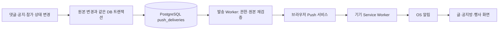

# 웹푸시 알림

Sliper는 표준 Web Push와 VAPID를 사용해 새 공지, 댓글·답글, 참가 확정·환불 완료를 기기로 발송한다. Firebase 프로젝트나 Redis는 필요하지 않다. 브라우저의 Push API·Service Worker와 서버의 `web-push` 라이브러리를 사용하며, 발송 대기열은 PostgreSQL에 저장한다.

## 사용자 화면과 동작

`/mypage`의 알림 설정에서 이 기기를 연결하고, 다음 종류를 각각 켜거나 끌 수 있다. 종류별 설정은 사용자의 연결된 기기 전체에 적용되며, 기기 연결 해제는 현재 기기에만 적용된다.

| 알림           | 수신 대상                                                     | 클릭 후 이동        |
| -------------- | ------------------------------------------------------------- | ------------------- |
| 댓글·답글      | 글 작성자와 답글의 원래 댓글 작성자, 본인 작성 제외·중복 제거 | 해당 글 모달        |
| 공지방 새 공지 | 유효한 확정 참가자·모집글 작성자·지정 담당자, 발행자 제외     | 해당 공지방         |
| 참가 확정      | 확정된 신청자                                                 | 해당 공지방         |
| 환불 완료      | 환불 완료된 신청자                                            | 해당 행사·신청 내역 |
| 테스트 알림    | 요청한 사용자의 현재 기기                                     | 마이페이지          |

등록된 구독은 사용자당 최대 10개다. 새 기기를 연결할 때 본인의 만료 구독과 이전 VAPID 키 구독을 정리한다. 테스트 알림 요청은 사용자당 1분에 한 번으로 제한한다. 알림 종류를 끄면 아직 대기하거나 처리 중인 해당 종류의 작업을 취소하며, 발송 직전에도 설정을 다시 확인한다. 이미 푸시 서비스로 전달된 알림을 취소하는 기능은 없다.

운영체제의 알림 권한 창은 사용자가 **알림 켜기**를 눌렀을 때만 요청한다. 먼저 Sliper의 안내 화면에서 혜택과 기기에 필요한 단계를 설명한다. 첫 방문이나 로그인 화면 진입만으로 시스템 권한 창을 띄우지 않는다. 권한 차단, 지원하지 않는 브라우저, HTTP 접속, 아이폰 홈 화면 추가 필요, 서버 설정 미완료를 각각 화면에 안내한다. 사용자 설정은 저장해두되, 새로운 기기는 다시 직접 연결해야 한다.

## 로그인·가입 이후의 알림 안내

루트 레이아웃의 `PushOnboardingProvider`가 환경과 권한을 확인한다. iPhone·iPad·Android·PC, Safari·Chrome·삼성 인터넷·Firefox, 카카오톡·Instagram·Facebook·LINE 등의 앱 내 브라우저, 홈 화면 실행 여부, HTTPS와 실제 Push API 지원을 함께 검사한다. 홈 화면 실행은 `navigator.standalone` 또는 `display-mode: standalone/fullscreen`으로 판별하며, iOS 버전이 확인되면 16.4 미만을 별도로 안내한다. User-Agent 정보만으로 알림 지원을 단정하지 않는다.

현재 `/login`에는 **알림 받는 방법 보기** 또는 **홈 화면에 앱으로 추가** 안내가 들어 있다. 비로그인 상태에서도 사용자가 직접 누르면 설치 방법을 볼 수 있지만, 개인 알림 연결은 현재 환경에서 인증된 설정 API가 성공한 뒤에만 가능하다. 재확인 요청 중이거나 요청에 실패하면 이전 인증 상태로 연결하지 않는다. 로컬 테스트 아이디·비밀번호 로그인이 성공하면 인증된 설정 응답을 받아 안내를 이어서 표시한다. 카카오·구글 OAuth와 정식 회원가입은 아직 연동 전이며, 공급자 버튼 자체를 성공한 인증으로 취급하지 않는다. [로컬 테스트 로그인](TEST_ACCOUNT.md)을 참고한다.

자동 안내는 다음 시점에 Sliper 자체 바텀 시트로 보여준다. PC에서는 가운데 모달로 표시한다.

- 로그인·가입 경로(`/login`, 이후 `/signup`)에 들어간 시각을 세션 저장소에 기록한다. **30분 안에**, 인증 화면을 벗어난 뒤 `/api/push/settings`가 인증된 응답을 반환하면 안내 대상으로 전환한다. 토큰이나 회원 개인정보를 브라우저 저장소에 추가하지 않는다.
- 로그인한 사용자가 글을 새로 북마크했거나, 같은 글을 화면에 보이는 동안 **60초** 읽었거나, 무료·유료·외부 신청의 참가 확정 상태를 확인했을 때 안내 대상으로 전환한다. 숨겨진 탭의 독서 시간은 세지 않는다.
- 이미 홈 화면으로 실행한 인증 사용자에게는 알림을 아직 허용하지 않은 첫 실행에서도 권한 안내를 보여줄 수 있다.
- 조건 충족 후 **1.2초** 기다리고, 화면이 보이며 다른 글·신청 모달이 열려 있지 않을 때 노출한다. 이미 열린 모달 위에 안내를 겹치지 않으며, 현재 페이지 세션에서는 한 번만 자동 노출한다.

| 현재 환경                                    | 안내와 다음 행동                                                                                       |
| -------------------------------------------- | ------------------------------------------------------------------------------------------------------ |
| iOS Safari의 일반 브라우저                   | 공유 아이콘 → **홈 화면에 추가**의 두 단계 안내. 추가 후 Sliper 아이콘으로 다시 실행                   |
| iOS Chrome 또는 앱 내 브라우저               | 공유·더보기 메뉴의 차이를 안내하고, 홈 화면 추가 메뉴가 없으면 링크를 복사해 Safari에서 열도록 안내    |
| iOS 홈 화면 웹앱                             | 설치 안내를 숨기고 공지·댓글 알림의 혜택과 **알림 켜기** 버튼 표시                                     |
| Android에서 실제 설치 이벤트가 도착한 경우   | **홈 화면에 앱으로 추가**와 **설치 없이 알림 받기** 선택. 브라우저가 제공한 이벤트의 `prompt()`만 호출 |
| Android에서 설치 이벤트가 없는 지원 브라우저 | 설치를 요구하지 않고 **알림 켜기**로 바로 연결                                                         |
| 이미 `granted`인 경우                        | 모든 설치·알림 홍보 안내를 숨김. 연결 상태와 종류별 설정은 마이페이지에서 관리                         |
| 이미 `denied`인 경우                         | 권한을 다시 요청하지 않음. 직접 연 안내에서 설정 복구 방법 제공                                        |
| HTTP·구형 iOS·지원하지 않는 브라우저         | 조건에 맞는 HTTPS·업데이트·일반 브라우저 안내 제공                                                     |

iOS는 브라우저의 설치 프롬프트를 가정하지 않는다. Safari의 도구 막대 위치는 버전과 사용자 설정에 따라 달라질 수 있으므로 특정 좌표를 가리키는 화살표 대신 실제 공유 아이콘을 표시한다. **웹앱으로 열기** 항목이 보이면 켜두고 홈 화면 아이콘으로 다시 열도록 안내한다. 타사 브라우저가 공유 메뉴에서 홈 화면 추가를 제공하는 경우에는 그 메뉴도 사용할 수 있다. [Apple 홈 화면 웹앱 안내](https://support.apple.com/guide/iphone/bookmark-a-website-iph42ab2f3a7/ios), [WebKit의 타사 브라우저·Web Push 안내](https://webkit.org/blog/13878/web-push-for-web-apps-on-ios-and-ipados/)

Android 설치 버튼은 지원 브라우저가 실제 `beforeinstallprompt` 이벤트를 보냈을 때만 나타난다. 이 API는 모든 브라우저에서 지원하지 않으며 이벤트 발생 시점도 보장되지 않는다. 설치를 수락해도 알림을 자동 요청하지 않고, **알림 켜기**를 별도로 누르게 한다. Android의 일반 브라우저에서는 설치 없이도 지원 조건을 만족하면 알림을 연결할 수 있다. [MDN beforeinstallprompt](https://developer.mozilla.org/en-US/docs/Web/API/Window/beforeinstallprompt_event)

**알림 켜기**의 클릭 핸들러는 공통 `startPushEnrollment()`를 직접 호출한다. 이 함수는 첫 `await`나 네트워크 요청 전에 `Notification.requestPermission()`을 실행해 iOS의 직접 동작 조건을 유지한다. 이미 허용한 권한은 재요청하지 않으며, 등록 API는 실제 서버 인증과 기존 기기 소유권 검사를 유지한다. 설치 안내와 마이페이지가 동일한 기기 가입 처리를 사용한다. [WebKit의 권한 요청 조건](https://webkit.org/blog/13878/web-push-for-web-apps-on-ios-and-ipados/)

권한이 차단되면 iOS는 **설정 → 알림 → Sliper → 알림 허용**, Android는 **브라우저 사이트 설정 → 알림 → Sliper 허용**과 브라우저 앱 자체의 알림 설정을 안내한다. 설정 변경 뒤 **설정 다시 확인하기** 또는 앱 복귀로 상태를 갱신한다. JavaScript로 OS 설정을 자동 변경하거나 차단된 권한을 반복 요청하지 않는다.

**방법을 확인했어요**는 안내만 닫고 7일 숨김을 저장하지 않는다. 홈 화면에 추가한 뒤 다시 실행하면 다음 알림 허용 단계로 이어질 수 있다. 닫기(X)·바깥 영역 닫기·다음에 할게요·Android 설치 거절은 로컬 저장소에 시각을 기록하고 **최소 7일** 자동 안내와 로그인 안내 배너를 숨긴다. 저장소가 차단된 환경에서는 현재 페이지 실행 중 메모리 상태로 반복 노출을 막는다. 7일 뒤에도 다음 적절한 이용 시점에서만 다시 안내하며, 페이지를 옮길 때마다 즉시 띄우지 않는다. `apple-touch-icon`은 기존 공식 로고 기반 192×192 PNG를 유지한다.

## 데이터 흐름과 저장소



새로 추가한 세 테이블은 모두 비공개 `sliper` 스키마에 있고 RLS가 활성화되어 있다. `PUBLIC`, `anon`, `authenticated`의 직접 접근 권한을 회수하며, 인증된 서버 서비스로 접근한다. 전체 Sliper 테이블은 기존 27개에서 **30개**가 되었다.

| 테이블               | 저장 내용                                                                            |
| -------------------- | ------------------------------------------------------------------------------------ |
| `push_preferences`   | 사용자별 댓글·공지·참가 상태 수신 설정                                               |
| `push_subscriptions` | 사용자·기기 구독 endpoint, 구독 암호화 키, VAPID 공개 키, 만료 시각                  |
| `push_deliveries`    | 구독별 발송 작업, 원본 참조, 일반 안내 문구·내부 이동 URL, 상태·시도 횟수·lease·만료 |

VAPID 개인 키는 이 테이블이나 클라이언트에 저장하지 않는다. 개발 전용 파일 또는 운영 서버 환경변수에서 읽는다. 서버 서비스의 조회 응답에는 endpoint나 구독 암호화 키를 노출하지 않는다. 현재 기기 확인에는 endpoint의 SHA-256 해시를 사용한다.

댓글은 `community-service.ts`에서 원본 댓글·댓글 알림 저장과 함께 대기열에 넣는다. 공지는 `participation-service.ts`에서 메시지 저장과 함께 넣는다. 참가 확정·환불 완료는 `application_web_push` DB 트리거가 처리하므로 무료 신청, 담당자 승인, 결제 웹훅, 환불 처리 모두 같은 보장을 받는다. 동일 상태로 재처리된 신청과 동일 기기의 같은 이벤트는 중복 작업을 만들지 않는다.

외부 전송은 원본 트랜잭션 안에서 하지 않는다. 원본 저장이 롤백되면 대기열도 롤백된다. 브라우저 Push 서비스가 장애를 겪어도 이미 저장된 글·공지·신청 내역은 유지된다. 현재 헤더 종 아이콘은 댓글·공지·참가·구독·리마인더의 통합 알림함으로 연결하고 종류별 읽음·미읽음을 저장한다. 공지방 SSE도 유지한다. 개인별 방의 마지막 메시지 열람 위치와 실제 화면 노출 증명은 별도 기능이다. [통합 알림의 저장·구독·리마인더 워커](ENGAGEMENT_AND_NOTIFICATIONS.md)를 참고한다.

## 로컬 개발

`C:\Sliper`의 독립 개발 DB에서 실행한다. 최초 설정에는 마이그레이션을 먼저 적용한다.

```powershell
npm run db:migrate
npm run push:setup
npm run dev
```

현재 작업 환경에는 마이그레이션 적용과 `push:setup` 실행을 완료했다. 설정은 Git에서 제외된 `.local/push-vapid.json`에 보존된다. `push:setup`은 이미 유효한 파일이 있으면 유지하며 개인 키를 출력하지 않는다. 이 파일은 전용 개발 DB·개발 인증 환경에서만 읽을 수 있다. 운영 환경에서 개발 키 파일로 대체하지 않는다.

전용 개발 DB 주소와 플래그가 모두 일치하는 개발 서버는 `PUSH_WORKER_MODE=external`이 없을 때 내장 발송 Worker를 시작한다. `src/instrumentation.ts`의 시작 훅에서 실행하므로 기존 서버를 완전히 재시작해야 한다. 로그의 `Sliper push worker ready.`로 시작 여부를 확인할 수 있다. 일반 소스 수정만으로 Worker가 시작되거나 VAPID 키가 갱신된다고 가정하지 않는다.

`.env.example`에는 운영용 기본값 `PUSH_WORKER_MODE=external`이 있다. 이 값을 그대로 사용하는 개발 환경에서는 별도 터미널에서 실행하거나, 로컬 개발 서버를 내장 모드로 명시해 시작한다.

```powershell
# 별도 발송 프로세스: 종료할 때까지 반복 처리
npm run push:worker

# 또는 Next 개발 서버 내부에서 실행
$env:PUSH_WORKER_MODE = 'embedded'
npm run dev
```

대기열을 한 번만 처리하는 명령도 제공한다.

```powershell
npm run push:drain
```

`push:drain`은 최대 20개를 한 번 가져와 처리한 뒤 종료한다. 모든 대기 작업을 비우거나 재시도 대기 시간을 기다리는 명령이 아니다. 상시 알림에는 `push:worker` 또는 상시 실행되는 내장 모드가 필요하다.

PC의 `http://127.0.0.1:3000`·`http://localhost:3000`은 지원 브라우저에서 보안 컨텍스트 예외로 사용할 수 있다. 휴대폰의 `http://192.168...:3000`은 해당 예외가 아니므로 알림 연결을 지원하지 않는다. [MDN 보안 컨텍스트](https://developer.mozilla.org/en-US/docs/Web/Security/Defenses/Secure_Contexts)

**설정된 정확한 Wi-Fi 주소에서는 테스트 비밀번호 로그인을 사용할 수 있다.** `SLIPER_LAN_HOST`의 사설 IPv4 주소:3000과 전용 개발 DB 조건을 함께 검사하며, LAN의 비로그인 사용자를 고정 임시 작성자로 처리하지 않는다. 이 계정은 HTTP LAN에서도 일반 기능을 확인할 수 있지만 푸시의 HTTPS 조건을 대신하지 않는다. 현재 테스트 어댑터는 임의의 공개 HTTPS 호스트를 허용하지 않으므로, 휴대폰 실제 푸시를 공개 HTTPS 주소에서 검증하려면 해당 주소의 회원 인증을 별도로 연결해야 한다. 카카오·구글 OAuth는 여전히 미연동이다. [테스트 계정과 세션 범위](TEST_ACCOUNT.md)를 참고한다.

## 운영 설정

1. 운영 DB에 최신 마이그레이션을 적용한다.
2. 실제 회원 세션을 `currentActor()`에 연결하고 HTTPS 주소로 제공한다.
3. 서버 비밀 저장소에서 P-256 VAPID 키 쌍을 생성·보관하고 아래 환경변수를 제공한다.
4. 동일 DB와 동일 VAPID 키를 사용하는 별도 상시 Worker를 실행한다.

```dotenv
VAPID_SUBJECT=mailto:운영연락처@실제도메인
VAPID_PUBLIC_KEY=생성한_공개키
VAPID_PRIVATE_KEY=생성한_개인키
PUSH_WORKER_MODE=external
```

위 값은 설명용 자리 표시자다. 실제 키는 서로 일치하는 URL-safe Base64 인코딩 P-256 키 쌍이어야 한다. subject는 실제 연락 가능한 `mailto:` URI 또는 HTTPS URI를 사용한다. 운영에서는 `.local/push-vapid.json` 대신 서버 환경변수만 사용한다. `NEXT_PUBLIC_` 개인 키를 만들거나 파일을 Git에 커밋하지 않는다.

앱과 모든 Worker가 같은 안정적인 키 쌍을 사용해야 한다. 키를 바꾸면 기존 브라우저 구독이 기존 키에 연결되어 있으므로 사용자 재연결이 필요하다. 설정을 바꾼 뒤 Next 서버·Worker를 재시작한다. 일회성 함수·서버리스 요청에 상시 `setTimeout` Worker 실행을 맡기지 않는다. 별도 프로세스 관리자나 상시 실행 플랫폼에서 재시작·종료를 관리한다.

Worker는 `DATABASE_URL`로 최대 두 개의 DB 연결을 사용한다. 복수 Worker를 실행할 수 있으며 작업 선점에 `FOR UPDATE SKIP LOCKED`를 사용한다. 프로세스 수와 DB 연결 예산은 함께 관리해야 한다.

## 재시도·만료·전달 보장

| 항목                    | 현재 동작                                           |
| ----------------------- | --------------------------------------------------- |
| 대기열 확인             | 한 배치가 끝난 뒤 2초 후 다음 배치 확인             |
| 배치 크기               | 최대 20개                                           |
| 한 Worker의 전송 동시성 | 최대 4개                                            |
| 작업 lease              | 120초; 중단된 Worker의 처리 작업을 이후 재선점 가능 |
| 전송 시도               | 최대 6회, 최초 전송 포함                            |
| 재시도 대상             | 네트워크 오류, HTTP 408·429·5xx                     |
| 재시도 간격             | 30초부터 지수 증가; Retry-After 반영, 최대 1시간    |
| 무효 구독               | HTTP 404·410 시 해당 구독 삭제                      |
| 작업 만료               | 생성 후 24시간                                      |
| Push 서비스 TTL         | 남은 작업 유효기간 이내, 최대 24시간                |
| 요청 timeout            | 10초                                                |

원본의 공개 여부, 댓글의 유효성·수신자, 방 멤버·담당자 권한, 신청의 현재 상태, 수신 설정, 구독 소유자·유효기간·VAPID 키를 전송 직전에 다시 확인한다. 취소·환불·삭제 이후 필요 없어진 작업은 전송하지 않고 취소한다. 발송을 시작한 뒤의 권한 변경은 이미 전송 중인 알림을 회수할 수 없으므로, 잠금 화면에 공지·댓글 본문이나 참가자의 개인정보를 넣지 않는다.

`sent`는 **Push 서비스가 요청을 받아들였음**을 뜻한다. 휴대폰 도착, 화면 표시, 사용자의 읽음을 뜻하지 않는다. 전원이 꺼져 있거나 인터넷이 끊긴 동안 실제 수신은 불가능하며, 재연결 시 유효기간 안의 알림을 받을 수 있지만 전달을 보장하지 않는다. 브라우저·OS 권한, 집중 모드, 배터리·네트워크 설정도 표시 여부에 영향을 준다.

대기열 처리와 재시도는 at-least-once 방식이다. 외부 서비스가 전송을 받아들인 직후 서버가 DB 상태 저장 전에 종료되면 같은 알림을 다시 보낼 수 있다. 동일 delivery ID를 알림 `tag`와 Push 서비스 `topic`으로 사용해 중복 표시를 줄이지만 exactly-once 전달을 보장하지 않는다. 최대 시도 횟수·유효기간·영구 오류에 따라 최종 실패할 수도 있다.

현재 자동 보관 정리 작업이나 사용자용 발송 이력 대시보드는 없다. 장기 운영에서는 완료·취소·실패 작업의 보관 정책, 대기 시간·오류율·Worker 생존 확인을 추가해야 한다.

## 기기 조건

안드로이드·PC는 Push API·Notifications API·Service Worker를 지원하는 브라우저와 알림 허용이 필요하다. 앱스토어 설치와 Firebase SDK는 필요하지 않다. 사이트 탭이 없어도 브라우저의 Service Worker가 알림 이벤트를 받을 수 있다. [MDN Push API](https://developer.mozilla.org/en-US/docs/Web/API/Push_API)

아이폰·아이패드는 **iOS/iPadOS 16.4 이상**, HTTPS, 홈 화면에 추가한 웹앱이 필요하다. 공유 메뉴의 **홈 화면에 추가** 후 Sliper 아이콘으로 열어 로그인 후 안내 또는 마이페이지에서 직접 알림 버튼을 누른다. 권한 요청에는 사용자의 직접 동작이 필요하며, 유료 Apple Developer Program 가입은 필요하지 않다. [Apple WebKit 안내](https://webkit.org/blog/13878/web-push-for-web-apps-on-ios-and-ipados/)

`/manifest.webmanifest`와 홈 화면 아이콘을 제공하며 Service Worker는 푸시 전용이다. 페이지·API·개인 화면을 오프라인 캐시에 넣지 않는다. PWA의 전체 오프라인 기능이나 공지방 미읽음 앱 배지를 추가한 것은 아니다.

## 보안 경계와 검증 범위

- 쓰기 API는 실제 서버 인증과 같은 출처 검사를 사용한다. 다른 사용자의 endpoint 소유권을 변경할 수 없다.
- HTTPS의 알려진 Push 서비스만 허용한다: `fcm.googleapis.com`, Mozilla의 `*.push.services.mozilla.com`, Apple의 `*.push.apple.com`, Microsoft의 `*.notify.windows.com`. 로컬 주소·임의 서버·다른 포트·인증 정보가 포함된 URL을 거부한다. 지원 서비스가 바뀌면 검토 후 allowlist를 갱신해야 한다.
- 구독 공개 키는 실제 P-256 점인지 검사하며, VAPID 공개·개인 키의 일치 여부도 검사한다.
- 알림 이동은 Sliper 내부의 정해진 글·방·행사·마이페이지 경로만 허용한다.
- 일반 오류 코드만 저장하고 로그에 endpoint·암호화 키·개인 키·본문을 출력하지 않는다.

테스트는 iOS·Android 환경 분기, 허용·차단 상태, 7일 숨김과 인증 진입 기록, 클릭 직후 권한 요청 순서, 공유 기기 재연결과 등록 실패 정리, 구독 소유권, 설정·기기 제한, 트랜잭션 대기열, 원본·권한 변경 후 발송 차단, 재시도·만료·무효 구독 삭제, 중단된 작업의 lease 복구와 성공 작업의 재발송 방지를 검증한다. 자동 테스트의 sender는 외부 Push 서비스에 실제 전송하지 않는 대체 함수다. **실제 휴대폰 잠금 화면 수신과 브라우저 권한 창의 직접 조작은 아직 검증하지 않았다.** `/mypage`의 테스트 알림으로 지원 기기·실제 인증·HTTPS 환경에서 별도 확인해야 한다.

개발 서버가 실행 중일 때 `npm run test:push-api`로 공개 응답·Origin·비로그인 접근·서비스 워커 헤더·매니페스트·마이페이지 HTTP 연결을 검증한다. 실제 브라우저 기기 구독이나 푸시 전송을 만드는 테스트는 아니다.

## 주요 코드

- `src/db/push-schema.ts`, `drizzle/0019_web_push.sql`, `drizzle/0020_web_push_integrity.sql`: 테이블·제약·참가 상태 트리거
- `src/server/push-service.ts`: 기기 구독·해제·설정·테스트 요청
- `src/server/push-events.ts`: 댓글·공지 트랜잭션 대기열 저장
- `src/server/push-dispatcher.ts`: 선점·권한 재검증·실제 전송·재시도
- `src/server/push-configuration.ts`, `src/server/push-validation.ts`: 키·endpoint·내부 URL 검증
- `src/server/push-worker-loop.ts`, `src/instrumentation.ts`, `scripts/push-worker.ts`: 발송 프로세스
- `src/app/api/push/[[...path]]/route.ts`: 설정·구독·테스트 API
- `src/components/push-settings.tsx`, `src/lib/push-client.ts`: 마이페이지 설정·공통 기기 구독
- `src/components/push-onboarding.tsx`, `src/components/push-onboarding-sheet.tsx`, `src/app/push-onboarding.css`: 로그인 안내·이용 시점 감지·기기별 바텀 시트
- `src/lib/push-onboarding-policy.ts`, `src/lib/push-onboarding-events.ts`: 환경 분기·7일 숨김·30분 인증 진입 기록·이용 이벤트
- `public/sw.js`, `src/app/manifest.ts`: 알림 표시·클릭 이동·홈 화면 웹앱
