# Sliper 구현 기준 아키텍처·데이터 흐름 설계서

기준일: 2026-10-01 · 확인 대상: `C:\Sliper`의 애플리케이션 소스, Drizzle 스키마, SQL 마이그레이션, 로컬 실행 설정.

이 문서는 현재 코드를 역설계한 문서다. 2026-10-01 Web Push 구현을 반영했으며, 알림 실행·배포 방법은 [Web Push 운영 문서](WEB_PUSH.md)를 참고한다. **현재 구현**과 **향후 권장 설계**를 구분한다. 소스와 로컬 설정을 확인했으며, 사용자 폭주 부하 시험이나 운영 환경의 처리량 측정을 수행한 보고서는 아니다. 실제 OAuth 공급자·클라우드 저장소·결제 플랫폼의 연결 여부는 코드 존재 여부와 별도로 표시한다.

## 1. 먼저 알아야 할 결론

- 구조는 기능별 서비스를 가진 **Next.js 모듈형 단일 애플리케이션**이다. 독립 채팅·결제 서버는 없으며, Web Push 발송 워커는 로컬 Next 프로세스 내부 또는 별도 Node 프로세스에서 실행한다.
- 영속 데이터는 PostgreSQL의 `sliper` 스키마 **30개 테이블**에 저장한다. 참조 대상인 `auth.users`는 이 수에 포함하지 않는다.
- **Redis를 사용하지 않는다.** Redis 클라이언트, 분산 캐시, Pub/Sub, BullMQ 작업 큐, PostgreSQL LISTEN/NOTIFY 구현을 찾지 못했다.
- 글·댓글·댓글 알림·공지 메시지·참가 권한·결제 확인 기록은 PostgreSQL에 저장한다. 업로드 이미지의 실제 파일은 로컬 디스크에 저장하고 DB에는 메타데이터를 기록한다.
- 공지방 화면은 **SSE**로 갱신한다. DB의 변경 감지는 연결마다 이전 조회 완료 후 **5초 간격으로 반복 조회**하는 방식이다.
- 종 아이콘의 알림은 **댓글·답글 알림**이다. 별도로 공지·댓글·답글·참가 확정·환불 완료의 **Web Push** 구독·발송·재시도를 구현했다. 공지 메시지별 개인 미읽음과 SMS·이메일은 아직 없다.
- 트랜잭션·행 잠금·중복 방지·정원 검사로 경쟁 요청의 데이터 정합성을 보호한다. 부하 분산·자동 확장·분산 요청 제한·실시간 팬아웃은 아직 구현하지 않았다.
- 현재 로컬 개발 환경은 일반 회원 인증을 연동하기 전 단계다. 실제 카카오·구글 로그인과 실결제 공급자 연결은 후속 작업이다.

## 2. 시스템 컨텍스트와 배포 구조

### 2.1 현재 실행 구조

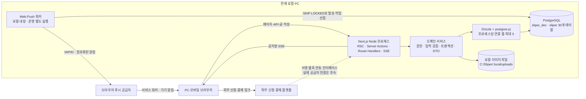

| 항목                    | 현재 상태                                             | 의미                                               |
| ----------------------- | ----------------------------------------------------- | -------------------------------------------------- |
| 프레임워크              | Next.js 16.3.7 App Router, React 19.3, TypeScript 5.9 | UI와 서버 기능이 하나의 애플리케이션에 존재        |
| 화면                    | Tailwind CSS 4, Radix 기반 UI, React Markdown         | 초기 RSC와 이후 클라이언트 상호작용 혼용           |
| DB 접근                 | Drizzle ORM 0.45.3 + postgres-js 3.4.9                | 브라우저가 DB에 직접 연결하지 않음                 |
| 로컬 DB                 | PostgreSQL 18, `127.0.0.1:55432/sliper_dev`           | 현재 Supabase 클라우드 DB에서 실행하는 상태는 아님 |
| DB 파일                 | `C:\Sliper\.local\postgres`                           | DB 데이터 디렉터리이며 별도 업로드 폴더와 구분     |
| 이미지 파일             | `C:\Sliper\.local\uploads`                            | 서버 파일시스템 의존                               |
| 개발 서버               | 포트 3000, LAN 실행 시 `0.0.0.0` 바인딩               | 개발용 접속 설정이며 운영 배포 구성은 아님         |
| 임시 사용자             | 제한된 localhost 개발 환경에서 고정 개발 사용자       | LAN 접속은 로그인한 회원으로 간주하지 않음         |
| Supabase Auth / Storage | 향후 연결 대상                                        | 현재 소셜 세션 검증·Storage 업로드는 미연동        |
| 외부 결제               | 공통 checkout 브리지·웹훅 계약 구현                   | 특정 플랫폼 실결제·정산이 연결된 상태는 아님       |

`getDatabase()`는 프로세스 전역에 DB 클라이언트를 재사용한다. 기본 연결 풀 최대값은 **5개/Node 프로세스**다. 이는 동시에 이용 가능한 사용자 수가 5명이라는 뜻이 아니다. 요청의 DB 작업 시간에만 연결을 점유한다. 서버 프로세스를 늘리면 각 프로세스의 풀이 별도로 생긴다.

근거: [package.json](C:/Sliper/package.json), [DB 연결 설정](C:/Sliper/src/db/connection.ts:6), [클라이언트 재사용](C:/Sliper/src/db/client.ts:8), [현재 사용자 판정](C:/Sliper/src/server/identity.ts:8).

### 2.2 계층과 의존성

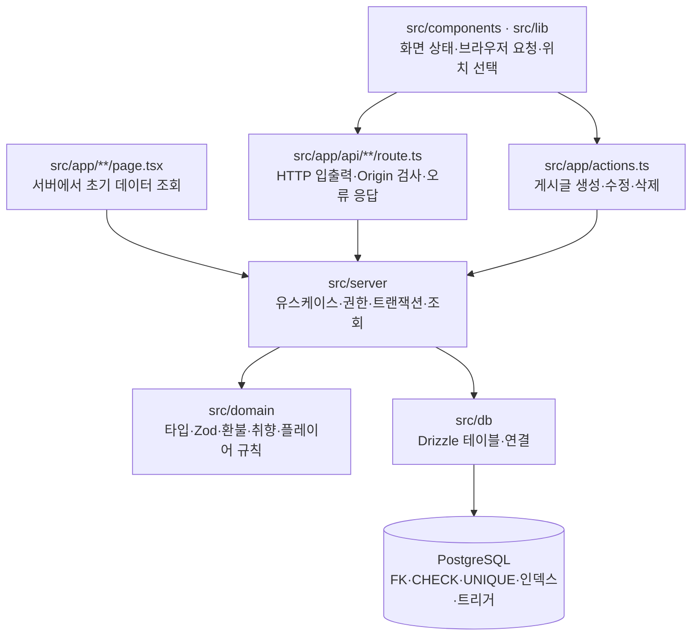

초기 RSC는 내부 REST API를 HTTP로 다시 호출하지 않고 서비스를 직접 호출한다. 서비스의 결과를 공개 DTO로 변환해 클라이언트 화면에 전달한다. 이후 클릭·등록·조회는 Server Actions 또는 Route Handler를 사용한다. 내부 사용자 ID나 신청자의 연락처가 일반 글·공지 DTO로 그대로 전달되지 않도록 응답 경계를 둔다.

서비스는 기능별로 나뉘지만 같은 Node 런타임·DB 풀을 공유한다. 따라서 인기 공지방의 DB 작업이 밀리면 다른 화면의 DB 작업도 풀 대기로 영향을 받을 수 있다.

## 3. 기능별 진입점과 책임

아래 API는 대표 진입점이다. 참가 관련 API의 공통 접두사는 `/api/participation`이다.

| 화면·기능                 | 초기 조회 / 서비스                                 | 브라우저·외부 요청                                                             |
| ------------------------- | -------------------------------------------------- | ------------------------------------------------------------------------------ |
| 홈 `/`, 이야기 `/stories` | `communityService.feed`, `inbox`                   | `/api/community` 피드·상세·댓글·반응·투표·알림; 글 CRUD는 Actions              |
| 마이페이지 `/mypage`      | `communityService.me`                              | `/api/community/me`, `/me/visit`                                               |
| 번개 `/lightning`         | 이벤트 피드, `lightningService`                    | `POST /api/lightning`, 커뮤니티 조회 API                                       |
| 모집 상세 `/events/{id}`  | `participationService.overview`                    | `/events/{id}/applications`, `/external-confirmation`, `/orders/{id}/checkout` |
| 내 신청·공지방 목록       | `participationService.home`                        | `/me`                                                                          |
| 내 행사 `/management`     | `participationService.managedEvents`               | `/management`                                                                  |
| 행사 대시보드             | `participationService.dashboard`, 관리·환불 서비스 | `/events/{id}/dashboard`, 설정·관리자·승인·환불 API                            |
| 공지방 `/rooms/{id}`      | `participationService.room`                        | `/rooms/{id}`, `/messages`, `/stream`                                          |
| 룰북·템플릿               | `libraryService`                                   | `/api/library`, 접근 신청·승인·다운로드·개최 API                               |
| 플레이어·매너·전적        | `playerService`                                    | `/api/players`, 행사 전적·매너 API                                             |
| 이미지                    | `uploadImage`, `readImage`                         | `POST /api/community/uploads`, `GET /api/media/{id}`                           |
| 결제·외부 참가 동기화     | 참여·외부 관리 서비스                              | `/api/payments/webhook`, `/external-webhook`                                   |

근거: [글 Actions](C:/Sliper/src/app/actions.ts:21), [커뮤니티 라우트](C:/Sliper/src/app/api/community/[[...path]]/route.ts:16), [참가 라우트](C:/Sliper/src/app/api/participation/[[...path]]/route.ts:15), [자료 라우트](C:/Sliper/src/app/api/library/[[...path]]/route.ts:8), [플레이어 라우트](C:/Sliper/src/app/api/players/[[...path]]/route.ts:8).

## 4. 데이터 저장소와 30개 테이블

### 4.1 어디에 저장되는가

| 데이터                             | 원본 저장소                              | 화면·읽음 처리                             |
| ---------------------------------- | ---------------------------------------- | ------------------------------------------ |
| 글·댓글·투표·좋아요·북마크         | PostgreSQL                               | 서비스에서 DTO를 만들어 전달               |
| 댓글·답글 알림                     | `sliper.notifications`                   | `read_at`으로 읽음 기록, 미읽음은 DB COUNT |
| 공지방 메시지                      | `sliper.room_messages`                   | 최신 30개 + 이전 기록 커서 조회            |
| 공지방 입장·회수                   | `room_members`, `room_managers`          | 확정 신청과 관리자 권한으로 검사           |
| 참가 신청·외부 결제 확인·환불 요청 | 관련 PostgreSQL 테이블                   | 실제 송금·정산은 외부 플랫폼 책임          |
| 룰북·템플릿·행사 진행 가이드       | PostgreSQL text / JSONB                  | 다운로드는 접근 확인 후 Markdown 생성      |
| 프로필·전적·매너 평가·활동 기록    | PostgreSQL                               | 활동점수 기록, 전적·매너 SQL 집계          |
| 업로드 이미지 실제 바이트          | 서버 `.local/uploads/*.webp`             | API가 권한 확인 후 파일 읽기               |
| 이미지 파일 키·용량·소유자·글 연결 | `sliper.media_assets`                    | DB 기록으로 파일 노출 여부 결정            |
| SSE의 이전 JSON·타이머             | Node 연결별 메모리                       | 서버 재시작 시 소멸하는 임시 상태          |
| 기기 알림 구독·종류 설정           | `push_subscriptions`, `push_preferences` | 회원별 비공개, 기기 최대 10개              |
| 푸시 발송 대기·재시도·결과         | `sliper.push_deliveries`                 | 워커가 선점 후 전송, 공급자 접수 상태 기록 |
| 현재 화면의 메시지·알림 목록       | 브라우저 React state                     | DB 원본의 화면용 복제본                    |

서버가 재시작돼도 PostgreSQL과 업로드 디스크가 보존되면 원본은 남는다. Node 메모리나 React state는 영구 저장소가 아니다. 다만 현재 디스크와 DB의 **자동 백업·복원 체계가 구현되어 있다고 볼 근거는 없다.**

### 4.2 테이블 목록

| 영역      | 테이블                    | 책임                                           |
| --------- | ------------------------- | ---------------------------------------------- |
| 커뮤니티  | `profiles`                | 내부 회원 참조, 공개용 ID, 프로필 기본 정보    |
| 커뮤니티  | `categories`              | 관심 카테고리·창작 게시판 분류                 |
| 커뮤니티  | `posts`                   | 글 본문·종류·익명 표시·모집 소개·투표 설정     |
| 커뮤니티  | `comments`                | 글과 부모 댓글 관계, 댓글 내용·상태            |
| 커뮤니티  | `media_assets`            | 이미지 소유·파일 키·글 연결·준비 상태          |
| 커뮤니티  | `post_likes`              | 글·회원당 좋아요                               |
| 커뮤니티  | `bookmarks`               | 글·회원당 북마크                               |
| 커뮤니티  | `post_daily_views`        | 글·방문자 해시·한국 날짜당 조회 기록           |
| 커뮤니티  | `notifications`           | 댓글·답글 알림과 읽음                          |
| 커뮤니티  | `poll_votes`              | 글·회원당 투표 항목                            |
| 커뮤니티  | `activity_events`         | 활동점수 적립 원인·중복 방지                   |
| 행사      | `event_settings`          | 일정·정원·비용·모집 설정·번개 여부·장소 좌표   |
| 행사      | `event_applications`      | 내부 신청·외부 참가 확인·상태·환불 기준 스냅샷 |
| 행사      | `payment_orders`          | 외부 결제 주문 참조·상태                       |
| 행사      | `payment_events`          | 내부 주문 결제 웹훅 중복 방지 기록             |
| 공지방    | `room_managers`           | 지정 담당자                                    |
| 공지방    | `room_members`            | 확정 신청과 연결한 참가 권한·회수 시각         |
| 공지방    | `room_messages`           | 담당자가 작성한 공지 원본                      |
| 외부 연동 | `external_receipts`       | 외부 신청번호·금액·수동/연동 검증·환불 확인    |
| 외부 연동 | `external_webhook_events` | 외부 참가 웹훅 중복 방지 기록                  |
| 환불      | `refund_requests`         | 환불 견적·요청·처리 상태·실제 확인 금액        |
| 자료      | `library_entries`         | 룰북·템플릿 시나리오·규칙·준비물·가이드·라운드 |
| 자료      | `library_access_requests` | 유료 자료 구매 확인·이용 승인·회수             |
| 자료      | `template_provenance`     | 원본 템플릿과 개최 당시 가이드 스냅샷          |
| 플레이어  | `player_preferences`      | 역할 성향·매칭·전적 공개 설정                  |
| 플레이어  | `event_results`           | 참석·노쇼·우승·역할 기록                       |
| 플레이어  | `manner_reviews`          | 동일 행사 참석자 사이의 매너 평가              |
| 푸시      | `push_preferences`        | 계정 전체의 댓글·공지·참가 알림 수신 설정      |
| 푸시      | `push_subscriptions`      | 브라우저별 endpoint·암호화 키·VAPID 키·만료    |
| 푸시      | `push_deliveries`         | 기기별 중복 방지·선점·재시도·만료·발송 결과    |

정의: [기본 21개](C:/Sliper/src/db/schema.ts:39), [자료 3개](C:/Sliper/src/db/library-schema.ts:19), [플레이어 3개](C:/Sliper/src/db/player-schema.ts:18), [푸시 3개](C:/Sliper/src/db/push-schema.ts).

### 4.3 핵심 ER 설계도

전체 FK를 모두 펼치기보다 행사·공지·자료의 핵심 관계를 표시한다. 사용자·카테고리 FK와 웹훅 참조 일부는 가독성을 위해 생략했다.

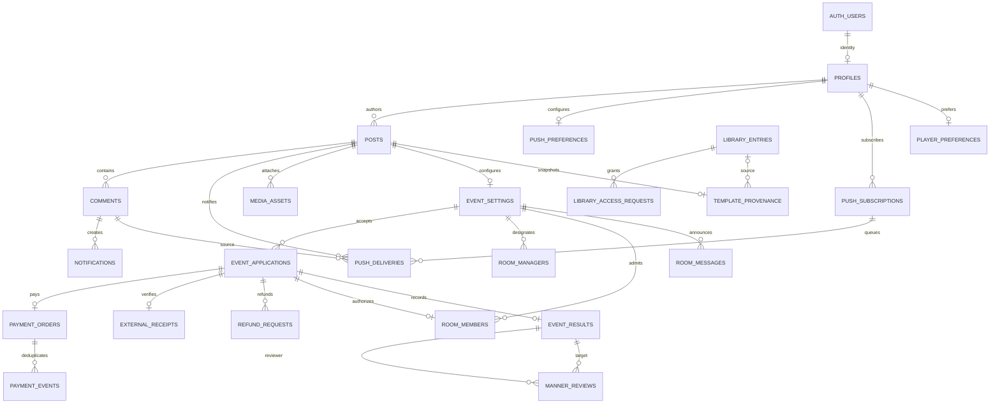

**별도 `rooms` 테이블은 없다.** `posts.id = event_settings.post_id`가 논리적인 방 ID다. `room_managers`, `room_members`, `room_messages`가 이 ID를 공유한다. 방 멤버는 신청 ID·행사 ID·회원 ID의 복합 FK로 해당 신청에 연결된다.

`roomMembers.joinedAt`라는 TypeScript 프로퍼티의 실제 SQL 컬럼명은 helper 정의에 따라 **`created_at`**이다. 문서나 SQL에서 `joined_at` 컬럼을 가정하면 안 된다.

## 5. 글·이미지·댓글·알림 데이터 흐름

### 5.1 글 작성과 이미지 업로드

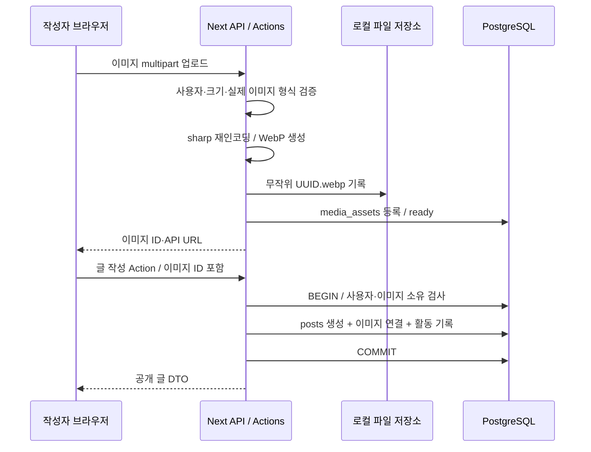

업로드는 요청 전체 11MiB, 파일 10MiB, 입력 이미지 2천만 화소를 제한한다. JPG·PNG·WebP·GIF를 실제 디코딩하고 첫 프레임을 WebP로 변환한다. 회전 보정, 최대 2400×2400 안에 맞춤, quality 85, 메타데이터 제거를 수행한다. 원본 파일명 대신 무작위 파일 키를 사용한다.

파일 기록 후 DB 등록이 실패하면 파일 삭제로 보상한다. 하지만 파일시스템과 PostgreSQL을 묶는 분산 트랜잭션은 아니다. 둘 사이에서 프로세스가 종료되면 고아 파일이 남을 수 있으며 자동 정리 워커는 없다. 미게시 이미지의 장기 보존 정책도 아직 없다.

이미지 조회는 연결 글이 공개 상태이거나, 글에 연결하지 않은 본인 업로드인지 확인한다. 응답은 `private, no-store`다. 현재 CDN·Supabase Storage·S3를 통해 제공하지 않으므로 이미지마다 Node·DB·디스크를 거친다.

근거: [업로드와 읽기](C:/Sliper/src/server/media.ts:14), [글 생성과 이미지 연결](C:/Sliper/src/server/community-service.ts:445).

### 5.2 댓글과 종 아이콘 알림

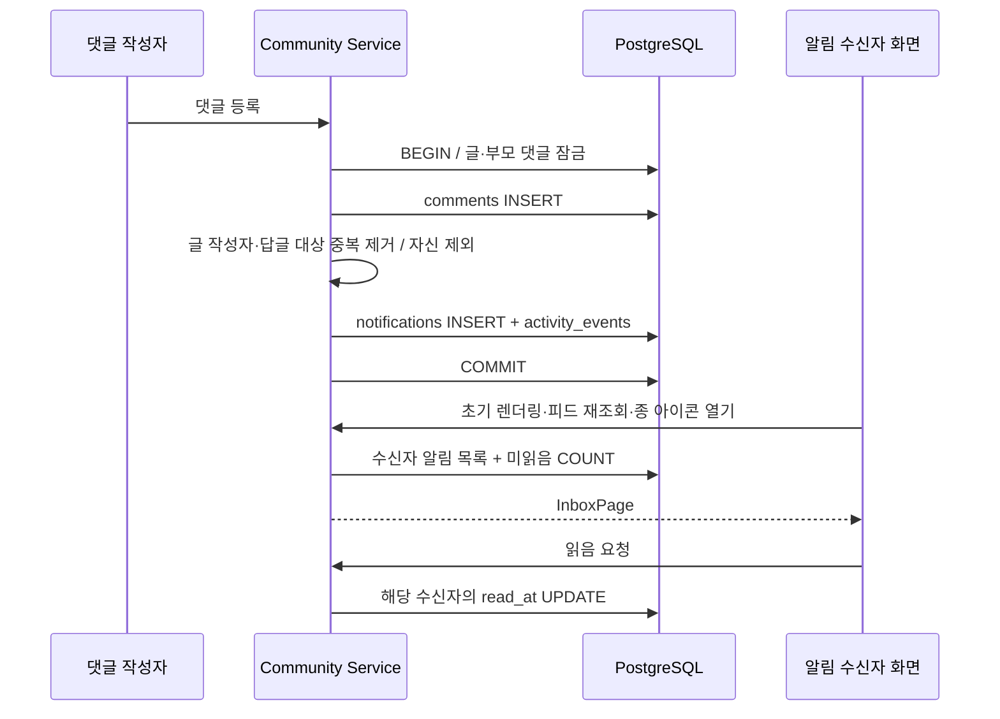

알림 종류는 `post_comment`, `comment_reply`뿐이다. 같은 댓글·수신자의 알림은 UNIQUE로 중복을 막고 자기 알림은 만들지 않는다. 같은 사람이 글 작성자이면서 답글 대상이면 한 건으로 합친다. 댓글·알림·활동 적립과 해당 기기의 푸시 발송 작업은 같은 트랜잭션에 저장한다. 기기를 구독하지 않은 회원에게는 푸시 작업을 만들지 않는다.

읽음은 `notifications.read_at`이며 별도 Redis 카운터를 사용하지 않는다. 모두 읽음 요청은 그 요청 시점 이전 알림만 갱신하여 이후 새 알림이 실수로 읽히지 않도록 한다. 기본 목록 20개, 요청 최대 50개이며 수신자별 커서로 더 읽는다.

**종 알림은 SSE로 계속 푸시되지 않는다.** 초기 조회, 피드 재조회, 알림창 열기, 더 보기·읽음 시 갱신한다. 홈의 60초 타이머는 인기·주목 콘텐츠 조회용이다.

근거: [댓글·알림 생성](C:/Sliper/src/server/community-service.ts:576), [알림 조회·읽음](C:/Sliper/src/server/notification-service.ts:31), [페이지 크기](C:/Sliper/src/server/pagination.ts:12), [콘텐츠 갱신](C:/Sliper/src/lib/use-community.ts:82).

## 6. 신청·결제·승인·공지방 입장 흐름

### 6.1 신청 상태와 정원

신청 상태는 `pending_payment`, `pending_approval`, `confirmed`, `cancelled`, `expired`, `review`, `rejected`, `refunded`를 사용한다. 다음 그림은 대표 전이를 나타내며 모든 관리 예외 경로를 열거한 상태 머신은 아니다.

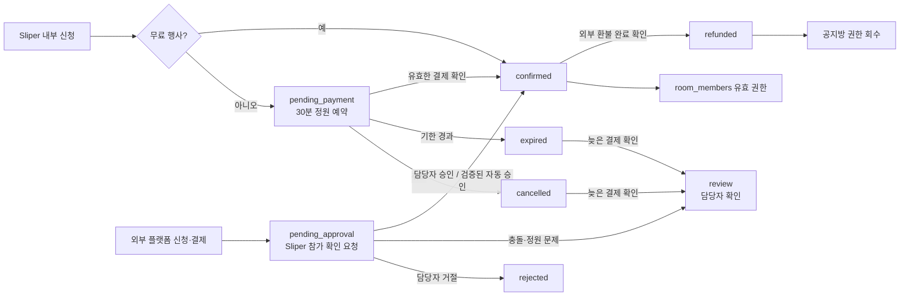

정원을 점유하는 것은 **확정 참가자와 만료되지 않은 결제 대기 신청**이다. 외부 참가 확인 대기 `pending_approval`은 Sliper 정원을 예약하지 않는다. 동일 행사·회원의 활성 신청 중복은 partial UNIQUE 인덱스로 막는다.

행사 행 잠금을 얻은 뒤 정원·상태를 검사해 동시에 마지막 한 자리를 신청하는 경쟁을 직렬화한다. DB 트리거도 정원과 상태 조건을 다시 검사한다. 결제 대기 만료는 별도 스케줄러가 아니라 행사 변경 시 갱신하고, 조회·정원 계산에서 만료 시각을 반영한다.

### 6.2 내부 유료 신청

1. 서버가 신청자·행사·신청 열림·시작 전·정원·중복 여부를 검사한다.
2. 같은 DB 트랜잭션에 `pending_payment` 신청과 `payment_orders`를 생성한다.
3. 외부 checkout 브리지를 호출한다. 이 네트워크 요청은 DB 트랜잭션 밖에서 실행하며 주문 ID를 멱등 키로 보낸다. 브리지 호출 timeout은 15초다.
4. 결제 공급자가 보낸 원본 바이트·시각의 HMAC 서명을 검증한다. 현재 계약은 시각 오차 300초 이내와 일정 길이의 서명을 검사한다.
5. `payment_events`의 공급자·이벤트 ID와 내용 digest로 중복 처리를 막고 주문·금액·통화를 검증한다.
6. 유효한 결제면 신청을 `confirmed`로 바꾼다. 만료·취소 뒤의 늦은 결제나 행사 종료 등은 자동 입장을 복구하지 않고 `review`로 보낸다.

Sliper는 결제 확인 상태를 저장하는 플랫폼이다. 현재 실제 결제·정산 공급자는 연결 전이며, 특정 플랫폼별 송금·정산 원장이나 지급 API는 없다.

근거: [신청](C:/Sliper/src/server/participation-service.ts:306), [결제 콜백](C:/Sliper/src/server/participation-service.ts:451), [checkout 브리지](C:/Sliper/src/server/payment-gateway.ts:77), [서명](C:/Sliper/src/server/payment-signature.ts:3).

### 6.3 외부 링크 신청과 참가 확인

외부 신청 링크가 있는 행사에서는 Sliper 내부 신청·주문 생성 경로를 차단하고 외부 플랫폼으로 이동한다. Sliper의 확인 요청은 외부 신청을 대신하는 결제가 아니다.

| 방식                  | 검증·승인 과정                                                                                                               |
| --------------------- | ---------------------------------------------------------------------------------------------------------------------------- |
| 수동                  | 회원이 신청번호로 확인 요청 → 담당자가 외부 결제 내역 확인 → `external_receipts` 기록 → 정원 검사 → 확정                     |
| 자동 연동             | 서명 웹훅 → 행사·공개 프로필 ID·외부 신청번호·금액 연결 → 연동 영수증 기록 → 자동 승인 설정과 정원·시각 조건을 충족하면 확정 |
| 수동 승인 설정 + 연동 | 결제 확인을 수신해도 담당자 승인까지 대기                                                                                    |
| 불일치·초과           | 자동 확정 대신 오류 또는 `review`로 남겨 담당자 확인                                                                         |

회원이 화면에서 “결제했어요”를 제출했다는 사실만으로 공지방에 입장하지 않는다. 외부 신청번호 재사용과 웹훅 중복은 DB 제약·이벤트 digest로 보호한다.

근거: [외부 확인 요청](C:/Sliper/src/server/event-management-service.ts:53), [수동 승인](C:/Sliper/src/server/event-management-service.ts:135), [자동 연동](C:/Sliper/src/server/event-management-service.ts:258).

### 6.4 확정과 공지방 권한은 원자적으로 변경된다

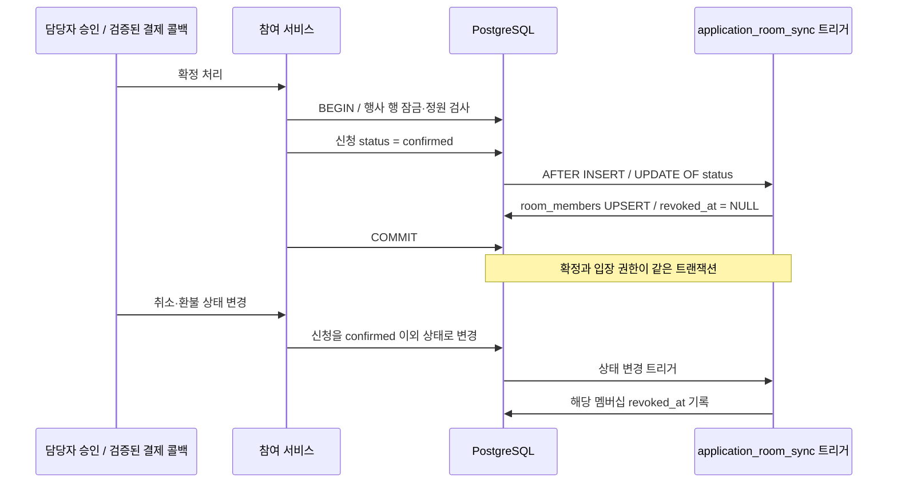

“자동 초대”는 현재 **DB 멤버십 부여**다. 별도 초대 메시지·초대 SMS를 보내는 흐름은 없다. 방 목록과 방 조회는 현재 유효한 권한을 검사한다.

근거: [멤버십 동기화](C:/Sliper/drizzle/0007_participation_integrity.sql:66).

### 6.5 한국 달력 날짜 기준 환불

| 행사 시작 한국 날짜까지 남은 날짜 | 환불율 |
| --------------------------------- | ------ |
| 5일 이상                          | 100%   |
| 4일                               | 80%    |
| 3일                               | 60%    |
| 2일                               | 40%    |
| 1일                               | 20%    |
| 당일·이후                         | 0%     |

시작 시각·가격·정책 버전은 신청에 스냅샷으로 저장한다. 환불 요청 시점의 한국 날짜로 견적을 계산하고 DB에서도 계산·변경 방지 조건을 검증한다. 환불 요청 화면은 송금 기능이 아니다. 담당자가 외부 환불 완료와 정확한 금액을 기록하거나 검증된 외부 환불 웹훅이 확인한다. 완료 시 신청 상태와 공지방 권한을 함께 변경한다. 이미 환불된 거래를 늦은 결제 콜백이 되살리지 못하도록 한다.

근거: [날짜 계산](C:/Sliper/src/domain/refund.ts:20), [환불 요청·처리](C:/Sliper/src/server/refund-service.ts:144), [DB 무결성](C:/Sliper/drizzle/0013_playbook_refund_integrity.sql:70).

## 7. 공지방의 실시간 전달과 알림 한계

### 7.1 작성과 읽기 권한

| 사용자                         | 읽기 | 공지 작성 |
| ------------------------------ | ---- | --------- |
| 모집글 등록자                  | 가능 | 가능      |
| 지정된 `room_managers`         | 가능 | 가능      |
| 현재 확정된 유효 참가자        | 가능 | 불가      |
| 미확정·환불·권한 회수된 사용자 | 불가 | 불가      |

공지 본문은 최대 10,000자이며 동일 작성자·동일 방의 최근 2초 발행을 조회해 429로 제한한다. 서버 검사와 DB 메시지 트리거가 작성 권한을 보호한다. 이 제한은 **공지 발행에 한정된 DB 기반 제한**이다. 사이트 전체 사용자/IP의 요청량을 제한하는 분산 rate limiter는 아니다.

입장 후에는 기존 공지도 읽을 수 있다. 현재 가입 시각 이후 공지만 노출하는 조건은 없다.

### 7.2 실제 SSE 흐름

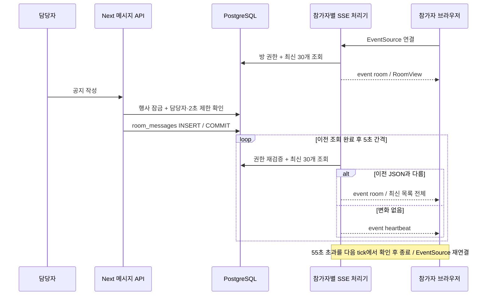

- 브라우저 전달은 SSE이고, DB 변경 감지는 폴링이다. WebSocket·Redis Pub/Sub·DB 변경 구독이 아니다.
- 변경 시 새 공지 한 건만 보내지 않고 최신 `RoomView` 전체를 전송한다. 이전 JSON 비교는 네트워크 응답을 줄이지만 DB 조회 자체를 생략하지 않는다.
- 연결마다 HTTP 스트림·타이머·이전 JSON을 Node 메모리에 유지한다. **SSE 연결이 DB 연결을 계속 점유하는 것은 아니다.** 각 조회 트랜잭션이 풀을 잠시 사용한다.
- 서버는 55초 초과를 다음 tick에서 확인하고 닫는다. 정확히 55초 강제 종료하는 타이머는 아니며 DB 지연에 따라 더 늦어질 수 있다.
- 메시지는 ID로 중복 제거한다. 이전 기록은 시간·UUID 커서로 읽는다.
- `id:` SSE 프레임, `Last-Event-ID` 복구, 재전송 큐·명시적 재연결 backoff는 없다. 재연결 시 최신 30개만 자동 조회하므로 끊긴 동안 많은 공지가 올라오면 중간 기록의 자동 복구는 보장하지 않는다. DB의 과거 원본은 남으며 이전 기록 조회가 가능하다.
- 권한 회수를 감지하면 `revoked` 이벤트로 연결을 닫고 화면의 비공개 데이터를 지운다. 클라이언트 epoch 검증으로 오래된 응답이 회수된 데이터를 다시 복원하지 않게 한다.

근거: [SSE 라우트](C:/Sliper/src/app/api/participation/rooms/[postId]/stream/route.ts:10), [브라우저 공지방](C:/Sliper/src/components/announcement-room.tsx:37), [방 조회](C:/Sliper/src/server/participation-service.ts:586), [작성·2초 제한](C:/Sliper/src/server/participation-service.ts:662), [권한 epoch](C:/Sliper/src/lib/room-access.ts:1).

### 7.3 공지 메시지와 개인 알림은 별개다

현재 공지 작성은 `room_messages`에 저장하고 SSE 화면에 전달한다. 같은 트랜잭션에서 수신을 켠 참가자·담당자 기기의 `push_deliveries`도 생성한다. 모든 참가자에게 `notifications`를 생성하는 종 아이콘 팬아웃은 없다. 다음 항목은 아직 구현되지 않았다.

- 방별 사용자 마지막 읽은 공지 위치와 미읽음 수
- 메시지별 읽음 확인·기기 수신 확인
- 이메일·SMS
- 초대·참가 확정·환불 완료 전용 종 알림

### 7.4 Web Push 데이터 흐름

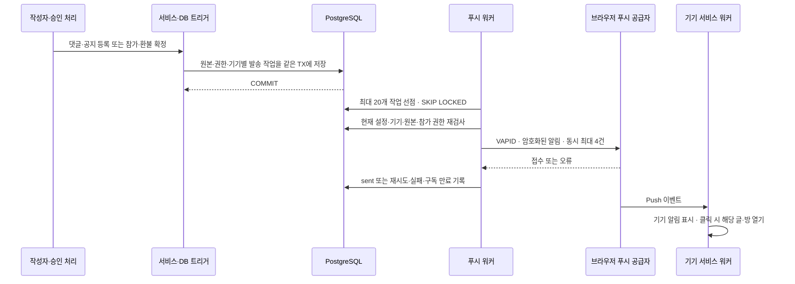

원본과 구독·발송 작업은 모두 PostgreSQL에 남는다. Redis나 Firebase SDK·Firebase 프로젝트를 별도로 도입하지 않았다. 댓글·공지는 서비스에서 예약하며 참가 확정·환불 완료는 `application_web_push` DB 트리거가 예약한다. DB 트랜잭션 안에서는 외부 네트워크 요청을 하지 않는다.

워커는 한 배치가 끝난 뒤 2초 후 다시 조회한다. 작업은 120초 선점 임대와 토큰으로 보호하며 비정상 종료 후 다시 선점한다. 일시 오류는 최대 6회, 24시간 만료 안에서 재시도한다. 404·410 응답은 만료 구독을 제거한다. `sent`는 공급자 접수이며 기기 도착·사용자 읽음 증거가 아니다. 공급자 접수 직후 프로세스가 종료되면 중복 전송이 가능하므로 동일 알림 tag/topic을 사용한다.

마이페이지에서 사용자가 직접 권한을 허용하고 구독한다. 계정별 종류 설정과 기기별 해제를 제공하며 전송 직전에 권한·설정을 다시 검사한다. 잠금 화면에는 본문이나 실명 대신 일반적인 안내만 보낸다. 실제 휴대폰 수신은 HTTPS·회원 인증·기기 권한을 연결한 후 검증해야 한다. 아이폰은 지원 OS의 홈 화면 웹앱에서 권한을 허용해야 한다. 운영 서버리스 배포는 상시 워커를 별도로 실행해야 하며 자동 실행이 보장되는 구조가 아니다.

근거: [푸시 스키마](C:/Sliper/src/db/push-schema.ts), [예약](C:/Sliper/src/server/push-events.ts), [참가 상태 트리거](C:/Sliper/drizzle/0020_web_push_integrity.sql), [워커](C:/Sliper/src/server/push-dispatcher.ts), [마이페이지 설정](C:/Sliper/src/components/push-settings.tsx), [실행 방법](WEB_PUSH.md).

## 8. 룰북·P2P 템플릿·플레이어·번개의 흐름

| 기능             | 저장·처리 흐름                                                | 현재 범위                                       |
| ---------------- | ------------------------------------------------------------- | ----------------------------------------------- |
| 무료 룰북        | `library_entries` 본문·JSONB → 공개 DTO·Markdown 다운로드     | 시나리오·준비물·가이드·라운드                   |
| 유료 룰북        | 외부 구매 → 접근 확인 요청 → 작성자 승인 → 본문·다운로드 허용 | 실제 자료 결제·정산 연결 전                     |
| 템플릿 개최      | 접근 권한 검사 → 글·행사 설정·`template_provenance` 동시 생성 | 개최 당시 비공개 진행 가이드 스냅샷 보존        |
| 타이머·준비 체크 | 브라우저 상태                                                 | 서버 스케줄러·이벤트 작업 큐가 아님             |
| 플레이어         | `player_preferences`, `event_results`, `manner_reviews`       | 전적·매너 집계, 공개 선택                       |
| 행사 전적        | 종료된 행사·확정 참가자에 대해 담당자 기록                    | 수정 사유, 자기 전적 직접 기록 방지             |
| 매너 평가        | 같은 행사 실제 참석자 사이에 평가                             | 행사·평가자·대상당 중복 방지                    |
| 번개             | `posts`와 `event_settings.meetup_type=lightning`              | 무료·2~12명·7일 이내·15분~12시간·공개 장소 좌표 |
| 거리·취향 검색   | 행사 좌표·일정·비용·분류로 SQL 조건 구성                      | Haversine 거리 계산, 거리 정렬                  |

활동점수는 `activity_events.points`를 합산하고, 전적·매너도 SQL로 집계한다. `profiles`에 점수 합계를 따로 저장하거나 Redis로 유지하지 않는다. 별도의 캐시·집계 워커는 없다. 매너 온도는 매칭 참고 지표이며 노쇼가 발생하지 않는다는 기술적 보장은 아니다. 공개 여부는 회원 설정을 존중한다. 템플릿 원본이 바뀌거나 삭제돼도 이미 개최한 행사의 스냅샷은 유지한다.

근거: [템플릿 개최](C:/Sliper/src/server/library-service.ts:462), [플레이어](C:/Sliper/src/server/player-service.ts:36), [번개](C:/Sliper/src/server/lightning-service.ts:8), [거리 조회](C:/Sliper/src/server/community-service.ts:166).

## 9. 정합성·권한·트랜잭션 설계

### 9.1 현재 보호하는 불변식

| 불변식                                | 보호 장치                                    |
| ------------------------------------- | -------------------------------------------- |
| 마지막 자리를 중복 확정하지 않음      | 행사 `posts` 행 잠금 + 정원 검사 + DB 트리거 |
| 같은 회원의 활성 신청 중복 방지       | 행사·회원 partial UNIQUE                     |
| 신청 확정과 공지방 권한 일치          | 같은 DB 트랜잭션의 멤버십 트리거             |
| 일반 참가자가 공지 작성하지 못함      | 서비스 권한 검사 + DB 메시지 트리거          |
| 동일 결제 이벤트 중복 처리 방지       | 공급자·이벤트 ID PK와 payload digest         |
| 외부 결제 확인 번호 재사용 방지       | 행사·외부 신청번호 UNIQUE                    |
| 다른 화면의 글 수정 덮어쓰기 방지     | 행 잠금 안에서 `expectedUpdatedAt` 정밀 비교 |
| 댓글이 다른 글의 부모를 가리키지 않음 | 댓글·글 복합 FK, 부모 변경 방지              |
| 하루 조회 중복 집계 방지              | 글·방문자 해시·한국 날짜 PK                  |
| 활동점수 중복 적립 방지               | 회원·원인 키 PK + 한국 날짜 일별 한도        |
| 잘못된 환불 금액·정책 변경 방지       | 신청·요청 스냅샷, DB 재계산·상태 전이 검증   |

조회수의 방문자는 서명된 브라우저 쿠키의 해시다. 같은 사람이 쿠키를 지우거나 다른 기기를 이용하는 경우까지 한 사람으로 식별하는 설계는 아니다.

### 9.2 신뢰 경계

변경 요청에 Origin 검사를 수행하고 Zod strict 입력 검증·본문 크기 제한·서버에서 결정한 사용자 ID를 사용한다. 웹훅은 일반 브라우저 Origin 인증 대신 서명·이벤트 중복 방지로 검증한다. 익명 표시는 공개 화면의 표시 방식이며 DB에서 작성자 소유 관계를 지우는 방식이 아니다.

모든 Sliper 테이블에 RLS를 활성화하고 `PUBLIC`, `anon`, `authenticated`의 직접 접근 권한을 회수했다. 현재 서버는 DB 소유자 연결을 사용하므로 **RLS가 사용자별 서비스 권한 검사를 대신하지 않는다.** 실제 참가·자료·개인 정보 권한은 서비스가 검사한다. 운영용 제한된 DB 역할과 검증된 OAuth 세션 연결은 후속 작업이다.

현재 `currentActor()`는 개발 모드·로컬 DB·개발 인증 플래그·localhost Host 조건을 모두 만족할 때만 임시 회원을 반환한다. 로그인 화면이 존재해도 카카오·구글 세션 인증이 완료된 것은 아니다.

근거: [요청 검증·오류](C:/Sliper/src/server/http.ts:6), [개발 사용자](C:/Sliper/src/server/identity.ts:8), [직접 DB 접근 회수](C:/Sliper/drizzle/0001_integrity_and_privacy.sql:1).

## 10. 사용자 폭주 대응: 현재 용량 구조와 병목

### 10.1 이미 있는 장치와 없는 장치

| 영역      | 현재 구현                                       | 현재 부족한 부분                                |
| --------- | ----------------------------------------------- | ----------------------------------------------- |
| DB 경쟁   | 트랜잭션·행 잠금·트리거·중복 제약               | 인기 행의 직렬화 병목 최적화                    |
| DB 연결   | 프로세스당 최대 5 연결, singleton               | 공유 pooler·인스턴스별 연결 예산·부하 검증      |
| 요청 범위 | JSON 크기·이미지 크기·페이지 크기 제한          | 사용자/IP 분산 rate limit·업로드 동시 실행 한도 |
| 공지 발행 | 담당자·방당 2초 제한                            | 사이트 전체 공격·대량 읽기 방어                 |
| 공지 전달 | SSE·30개 페이지·권한 재확인                     | 방별 변경 팬아웃·증가분 전달·resume             |
| 화면 요청 | 중복 클릭 gate, 일부 요청 취소·오래된 응답 폐기 | 서버 DB 취소·대기 timeout 보장                  |
| 배포      | 로컬 단일 Node·PostgreSQL                       | LB·자동 수평 확장·SSE 운영 런타임 설정          |
| 파일      | 재인코딩·소유 확인                              | Object Storage·CDN·고아 정리·백업               |
| 조회      | 기본 인덱스·키셋 커서                           | 깊은 OFFSET·인기 집계·검색·거리 최적화          |
| 운영      | 기능·API 테스트, 오류 응답                      | 실제 부하 시험·p95·잠금·풀·메모리 계측·SLO      |

기능 테스트의 성공은 초당 요청 수나 동시 사용자 수의 보장이 아니다. 현재 수용 가능한 접속자 수를 측정한 결과는 없다.

### 10.2 공지방 연결이 만드는 조회량

권한 있는 사용자에 대한 `room()` 한 번은 다음 **5개 SELECT**를 트랜잭션 안에서 실행한다.

1. 모집글 조회 및 `FOR UPDATE`
2. 행사 설정 존재 확인
3. 지정 담당자 확인
4. 멤버십과 확정 신청 확인
5. 메시지·담당자 표시 이름 조회

DB 지연이 작다고 가정하면 연결 `N`개에 대해:

- 방 재조회/초 ≈ `N / 5`
- SELECT/초 ≈ `(N / 5) × 5 = N`

예: 공지방 연결 1,000개는 약 **200번의 방 재조회/초와 1,000개 SELECT/초**를 유발한다. BEGIN/COMMIT, 최초 RSC, SSE 최초 조회·재연결, 기타 화면 쿼리는 포함하지 않는다. 이 계산은 **부하 요구량 추정**이며 해당 요청을 실제 처리할 수 있다는 측정치가 아니다.

조회 완료 뒤 5초를 기다리므로 DB가 밀리면 실제 반복 빈도는 낮아지지만 화면 갱신 지연은 길어진다. 공지가 없는 때에도 권한·메시지 조회를 반복한다. 변경 시 최신 목록 전체를 보내므로 메시지가 긴 방과 느린 클라이언트의 네트워크·메모리 부담도 커질 수 있다. 스트림 backpressure나 연결 수 admission control을 검사하는 별도 코드는 없다.

### 10.3 가장 큰 병목: 읽기에도 배타 행 잠금

`room()`은 읽기 작업이지만 행사 모집글에 **`FOR UPDATE`**를 건다. 동일 인기 방의 접속자는 같은 행 잠금에 줄을 서며, 신청·결제·환불·공지 작성도 같은 잠금을 사용한다.

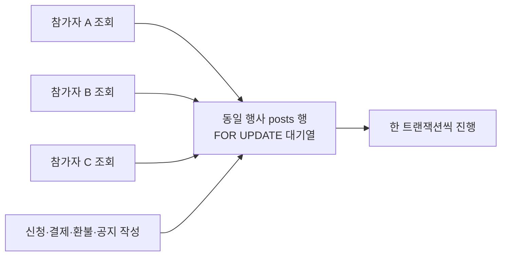

이 잠금은 권한 회수와 읽기가 엇갈리는 문제를 막기 위해 들어가 있다. 따라서 성능 개선 시 단순 삭제하면 권한 보장이 바뀐다. 권한 변경 트랜잭션과 함께 잠금·스냅샷·검증 모델을 재설계해야 한다. 배타 잠금에서 기다리는 구조는 PostgreSQL의 [명시적 잠금 문서](https://www.postgresql.org/docs/18/explicit-locking.html)와 일치한다.

인기 일반 글의 댓글·좋아요·북마크·조회·투표도 글 잠금을 공유한다. 자료 상세는 자료 행을 잠그므로 인기 룰북 읽기 역시 병목 후보다. 풀을 크게 늘리는 것만으로 동일 행의 직렬화는 해결되지 않는다.

### 10.4 공지방 외에도 주기적 조회가 있다

| 화면                | 실제 반복 조건·주기                                            |
| ------------------- | -------------------------------------------------------------- |
| 내부 신청 화면      | `pending_payment`이고 화면이 보일 때 3초                       |
| 외부 행사 화면      | 화면이 보이고 작업 중이 아닐 때 5초; 확정 뒤에도 타이머 유지   |
| 행사 대시보드       | 화면이 보이고 작업 중이 아닐 때 15초                           |
| 환불 패널           | 마운트된 상태에서 화면이 보이고 작업 중이 아닐 때 15초         |
| 자료 상세           | 내 접근 요청이 pending이고 화면이 보일 때 10초; 중첩 조회 방지 |
| 홈 주목·인기 콘텐츠 | 화면이 보이는 조건의 60초 갱신                                 |
| 이미지·광고 움직임  | 로컬 화면 애니메이션 자체가 매 프레임 DB 조회를 만들지는 않음  |

외부 행사 화면은 현재 승인 대기 상태일 때만 폴링하는 구조가 아니다. 환불 패널도 접힌 UI가 마운트 상태를 유지하면 조회를 계속할 수 있다. 향후 수명주기·상태별 조회를 줄일 여지가 있다.

근거: [내부 신청](C:/Sliper/src/components/event-application.tsx:41), [외부 행사](C:/Sliper/src/components/external-event.tsx:37), [대시보드](C:/Sliper/src/components/event-dashboard.tsx:79), [환불](C:/Sliper/src/components/refund-panel.tsx:89), [자료](C:/Sliper/src/components/library-detail.tsx:34).

### 10.5 피드·검색·파일 조회 비용

홈과 이야기 목록은 한 페이지 20개로 초기 요청한다. 번호 페이지는 `COUNT + LIMIT/OFFSET` 방식이다. 댓글·알림·공지 과거 목록 등은 커서를 사용한다. 따라서 모든 목록이 키셋 방식이라고 설명하면 현재 코드와 다르다.

피드는 좋아요·조회·댓글 수를 SQL 서브쿼리로 집계하고 인기순 정렬을 계산한다. 이미지와 투표 집계를 추가로 조회하며, 주목 12개·인기 6개도 별도 조회한다. 검색은 제목·본문의 `%검색어%` ILIKE다. 거리 검색은 좌표에 Haversine 수식을 계산하며 PostGIS 공간 인덱스를 사용하는 구조가 아니다.

데이터가 커지면 깊은 OFFSET, 반복 COUNT, 인기 집계 정렬, 부분 문자열 검색·거리 계산이 느려질 수 있다. 실제 실행 계획과 행 수를 측정한 뒤 집계·검색·공간 인덱스 변경을 결정해야 한다. 이미지 재인코딩은 CPU·메모리를 사용하지만 앱 수준의 변환 동시 실행 큐는 없다.

근거: [번호 피드](C:/Sliper/src/server/community-service.ts:208), [피드 집계](C:/Sliper/src/server/post-reader.ts:11), [이미지 변환](C:/Sliper/src/server/media.ts:35).

### 10.6 로컬 DB 설정 확인값과 의미

읽기 전용으로 확인한 현재 로컬 설정:

| 설정                                  | 값                |
| ------------------------------------- | ----------------- |
| `max_connections`                     | 100               |
| `superuser_reserved_connections`      | 3                 |
| `reserved_connections`                | 0                 |
| `shared_buffers`                      | 128MiB            |
| `statement_timeout`                   | 0ms               |
| `idle_in_transaction_session_timeout` | 0ms               |
| `listen_addresses` / `port`           | 127.0.0.1 / 55432 |

DB 연결 100개는 사용자 100명 제한이나 처리량 100 TPS를 의미하지 않는다. timeout 0은 해당 DB 설정으로 시간 제한을 두지 않는다는 뜻이다. 브라우저 요청의 25초 timeout은 DB 쿼리·잠금이 반드시 25초에 중단된다는 보장이 아니다.

이 값은 현재 로컬 개발 환경의 스냅샷이다. 운영 DB의 권장 설정이나 성능 검증 결과로 재사용하면 안 된다.

## 11. 장애·실패 시 데이터 흐름

| 실패                        | 현재 동작                                       | 남은 운영 과제                           |
| --------------------------- | ----------------------------------------------- | ---------------------------------------- |
| 글·댓글 트랜잭션 실패       | 관련 DB 변경 전체 rollback                      | 원인별 계측·사용자 재시도 UX             |
| 이미지 기록 뒤 DB 등록 실패 | 파일 삭제 보상                                  | 중간 프로세스 종료의 고아 파일 정리      |
| checkout 외부 호출 실패     | DB 주문을 유지하고 재시도 가능, 주문 ID 멱등 키 | 공급자 운영 SLA·일치 확인 작업           |
| 웹훅 중복                   | 이벤트 키·digest로 중복 처리 방지               | 공급자 재시도 계약·누락 대사             |
| 만료 후 결제                | 자동 확정 대신 review                           | 외부 환불·담당자 처리 운영               |
| SSE 중단                    | EventSource 재연결, 최신 공지 재조회            | 모든 중간 공지 resume·클라이언트 backoff |
| 권한 회수                   | 다음 조회에서 접근 거부·화면 폐기               | 즉시 다중 서버 권한 무효화 이벤트        |
| DB 지연                     | 풀·행 잠금 대기, 화면 갱신 지연                 | timeout·요청 한도·지표·과부하 응답       |
| Node 재시작                 | 스트림·타이머 소멸; DB·디스크 원본 유지         | 운영 재연결 분산·헬스 체크               |
| 로컬 디스크 손실            | 이미지와 로컬 DB 파일 복구 근거 없음            | 독립 백업·복원 시험·관리형 저장소        |

DB 트랜잭션을 잘 사용해도 외부 플랫폼 호출·파일 저장·브라우저 전달까지 하나의 ACID 트랜잭션이 되는 것은 아니다. 현재는 멱등성·상태 보존·보상 처리로 일부 경계를 다룬다.

## 12. 향후 권장 아키텍처 — 아직 구현하지 않은 설계

메시지·알림 원본은 PostgreSQL에 계속 저장하고, 변경 전달·임시 캐시·요청 제한을 보조 인프라로 분리하는 방향을 권장한다.

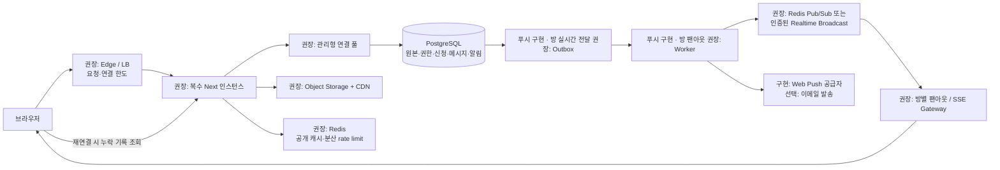

이 그림의 **푸시 Outbox·발송 Worker는 구현되어 있다.** 공지방 SSE의 변경 전달·팬아웃은 여전히 5초 DB 폴링이다. Edge, pooler, Redis, 별도 SSE Gateway, Object Storage·CDN, 이메일과 SSE 팬아웃용 작업 전달은 **권장 구성**이다. 처음부터 전부 별도 서비스로 나눌 필요는 없고, 실제 부하와 운영 필요에 따라 단계적으로 도입한다.

### 12.1 Redis를 쓴다면 담당할 역할

| 역할                  | 저장·유실에 대한 원칙                                    |
| --------------------- | -------------------------------------------------------- |
| 공지 변경 Pub/Sub     | 서버 간 새 메시지 힌트·팬아웃; 영구 메시지 원본은 PG     |
| 분산 rate limit       | 여러 Next 인스턴스가 사용자/IP 요청 예산 공유            |
| 공개 인기 콘텐츠 캐시 | 재생성 가능한 결과, 사용자별 북마크·신청·연락처와 분리   |
| 작업 큐 / Streams     | 적절한 persistence·재시도·중복 제거를 구성한 비동기 처리 |

Redis Pub/Sub은 **at-most-once** 전달이므로 구독자가 끊긴 동안의 메시지 복구를 맡기면 안 된다. 공식 문서도 Pub/Sub 유실 가능성과 Streams의 지속성을 구분한다. 따라서 PostgreSQL 메시지 이력과 재연결 커서, 또는 내구성 있는 큐가 필요하다. [Redis 공식 문서](https://redis.io/docs/latest/develop/pubsub/).

### 12.2 공지 전송의 개선 원칙

1. 메시지 INSERT와 Outbox 이벤트 INSERT를 같은 PG 트랜잭션에 저장한다.
2. Worker가 커밋된 이벤트를 재시도 가능한 방식으로 처리한다. 발행 성공 전 종료돼도 다시 읽을 수 있게 한다.
3. 방을 구독한 서버가 새 메시지를 받아 자신의 연결에 전달한다. 참가자마다 5초마다 전체 DB 조회를 하지 않도록 바꾼다.
4. 메시지 ID·순서 커서를 전달하고 재연결 때 DB에서 누락분을 읽는다. 이벤트 중복은 메시지 ID로 제거한다.
5. 권한 회수·관리자 변경도 무효화 이벤트와 서버 검증을 포함한다. 오래된 캐시 권한으로 전달하지 않도록 한다.
6. 미읽음 기능을 원하면 사용자별 방 읽기 위치를 새 모델로 추가한다. 현재 테이블에 이미 존재한다고 가정하지 않는다.

DB 트리거·권한 경쟁 보장을 유지하면서 읽기 잠금을 줄여야 한다. Pub/Sub만 추가하고 현재 `room()`을 그대로 연결마다 호출하면 핵심 조회·잠금 병목이 남는다.

### 12.3 수평 확장의 전제

로컬 업로드를 Object Storage로 옮겨 인스턴스마다 파일이 달라지는 문제를 먼저 없앤다. 세션 검증·분산 요청 제한·공지 이벤트 전달도 여러 인스턴스에서 일관되어야 한다. SSE의 장기 연결·프록시 버퍼링·런타임 제한을 배포 환경에서 확인한다.

DB 연결 예산은 `앱 인스턴스 수 × 인스턴스당 풀 크기 + 워커·관리·기타 연결`로 관리한다. 현재 5개 풀을 무조건 키우거나 서버만 추가하면 DB 연결 한도를 넘을 수 있다. Supabase를 사용할 때는 실행 환경에 맞는 direct/session/transaction pooler를 검토한다. [Supabase 연결 문서](https://supabase.com/docs/guides/database/connecting-to-postgres).

## 13. 권장 작업 순서와 검증 기준

이 문서에서는 다음 작업을 **권장**한다. 실제 변경을 완료했다고 의미하지 않는다.

| 순서 | 작업                                       | 완료를 판단할 증거                                          |
| ---- | ------------------------------------------ | ----------------------------------------------------------- |
| 1    | 운영 인증·DB 역할·Storage·실결제 계약 확정 | 실제 사용자·권한·서명 연동 시험, DB·파일 백업 복원          |
| 2    | 현재 부하 측정과 관측 추가                 | p50/p95/p99, 오류율, 풀·잠금 대기, CPU·메모리·SSE 수·전송량 |
| 3    | 인기 방 읽기 잠금과 불필요한 폴링 개선     | 권한 회수 경쟁 시험 유지, 동일 방 집중 부하에서 대기 감소   |
| 4    | 요청 제한·업로드 동시 처리·DB 대기 제한    | 과부하 시 제어된 응답, 결제 콜백 중복·재시도 보존           |
| 5    | 공지 Outbox·팬아웃·resume                  | Worker 중단·재시작·중복·연결 유실에서도 메시지 복구         |
| 6    | 파일 CDN·공개 피드 캐시·집계·검색 개선     | 실행 계획·캐시 적중·쿼리 수 감소, 개인 정보 혼입 방지       |
| 7    | 관리형 풀·앱 복제·자동 확장                | 연결 예산 준수, 서버 종료·확장 중 신청·공지 정확성 유지     |
| 8    | 미읽음·푸시 운영 검증과 보존 정책          | 읽기 커서·중복 제거·권한·전송 실패 재시도·정리 검증         |

대표 부하 시험은 전체 홈 접속 외에 **한 행사로 집중되는 접속**을 반드시 포함해야 한다.

- 같은 행사의 마지막 자리를 동시에 신청: 초과 확정 없음, 상태·권한 일치
- 동일 웹훅 반복·순서 역전·환불 뒤 늦은 paid: 이중 입장·권한 복원 없음
- 공지방 100/1,000/10,000 연결 단계: 지연·메모리·잠금·풀·연결 복구 측정; 각 단계는 시험 시나리오이며 허용 인원 선언이 아님
- 접속 중 회원·담당자 권한 회수: 이후 비공개 데이터가 전달·복원되지 않음
- 인기 글·룰북 집중 조회: 읽기·반응 경합과 DB 영향 측정
- 이미지 동시 업로드: 메모리·CPU·실패·고아 파일 측정
- 외부 공급자 timeout·DB 지연·Node 종료: 상태 보존과 재시도 확인

SLO와 수용 가능한 동시 사용자 수는 운영 사양·측정 결과를 바탕으로 정해야 한다. 현재 코드만 보고 특정 접속자 수를 보장할 수는 없다.

## 14. 근거 파일과 문서 관리

| 근거                                                                                  | 확인 내용                                     |
| ------------------------------------------------------------------------------------- | --------------------------------------------- |
| [schema.ts](C:/Sliper/src/db/schema.ts:270)                                           | 알림·행사·결제·공지·환불 테이블               |
| [library-schema.ts](C:/Sliper/src/db/library-schema.ts:19)                            | 자료와 개최 스냅샷                            |
| [player-schema.ts](C:/Sliper/src/db/player-schema.ts:18)                              | 취향·전적·매너                                |
| [connection.ts](C:/Sliper/src/db/connection.ts:6)                                     | 풀 최대 5, prepare false                      |
| [community-service.ts](C:/Sliper/src/server/community-service.ts:208)                 | 번호 피드·CRUD·정합성·알림                    |
| [post-reader.ts](C:/Sliper/src/server/post-reader.ts:11)                              | 조회별 집계·이미지·투표 조회                  |
| [notification-service.ts](C:/Sliper/src/server/notification-service.ts:31)            | 수신자별 알림과 read_at                       |
| [participation-service.ts](C:/Sliper/src/server/participation-service.ts:586)         | 공지 권한·읽기 잠금·30개 페이지·2초 발행 제한 |
| [stream route](C:/Sliper/src/app/api/participation/rooms/[postId]/stream/route.ts:10) | 연결별 DB 폴링·SSE                            |
| [event-management-service.ts](C:/Sliper/src/server/event-management-service.ts:135)   | 외부 수동·자동 승인                           |
| [refund-service.ts](C:/Sliper/src/server/refund-service.ts:144)                       | 환불 요청과 외부 처리 확인                    |
| [media.ts](C:/Sliper/src/server/media.ts:14)                                          | 로컬 이미지·변환·권한·보상                    |
| [identity.ts](C:/Sliper/src/server/identity.ts:8)                                     | 임시 개발 사용자·실인증 미연동                |
| [0007 SQL](C:/Sliper/drizzle/0007_participation_integrity.sql:66)                     | 공지방 멤버십·작성자 DB 검증                  |
| [0009 SQL](C:/Sliper/drizzle/0009_external_approval_integrity.sql:3)                  | 외부 확인 포함 활성 신청 중복 방지            |
| [0013 SQL](C:/Sliper/drizzle/0013_playbook_refund_integrity.sql:70)                   | 자료·환불 무결성                              |
| [0017 SQL](C:/Sliper/drizzle/0017_event_venue_integrity.sql:1)                        | 신청 이후 일정·장소 변경 보호                 |
| [0018 SQL](C:/Sliper/drizzle/0018_lightning_post_integrity.sql:1)                     | 번개 속성 보호                                |

과거 [architecture.md](C:/Sliper/docs/architecture.md)에는 초기 범위와 이후 확장 기록이 섞여 있다. **현재 구현의 전체 구조는 이 문서를 기준으로 읽으며, 푸시 실행 환경과 기기 검증은 [WEB_PUSH.md](WEB_PUSH.md)를 함께 참고한다.** 스키마·서비스·마이그레이션이 바뀌면 이 문서의 기준일·도식·부하 계산도 갱신해야 한다.
